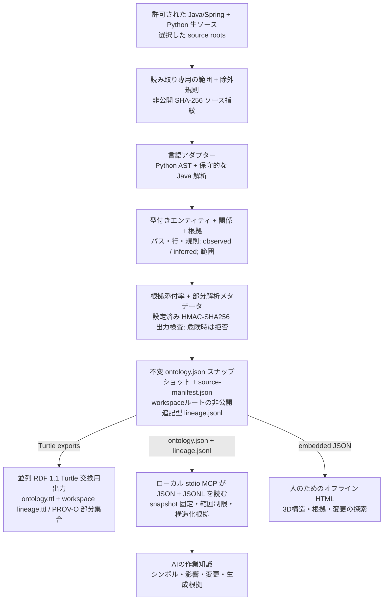

# Code Ontology Companion

[English](README.md) | [한국어](README.ko.md) | [日本語](README.ja.md) | [简体中文](README.zh-CN.md) | [Русский](README.ru.md)

Code Ontology Companion は **AIデータパイプラインプラットフォームの初期MVP** として、許可された Java/Spring・Python の生ソースからオントロジーを生成するローカルパイプラインです。型付きエンティティ、根拠付き関係、スナップショットの系譜を作り、RDF標準ファイルへ出力し、ローカル MCP でAIの作業に必要な根拠を渡します。人は同じオントロジーを生成されたオフライン3D HTMLで探索します。

**0.9.0** · 選択した GPT-6 Astra または GPT-6.1 Sol と推論強度を維持します。Windows・macOS・Linux でAIはローカル MCP の根拠、人はオフライン HTML を使います。完全パッケージは既存7個に `ontology_large_modules`、`ontology_large_search`、`ontology_large_neighbors`、`ontology_evidence_bundle`、`ontology_evidence_pack` を追加した12個の範囲制限付き読み取り専用ツールを提供します。関連照会は固定したスナップショットを使い、大規模プロジェクトの経路は選択した単一モジュール内です。モデル優位性や実行成功を証明したとは主張しません。

## 0.9.0 のワークフロー

復旧可能なスナップショット確定、非公開の増分キャッシュと Windows の全体解析への切り替え、任意使用の12番目の MCP ツール `ontology_evidence_pack` を追加しました。オフライン HTML は5言語のマップ・一覧と以前/現在の比較を提供します。ソースと生成器の最新性を分けて報告し、RDF パーサー・SHACL は任意の開発検証として使用します。モデル性能の優位性は主張しません。

[ワークフロー・予算・対応範囲](docs/ja/references/v090-workflow.md)

## 生ソースからAIの作業知識へ

Companionワークスペースの決定的パイプラインは選択したソースを読み、対象コードを実行しません。ファイルごとのSHA-256は非公開source manifestに保存し、範囲全体の指紋でスナップショットを識別します。別途設定したHMAC-SHA256識別プロファイルで対応出力を検査します。



`ontology.ttl` は型付きコードグラフと `RelationshipEvidence` をRDF 1.1 Turtleで出力します。workspaceの `lineage.ttl` は限定PROV-O部分集合でjournal記録を情報Entity、裏付け済みローカルsnapshot buildをActivity/Source/Snapshot生成関係として表します。保存済みsnapshot metadata・source manifestとの照合であり、完全な系譜・人への帰属・実行成功を証明しません。MCPは `ontology.json` とworkspaceの `lineage.jsonl` を読み、AIの作業に必要な構造化根拠を選択します。人向けの `graph.html` も同じJSONオントロジーから作ったportable payloadを内蔵します。品質・部分解析診断だけでスナップショットを自動拒否せず、精度や実行証拠とも見なしません。プライバシー拒否や解析中のソース変更は出力またはスナップショット確定を中断し、任意の識別プロファイルがなければ実名は検出しません。

保持するソース範囲、解析器バージョン、解析前後のソース指紋、追記型系譜が全段階の再現性を支えます。オントロジー品質・HTML・文書・パッケージ・プライバシー回帰は別のリリース検証です。図はCompanionの流れであり、単独indexはJSON/Turtle/reportを生成し、HTMLは別の可視化コマンドで作ります。

> 任意のローカルモデル補強は別途同意を必要とし、観測されたソース根拠と分離した非公開の `inferred` sidecarに保存します。この決定的パイプラインにモデルは不要です。

**プラットフォームの拡張方向:** 入力アダプターと明示的な変換・提供契約を拡張します。実装済みMVPの入力はJava/Spring・Pythonコードで、より広いデータ基盤機能は設計方向として区別します。

## 今の作業に適用する

> Code Ontology Companion をこのプロジェクトの作業に適用して。

Codex が実行可能なツールと既存の許可済みワークスペースを確認し、状態の確認と関連するシンボル検索または影響照会を実行します。関連する照会は同じスナップショットを使います。重要な Java/Python の変更後は、許可範囲内で更新し、鮮度・解析範囲・警告を確認します。既定の範囲は現在の会話です。プロジェクトへの指示の保存は明示的な依頼がある場合のみ行います。

> この作業用にオントロジーを設定して。

一般的な依頼では Code・Context・Contracts のうち実際に実行可能な製品を選びます。Code 単独でも使え、製品を指定した場合はその製品を優先します。不足する製品を自動インストールしません。Context は選択・確認済みの決定や制約のみを保存して再読み取りし、Contracts は選択した実際の交換 JSON を検証して未対応・情報損失・未検証を保持します。

[適用ワークフロー](skills/apply-code-ontology/SKILL.md)

## インストール / 使用

[プラグインディレクトリ](https://chatgpt.com/plugins/plugins_6a6a23c0434c8191aec6a38bb590fd3c) · [GitHub パッケージ](https://github.com/battle-doll/code-ontology-companion/releases)

このソースは0.9.0です。ディレクトリには別の審査・公開手順があるため提供バージョンが異なる場合があります。公式スキル版は適用・管理の両スキル、分析器、画面、ローカル MCP 設定ガイドを含みます。MCPサーバーは含まず、GitHub 完全版には読み取り専用stdio MCPサーバーも含まれます。クラウド接続先は不要です。

## 実際の自己オントロジーを探索

[**3D エクスプローラーを開く →**](https://battle-doll.github.io/code-ontology-companion/)

このプラグイン自身の対応ソースから生成した静的スナップショットです。モジュールやシンボルを選び、接続とソース位置を確認できます。別タブで開くにはCommandまたはCtrlを押しながらクリックしてください。

[生成根拠](https://battle-doll.github.io/code-ontology-companion/snapshot.json) · [アーキテクチャ](docs/ja/ARCHITECTURE_AND_ROADMAP.md)

## バージョン 0.9.0 の対応機能

- 現在の会話で最初の照会を実行し、変更後の許可された更新と状態確認につなげます。
- 構造・影響・変更の3Dオフライン画面とカメラフォーカス。
- 完全一致優先検索、構造フィルター、ページ送り、スナップショット固定読み取り。
- 方向別の依存経路と各段階の根拠、明確な探索上限。
- 追加・削除・修正と根拠変更の一貫した比較。
- Java/Springの型・import・保守的な呼び出し解決・注入・プロキシ信号、Pythonのモジュール・関数・呼び出し・パイプライン役割推定。
- 元の根拠を保持するCode参照、Context用不変ロケーター、明示的なContracts互換範囲。
- キーボード・テキスト探索、動きの低減、安全なテキスト一覧。

## クイックスタート

Python 3.9+が必要です。まず書き込まずに対応範囲を確認します。所有または解析を許可されたコードのみを使用し、生成する資料を確認してからリポジトリ外のワークスペースを初期化します。

```bash
python3 skills/manage-code-ontology/scripts/companion.py doctor --repo "/path/to/repo"
python3 skills/manage-code-ontology/scripts/companion.py preflight --repo "/path/to/repo"
```

```bash
python3 skills/manage-code-ontology/scripts/companion.py init --repo "/path/to/repo" --workspace "/path/outside/repo/ontology" --authorized
python3 skills/manage-code-ontology/scripts/companion.py query --workspace "/path/outside/repo/ontology" --term "OrderService"
python3 skills/manage-code-ontology/scripts/companion.py impact --workspace "/path/outside/repo/ontology" --symbol "OrderService" --direction incoming
python3 skills/manage-code-ontology/scripts/companion.py diff --workspace "/path/outside/repo/ontology"
```

テストやコードのコピーがある場合は本番用ソースのディレクトリを明示してください。複数の相対ディレクトリには `--source-root` を繰り返します。更新時も範囲を保持し、`sync --source-root .` でリポジトリ全体の探索へ明示的に戻せます。別ファイルの競合宣言は統合せず分析を停止します。全グループを検索・ページ移動で探し、要素とソース関係へ展開できます。概要の接続は集約表示であり、パスフィルターは配備の証拠ではなく推定です。

表示深度は全モジュール、選択モジュールの構成要素、選択要素のメンバーの3段階です。他の領域は折り畳みます。呼び出し強調は別に静的な CALLS の1・2・3段階をたどります。任意の標本抽出はせず、索引内の全要素と関係を展開・ページ移動で確認でき、折り畳みと別ページの数を表示します。

```bash
python3 skills/manage-code-ontology/scripts/companion.py preflight --repo "/path/to/repo" --source-root src/main
python3 skills/manage-code-ontology/scripts/companion.py sync --workspace "/path/outside/repo/ontology" --source-root src/main
```

## 根拠と互換性

`graph.html`、`ontology.json`、`ontology.ttl`は同じソースオントロジーを使用します。RDF 1.1 Turtle の `RelationshipEvidence` と PROV-O 系譜が根拠を保持します。`inferred`は検証済みではなく、`runtime_unknown`は実行の証明ではありません。根拠添付率は解析精度ではありません。

Codeはコード構造、Contextは決定と有効時点、Contractsは対応交換形式の検証を担当します。製品は独立して使用できます。[AIデータ契約](skills/manage-code-ontology/references/ai-data-contract.md) · [参照交換](skills/manage-code-ontology/references/code-reference.md)。

Context には元のデータへの参照を渡します。実際のスナップショットを厳密な Contracts draft へ直接変換する機能は未対応です。検証済みの範囲は参照ガイドに記載しています。

既存の Ollama `127.0.0.1:11434` は個別の同意後にのみ利用し、推論は観察された根拠と分離します。決定的解析にモデルは不要です。

## 新しいモデル環境のローカル利用

選択した GPT-6 Astra または GPT-6.1 Sol と推論強度を維持します。Windows・macOS・Linux でAIはローカル MCP の根拠、人はオフライン HTML を使います。完全パッケージは既存7個に `ontology_large_modules`、`ontology_large_search`、`ontology_large_neighbors`、`ontology_evidence_bundle`、`ontology_evidence_pack` を追加した12個の範囲制限付き読み取り専用ツールを提供します。関連照会は固定したスナップショットを使い、大規模プロジェクトの経路は選択した単一モジュール内です。モデル優位性や実行成功を証明したとは主張しません。

[5言語の利用ガイド](docs/ja/MODEL_ERA_WORKFLOW.md) · [翻訳範囲](docs/TRANSLATION_COVERAGE.md)

## プライバシー運用

設定したローカル HMAC-SHA256 検査は対応する生成出力を保護します。任意プロファイルがなければ実名を検出しません。`CODE_ONTOLOGY_PRIVACY_FILE`を保護ルート外に置き、キーや指紋を公開しません。公開PRには新しい信頼できるGitHubアカウント保護記録と選択したサービスref監査が必要です。公式公開名はbattle-dollのみで、それ以外はHOLDです。保持refの削除にはサービス確認が必要で、全体の個人情報ゼロは主張しません。

[プライバシー運用](docs/ja/PRIVACY_OPERATIONS.md)

## ライセンスとプライバシー

Apache-2.0。分析器は対象コードの実行、テレメトリ送信、直接ネットワーク接続を行いません。ユーザーの作業領域はローカルに保持し、公開デモはこの公開リポジトリのみを対象とします。ソース本文、コメント、秘密情報は保持しません。

[プライバシー](PRIVACY.md) · [セキュリティ](SECURITY.md) · [サポート](SUPPORT.md) · [規約](TERMS.md) · [変更履歴](CHANGELOG.md)
