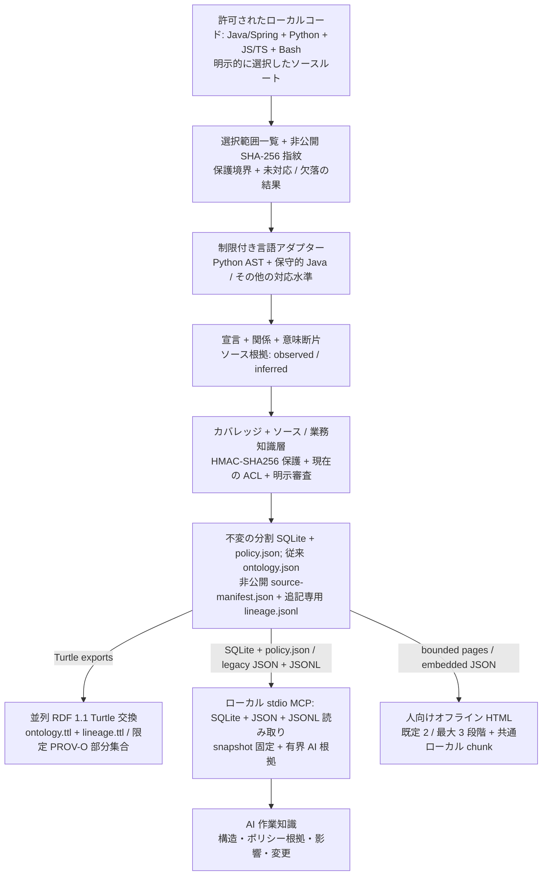

# Code Ontology Companion

[English](README.md) | [한국어](README.ko.md) | [日本語](README.ja.md) | [简体中文](README.zh-CN.md) | [Русский](README.ru.md)

Code Ontology Companionは**AIデータパイプライン基盤の初期MVP**です。許可されたローカルコードから、AI用のソースに結び付いた知識と、人向けの軽量オフライン概要を生成します。対象プロジェクトを実行しない静的解析であり、モデルやクラウドサービスは必須ではありません。

**0.9.3 リリース候補** · 開発者: **battle-doll** · 日本語・英語・韓国語・簡体字中国語・ロシア語 · Windows・macOS・Linux。選択したGPT-6 AstraまたはGPT-6.1 Solと推論強度を維持し、自動変更しません。

## バージョン 0.9.3 の対応機能

- ソースフォルダーを選び、選択範囲全体を一覧化し、変更不能な分割ソース・業務知識スナップショットを生成します。
- 宣言・関係・呼び出し候補・意味断片と、そのソース結合、対応限界、変更、カバレッジをローカル読み取り専用MCPで照会します。
- 業務概念と型付きプロパティをソース根拠に結び付け、主張を明示的に審査・撤回し、対応するポリシー断片を型付き文脈で照会します。
- オフライン3D概要を開くほか、レコードページ、移行用SQLite/JSON、別系統のRDF 1.1 Turtleグラフを明示的に出力します。

Java/Spring・Python・JavaScript/TypeScript・Bashでは対応解析が異なります。他のアダプターにも宣言/importまたは部分対応の水準があります。ファイルや式の認識は、言語や業務意味全体の解明ではありません。[実装ガイド](docs/ja/PIPELINE_0_9_0.md)と[品質ワークフロー](docs/ja/QUALITY_0_9_3.md)を参照してください。

## 自分のコードで始める

Python 3.9以上を使用します。Windowsでは`python3`を`py -3`に置き換えられます。知識ワークスペースにはソースツリー外の新規パスを選びます。HTMLや移行用出力の前に、ソース・出力ルート外の非公開識別情報拒否プロファイルを`CODE_ONTOLOGY_PRIVACY_FILE`へ設定してください。[プライバシー設定](docs/ja/PRIVACY_OPERATIONS.md)に手順があります。

```sh
python3 skills/manage-code-ontology/scripts/companion.py analyze --repo /path/to/source --workspace /path/outside/source/knowledge --authorized --language ja
python3 skills/manage-code-ontology/scripts/companion.py pipeline-status --workspace /path/outside/source/knowledge
python3 skills/manage-code-ontology/scripts/companion.py pipeline-search --workspace /path/outside/source/knowledge --snapshot SNAPSHOT_ID --term Service --limit 20
```

`SNAPSHOT_ID`は結果の具体的なIDに置き換えます。相対ソースディレクトリは`analyze`の`--source-root`を繰り返して選べます。結果はソース・業務・HTMLを別段階で報告します。返されたHTMLの`entrypoint`を`file://`で直接開いてください。ソース生成の成功だけでは後続の業務・HTML完了を意味しません。

コード変更後は`refresh --workspace /path/outside/source/knowledge --language ja`を実行します。選択範囲と過去のスナップショットを維持します。知識のみ必要ならanalyze/refreshに`--no-html`を追加します。状態照会は保存物を検査し、ソースを再読しないため、現在のソースや実行状態の証明にはなりません。

AIには**「この作業にCode Ontology Companionを適用し、許可済みワークスペースを使って」**と依頼できます。[適用スキル](skills/apply-code-ontology/SKILL.md)が利用可能なツールを確認し、実際の初回照会を行い、関連照会を同じスナップショットに固定します。ローカルMCPの結果を遠隔モデルに送る許可は別です。

## 人向け概要とAI向けの正確な知識

公開`analyze`・`refresh`・通常の`pipeline-html`は`--presentation human`が既定です。領域 → 主要な構造モジュール → 中核フロー・根拠を、既定2段階・最大3段階で表示します。初期ページは32ノード・64集約エッジ・128 KiB以内です。5言語UIはデータ一式を共有し、選択画面だけをローカルscript chunkで読みます。全記録や全検索索引を最初に解析せず、ネットワークやHTTPサーバーも不要です。検索対象は現在のページです。

全体モードは全範囲の要約、フォーカスモードは限定した選択範囲です。3Dアニメーション、独立した全範囲リンク、動きの低減、モバイル/テキスト代替、カメラ操作を維持します。未分類と残余件数を明示します。現行ソースポリシーカードは意味が**UNKNOWN**の不透明な根拠タイルであり、条件・計算・例外を完備した説明文ではありません。

元ソースレコード数、ファイル処理結果、表示グループ/ノード、根拠参照数は別単位です。非表示グループはオントロジー欠落ではなく、プライバシーで保留した関係数は人数や全レコード数ではありません。要約はオントロジー/MCPカバレッジを変更しません。実機ブラウザー/OSと処理容量は別途検証します。

深い正確な知識にはMCPを使います。`--presentation records`は全レコード表示を維持します。従来形式・明示的分割経路と、業務HTML固有の投影契約も維持します。既存スナップショットを新規出力先へ表示するには次を使います。

```sh
python3 skills/manage-code-ontology/scripts/companion.py pipeline-html --workspace /path/outside/source/knowledge --snapshot SNAPSHOT_ID --output /path/to/new-html --language ja
```

## ローカルコードから使える知識へ



ソース層は宣言・根拠・限界を保持し、業務層はソースに結び付いた概念・型付きプロパティ・明示的審査状態を加えます。`observed`・`inferred`・`runtime_unknown`は区別します。確定呼び出し・候補・未解決を分け、未解決を黙って消したり確定へ格上げしたりしません。コンストラクター/構成要素、呼び出し元/提供元、helper転送は限定的な構造根拠であり、ポリシー意味や実行値の自動確定ではありません。

選択一覧、宣言/型、確定呼び出し、ポリシー意味、MCP配信、ポリシー文書には別の分母があります。未対応・欠落・秘匿・PARTIAL・UNKNOWNを残します。文章化前に必須条件、AND/OR、状態/効果、単位、式、丸め、例外、権限、所有、時間境界を根拠へ結び付け、裏付けのない意味はUNKNOWNとします。根拠ワークシート → カバレッジ/意味確認 → 対応範囲の修正または明示審査 → 新スナップショット → 固定照会、という検証循環を使います。ワークシートや小さなHTML概要は、完全なポリシー文書の証明ではありません。

スナップショットはソース指紋・解析仕様・成果物ハッシュに結合します。非公開`source-manifest.json`と追記専用`lineage.jsonl`がローカル検査を支え、`lineage.ttl`は限定的PROV-O部分集合を使います。RDFの`RelationshipEvidence`と形状検証は、真実、全ソース復元、完全な来歴、人の身元、実行成功の認証ではありません。MCPはRDF系統ではなく封印済みSQLite/JSON/JSONLを読みます。従来の`graph.html` / `ontology.json` / `ontology.ttl`は別に維持します。

## ポリシー知識と出力方法

業務知識はソースに結び付き、型を持ちます。承認/撤回、現在のソース・業務スナップショットpinを抽出とは別に検査します。`verified_implemented`と`approved_business`は異なり、`DECLARED`はソースでの強制の証明ではありません。対応する静的評価にも明示的文脈と完全な対応入力が必要です。文脈不足、曖昧な合成、未対応効果、不明な単位はUNKNOWNです。ソース一致や生IRだけで権限・業務上の正しさは確定しません。

`business-html`の既定は従来の非可逆な`business_only`です。明示的`--projection policy_projection`は、`read_policy`と`export_html`の下で、選択ID、ソース候補、型付き対応、UNKNOWN、集約スナップショット結合を含む正確な許可MCPポリシー表示を保ちます。

```sh
python3 skills/manage-code-ontology/scripts/companion.py business-html --workspace /path/outside/source/knowledge --snapshot SNAPSHOT_ID --business-snapshot BUSINESS_ID --business-digest BUSINESS_DIGEST --output /path/to/new-policy-view --projection policy_projection
```

通常のポリシー投影は10,000レコード・1 GiB以内です。より大きなschema2業務スナップショットには`--partitioned --partition-size 10000`を明示します。物理区分は元の選択分母を保持し、信頼されたワークスペース予算内で処理します。隔離ワーカーに対応Python/SQLiteが必要で、`--export-python PATH`で既に信頼する実行環境を選べます。自動探索・導入はしません。SQLite割り当て128 MiBはプロセス全体メモリー保証ではありません。資源失敗時は未完了件数/境界を残し、保存完了を業務意味の完全性とはみなしません。

`pipeline-html --presentation records --partitioned`は既存の分割ソースatlas/レコード経路です。`pipeline-export`は許可された移行用一式を生成します。SQLite/JSONは許可された全レコードを保持し、RDFは定義済み投影であって万能な無損失復元ではありません。各出力の権限・上限・秘匿規則は維持します。未署名コピーは発行者認証、公開許可、既存コピーの遠隔撤回を提供しません。

## ローカル導入と互換性

[GitHubパッケージ](https://github.com/battle-doll/code-ontology-companion/releases) · [ディレクトリ項目](https://chatgpt.com/plugins/plugins_6a6a23c0434c8191aec6a38bb590fd3c) · [ローカルMCP設定](skills/manage-code-ontology/references/local-mcp.md)

完全パッケージには読み取り専用stdio MCPサーバーがあり、従来12個+パイプライン8個、計20個のツールを提供します。**Skills-only**には適用/管理スキル・解析器・workbench・設定案内がありますが、MCPサーバーはありません。クラウドendpointは不要です。ディレクトリの提供版には別の審査があり、このソース候補は公式提出・承認・推奨・提出資格を主張しません。

従来の`init`/`sync`、`query`、`impact`、`diff`ワークスペースは自動変換しません。従来の大規模照会には`ontology_large_modules`、`ontology_large_search`、`ontology_large_neighbors`、`ontology_evidence_bundle`、`ontology_evidence_pack`があります。Codeはソース構造を担当し、任意のContext・Contractsは固有の役割と検証済み互換範囲を保ちます。[モデル環境の手順](docs/ja/MODEL_ERA_WORKFLOW.md) · [参照交換](skills/manage-code-ontology/references/code-reference.md)。

既存Ollama `127.0.0.1:11434`の利用には別途同意が必要です。提案は観測根拠外の`inferred` sidecarに分離します。決定的解析にモデル導入や自動切り替えは不要です。

## プライバシーと信頼境界

ローカル解析許可、ACL、知識審査、公開許可は別です。現在のACL/プロファイル/結合検査は必須です。個人情報と登録保護値は、管理者承認、別名、`manage_knowledge`、審査理由でも迂回できません。HMAC-SHA256の鍵や保護指紋を公開しないでください。必要な保護や公開身元を確認できなければ**HOLD**とし、公開開発者名は**battle-doll**のみです。

コメント/リテラルは既定で不透明です。明示的な非公開occurrence許可で認めたローカル根拠を保持できても、意味承認、命令権限、公開許可ではありません。撤回は以後の許可読み取りに適用され、既存コピーは消去できません。解析器は対象コードを実行せず、telemetryや直接ネットワーク要求を送りません。ホストが選択MCP結果を転送する場合の受信者許可は別途確認します。

## 詳細

[品質手順](docs/ja/QUALITY_0_9_3.md) · [カバレッジ](docs/ja/COVERAGE_0_9_2.md) · [パイプライン](docs/ja/PIPELINE_0_9_0.md) · [公開自己オントロジーデモ](https://battle-doll.github.io/code-ontology-companion/) · [翻訳範囲](docs/TRANSLATION_COVERAGE.md)

Apache-2.0 · [プライバシー](PRIVACY.md) · [セキュリティ](SECURITY.md) · [サポート](SUPPORT.md) · [利用条件](TERMS.md) · [変更履歴](CHANGELOG.md)
