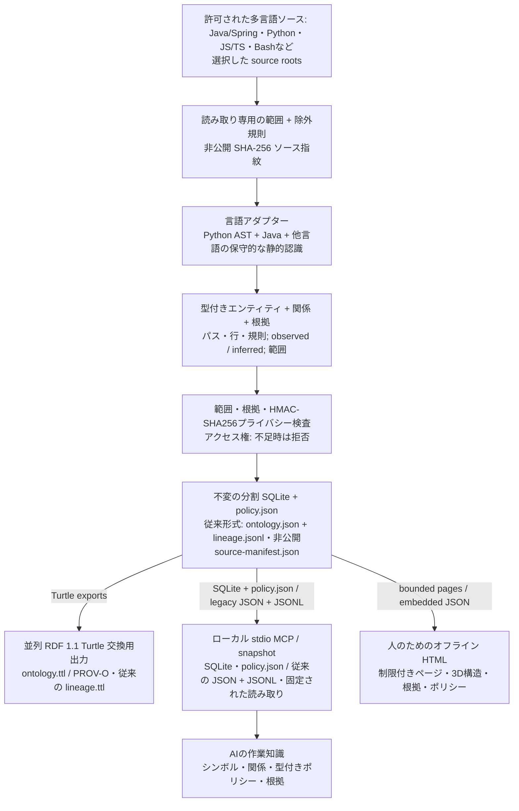

# Code Ontology Companion

[English](README.md) | [한국어](README.ko.md) | [日本語](README.ja.md) | [简体中文](README.zh-CN.md) | [Русский](README.ru.md)

Code Ontology Companion は **AIデータパイプラインプラットフォームの初期MVP** として、許可された多言語コードから根拠付きオントロジーと型付きポリシー知識を生成するローカルパイプラインです。Java/Spring・Pythonに加え、JavaScript/TypeScript、Bashなどを明示された部分対応の範囲で解析します。固定されたSQLiteスナップショットと型付きポリシーからローカルMCPでAIに知識を渡します。RDF系譜は並列の交換形式として出力し、人は同じ知識を5言語のオフラインHTMLで探索します。

**0.9.0** · 選択した GPT-6 Astra または GPT-6.1 Sol と推論強度を維持します。Windows・macOS・LinuxでAIはローカルMCP、人はオフラインHTMLを使います。完全パッケージは既存12個とパイプライン用7個の合計19個の読み取り専用MCPツールを提供します。関連する読み取りはスナップショットを固定し、従来の大規模プロジェクト経路は選択した単一モジュール内に限定します。モデル優位性、実機動作、測定していない大規模容量は主張しません。

## 0.9.0 のワークフロー

`analyze`と`refresh`で、不変の分割SQLiteスナップショット、未変更ファイルの事実再利用、復旧可能な確定処理、型付きポリシー、所有者を既定とするアクセス権、5言語の制限付きHTMLページを提供します。ポリシーへの質問はソースを再読せず保存された知識を使い、未確認は`UNKNOWN`のままです。Java/TypeScriptのポリシーは型を明示した純粋な真偽条件関数に限定します。従来の`init`/`sync`、ファイル解析キャッシュ、`ontology_evidence_pack`、変更比較は引き続き利用できます。

オフラインHTMLの3Dページは **フォーカスモード**で開始し、別の**全体モード**も用意します。フォーカスのレベル 1 はモジュールの入口です。地図または一覧で項目を選んで進むと、その項目が宣言する子だけをレベル 4 まで表示します。経路ボタンで親へ戻れます。選択範囲の地図はモバイル・PC とも 1 ページに**最大 60 ノードと 160 本の表示エッジ**を含み、残りは明示的なページとテキスト一覧からアクセスできます。これは表示の上限であり、ソース解析の上限ではありません。既存の全体・累積探索は独自の上限とレベル 4 以降の確認を維持します。

[ワークフロー・予算・対応範囲](docs/ja/references/v090-workflow.md)

[実装された0.9.0パイプラインの使い方](docs/ja/PIPELINE_0_9_0.md) · [保存された設計基準](docs/ja/NEXT_ARCHITECTURE_0_9_0.md) — 設計は目標と後続の方向を記録し、実際の対応範囲は実装ガイドと検証記録で区別します。

## 生ソースからAIの作業知識へ

Companionワークスペースの決定的パイプラインは選択したソースを読み、対象コードを実行しません。ファイルごとのSHA-256は非公開source manifestに保存し、範囲全体の指紋でスナップショットを識別します。別途設定したHMAC-SHA256識別プロファイルで対応出力を検査します。



新しいパイプラインのMCPは、封印されたSQLiteと`policy.json`から固定された構造・ポリシー・根拠を読みます。人向けHTMLは50件単位の静的ページと正確な根拠アンカーを持ち、必要な移動に`fetch`を使いません。RDF 1.1 TurtleとPROV-Oは並列の交換・系譜表現であり、MCPがRDFを実行する構成ではありません。従来形式では`ontology.json`とワークスペースの`lineage.jsonl`をMCPが読み、`graph.html`に同じJSONの表示データを埋め込みます。`ontology.ttl`の`RelationshipEvidence`と`lineage.ttl`の限定PROV-O表現も保持します。品質・カバレッジは実行成功や業務承認を証明しません。プライバシー・権限・完全性の検査に失敗した場合は拒否し、新しいHTML・移行用エクスポートには非公開識別情報プロファイルが必要です。

ソース範囲、解析器バージョン、ソース指紋、固定スナップショットが再現性を支えます。新しいパイプラインの状態確認はソースを再読せず、`refresh`で再検証します。従来の単独indexはJSON/Turtle/reportを作り、別の可視化コマンドでHTMLを生成できます。オントロジー・HTML・文書・パッケージ・プライバシーの検証と、実ブラウザー・ネイティブOSの検証は別です。

> 任意のローカルモデル補強は別途同意を必要とし、観測されたソース根拠と分離した非公開の `inferred` sidecarに保存します。この決定的パイプラインにモデルは不要です。

**プラットフォームの拡張方向:** 実装は文書化された多言語コード、制限付き静的関係、型付きポリシーを扱います。より広いデータ源、完全な言語意味論、未測定の大規模容量は後続の設計目標であり、実装済みとは見なしません。

## 今の作業に適用する

> Code Ontology Companion をこのプロジェクトの作業に適用して。

Codex が実行可能なツールと既存の許可済みワークスペースを確認し、状態の確認と関連するシンボル検索または影響照会を実行します。関連する照会は同じスナップショットを使います。重要な Java/Python の変更後は、許可範囲内で更新し、鮮度・解析範囲・警告を確認します。既定の範囲は現在の会話です。プロジェクトへの指示の保存は明示的な依頼がある場合のみ行います。

> この作業用にオントロジーを設定して。

一般的な依頼では Code・Context・Contracts のうち実際に実行可能な製品を選びます。Code 単独でも使え、製品を指定した場合はその製品を優先します。不足する製品を自動インストールしません。Context は選択・確認済みの決定や制約のみを保存して再読み取りし、Contracts は選択した実際の交換 JSON を検証して未対応・情報損失・未検証を保持します。

[適用ワークフロー](skills/apply-code-ontology/SKILL.md)

## インストール / 使用

[プラグインディレクトリ](https://chatgpt.com/plugins/plugins_6a6a23c0434c8191aec6a38bb590fd3c) · [GitHub パッケージ](https://github.com/battle-doll/code-ontology-companion/releases)

このソースは0.9.0です。ディレクトリには別の審査・公開手順があるため提供バージョンが異なる場合があります。公式スキル版は適用・管理の両スキル、分析器、画面、ローカル MCP 設定ガイドを含みます。MCPサーバーは含まず、GitHub 完全版には読み取り専用stdio MCPサーバーも含まれます。クラウド接続先は不要です。

## 実際の自己オントロジーを探索

[**3D エクスプローラーを開く →**](https://battle-doll.github.io/code-ontology-companion/)

このプラグイン自身の対応ソースから生成した静的スナップショットです。モジュールやシンボルを選び、接続とソース位置を確認できます。別タブで開くにはCommandまたはCtrlを押しながらクリックしてください。

[生成根拠](https://battle-doll.github.io/code-ontology-companion/snapshot.json) · [アーキテクチャ](docs/ja/ARCHITECTURE_AND_ROADMAP.md)

## バージョン 0.9.0 の対応機能

- 制限付き多言語パイプライン、固定SQLiteスナップショット、部分対応の明示、復旧可能な更新。
- ソース再読不要の型付きポリシー知識、権限付きMCP、正確な根拠を持つ5言語HTMLページ。
- 以下の従来機能と参照互換性も保持します。
- 現在の会話で最初の照会を実行し、変更後の許可された更新と状態確認につなげます。
- 構造・影響・変更の3Dオフライン画面とカメラフォーカス。
- 完全一致優先検索、構造フィルター、ページ送り、スナップショット固定読み取り。
- 方向別の依存経路と各段階の根拠、明確な探索上限。
- 追加・削除・修正と根拠変更の一貫した比較。
- Java/Springの型・import・保守的な呼び出し解決・注入・プロキシ信号、Pythonのモジュール・関数・呼び出し・パイプライン役割推定。
- 元の根拠を保持するCode参照、Context用不変ロケーター、明示的なContracts互換範囲。
- キーボード・テキスト探索、動きの低減、安全なテキスト一覧。

## クイックスタート

Python 3.9+を使い、許可されたソースの外に新しいワークスペースを作ります。HTML生成前に、既存の非公開識別情報拒否プロファイルを`CODE_ONTOLOGY_PRIVACY_FILE`へ設定し、ソース・出力ルートの外に置いてください。手順と対応範囲は[パイプラインガイド](docs/ja/PIPELINE_0_9_0.md)を参照してください。

```bash
python3 skills/manage-code-ontology/scripts/companion.py analyze --repo "/path/to/repo" --workspace "/path/outside/repo/knowledge" --authorized --language ja
python3 skills/manage-code-ontology/scripts/companion.py refresh --workspace "/path/outside/repo/knowledge" --language ja
python3 skills/manage-code-ontology/scripts/companion.py pipeline-status --workspace "/path/outside/repo/knowledge"
```

### 従来形式の互換ワークフロー

以下の`init`/`sync`、`query`、`impact`、`diff`は従来のJSONワークスペース向けで、新しいパイプラインを暗黙に変換しません。

Python 3.9+が必要です。まず書き込まずに対応範囲を確認します。所有または解析を許可されたコードのみを使用し、生成する資料を確認してからリポジトリ外のワークスペースを初期化します。

```bash
python3 skills/manage-code-ontology/scripts/companion.py doctor --repo "/path/to/repo"
python3 skills/manage-code-ontology/scripts/companion.py preflight --repo "/path/to/repo"
```

```bash
python3 skills/manage-code-ontology/scripts/companion.py init --repo "/path/to/repo" --workspace "/path/outside/repo/ontology" --authorized
python3 skills/manage-code-ontology/scripts/companion.py query --workspace "/path/outside/repo/ontology" --term "OrderService"
python3 skills/manage-code-ontology/scripts/companion.py impact --workspace "/path/outside/repo/ontology" --symbol "OrderService" --direction incoming
python3 skills/manage-code-ontology/scripts/companion.py diff --workspace "/path/outside/repo/ontology"
```

テストやコードのコピーがある場合は本番用ソースのディレクトリを明示してください。複数の相対ディレクトリには `--source-root` を繰り返します。更新時も範囲を保持し、`sync --source-root .` でリポジトリ全体の探索へ明示的に戻せます。別ファイルの競合宣言は統合せず分析を停止します。全グループを検索・ページ移動で探し、要素とソース関係へ展開できます。概要の接続は集約表示であり、パスフィルターは配備の証拠ではなく推定です。

表示深度は全モジュール、選択モジュールの構成要素、選択要素のメンバーの3段階です。他の領域は折り畳みます。呼び出し強調は別に静的な CALLS の1・2・3段階をたどります。任意の標本抽出はせず、索引内の全要素と関係を展開・ページ移動で確認でき、折り畳みと別ページの数を表示します。

```bash
python3 skills/manage-code-ontology/scripts/companion.py preflight --repo "/path/to/repo" --source-root src/main
python3 skills/manage-code-ontology/scripts/companion.py sync --workspace "/path/outside/repo/ontology" --source-root src/main
```

## 根拠と互換性

新しいパイプラインは同一の封印スナップショットからSQLite、`policy.json`、RDFと制限付きHTMLページを提供します。従来形式の説明: `graph.html`、`ontology.json`、`ontology.ttl`は同じソースオントロジーを使用します。RDF 1.1 Turtle の `RelationshipEvidence` と PROV-O 系譜が根拠を保持します。`inferred`は検証済みではなく、`runtime_unknown`は実行の証明ではありません。根拠添付率は解析精度ではありません。

Codeはコード構造、Contextは決定と有効時点、Contractsは対応交換形式の検証を担当します。製品は独立して使用できます。[AIデータ契約](skills/manage-code-ontology/references/ai-data-contract.md) · [参照交換](skills/manage-code-ontology/references/code-reference.md)。

Context には元のデータへの参照を渡します。実際のスナップショットを厳密な Contracts draft へ直接変換する機能は未対応です。検証済みの範囲は参照ガイドに記載しています。

既存の Ollama `127.0.0.1:11434` は個別の同意後にのみ利用し、推論は観察された根拠と分離します。決定的解析にモデルは不要です。

## 新しいモデル環境のローカル利用

選択した GPT-6 Astra または GPT-6.1 Sol と推論強度を維持します。Windows・macOS・LinuxでAIはローカルMCP、人はオフラインHTMLを使います。完全パッケージは既存12個とパイプライン用7個の合計19個の読み取り専用MCPツールを提供します。関連する読み取りはスナップショットを固定し、従来の大規模プロジェクト経路は選択した単一モジュール内に限定します。モデル優位性、実機動作、測定していない大規模容量は主張しません。

[5言語の利用ガイド](docs/ja/MODEL_ERA_WORKFLOW.md) · [翻訳範囲](docs/TRANSLATION_COVERAGE.md)

## プライバシー運用

HTML・移行用エクスポートには`CODE_ONTOLOGY_PRIVACY_FILE`で指定する保護された識別情報拒否プロファイルが必要です。ソースと出力ルートの外に置き、キーや指紋を公開しません。設定が欠ける場合はエクスポートを拒否します。従来の任意プロファイルを使わない経路では実名検出を保証しません。知識の読み取りとエクスポートには別々のアクセス権があり、ローカルMCPの応答をリモートモデルへ転送する許可は別途必要です。公開開発者名はbattle-doll（배틀돌）だけです。生成物の検査は外部サービスの情報削除や全面的なプライバシー保証を意味せず、この作業は公式提出・公開を行いません。

[プライバシー運用](docs/ja/PRIVACY_OPERATIONS.md)

## ライセンスとプライバシー

Apache-2.0。分析器は対象コードの実行、テレメトリ送信、直接ネットワーク接続を行いません。ユーザーの作業領域はローカルに保持し、公開デモはこの公開リポジトリのみを対象とします。ソース本文、コメント、秘密情報は保持しません。

[プライバシー](PRIVACY.md) · [セキュリティ](SECURITY.md) · [サポート](SUPPORT.md) · [規約](TERMS.md) · [変更履歴](CHANGELOG.md)


既存の12ツールには `ontology_large_modules`、`ontology_large_search`、`ontology_large_neighbors`、`ontology_evidence_bundle`、`ontology_evidence_pack` が含まれます。公開IDは battle-doll のみです。未解決の公開個人情報がある場合は HOLD とし、ローカル検査の合格を外部公開の承認と解釈しません。
