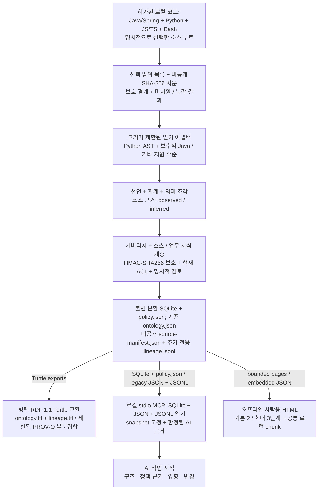

# Code Ontology Companion

[English](README.md) | [한국어](README.ko.md) | [日本語](README.ja.md) | [简体中文](README.zh-CN.md) | [Русский](README.ru.md)

Code Ontology Companion은 **AI 데이터 파이프라인 플랫폼의 초기 MVP**입니다. 허가된 로컬 코드를 AI가 조회할 소스 연결 지식과 사람이 볼 가벼운 오프라인 개요로 만듭니다. 대상 프로젝트를 실행하지 않는 정적 분석이며, 모델이나 클라우드 서비스가 필수는 아닙니다.

**0.9.3 릴리스 후보** · 개발자: **battle-doll** · 한국어·영어·일본어·중국어 간체·러시아어 · Windows·macOS·Linux. 사용자가 선택한 GPT-6 Astra 또는 GPT-6.1 Sol과 추론 강도를 유지하며 자동 변경하지 않습니다.

## 버전 0.9.3 지원 기능

- 소스 폴더를 선택하고 전체 선택 범위를 목록화하여 변경 불가능한 분할 소스·업무 지식 스냅샷을 생성합니다.
- 선언·관계·호출 후보·의미 조각을 찾고, 소스 결속·지원 한계·변경·커버리지를 로컬 읽기 전용 MCP로 조회합니다.
- 업무 개념과 타입이 있는 속성을 소스 근거에 연결하고, 주장을 명시적으로 검토·철회하며 지원되는 정책 조각을 타입 문맥으로 질의합니다.
- 오프라인 3D 개요를 열거나, 레코드 페이지·이식용 SQLite/JSON 묶음·별도 RDF 1.1 Turtle 그래프를 명시적으로 내보냅니다.

Java/Spring·Python·JavaScript/TypeScript·Bash는 지원하는 분석이 서로 다릅니다. 다른 어댑터도 선언/import 또는 부분 지원 수준을 명시합니다. 파일이나 표현식이 인식되었다고 언어·업무 의미 전체가 해석된 것은 아닙니다. [구현 안내](docs/ko/PIPELINE_0_9_0.md)와 [품질 작업 흐름](docs/ko/QUALITY_0_9_3.md)을 참고하세요.

## 내 코드로 시작하기

Python 3.9 이상을 사용합니다. Windows에서는 `python3` 대신 `py -3`를 사용할 수 있습니다. 지식 작업 공간은 소스 트리 밖의 새 경로로 선택하세요. HTML·이식용 내보내기 전에 소스·출력 루트 밖의 비공개 신원정보 거부 프로필을 `CODE_ONTOLOGY_PRIVACY_FILE`에 설정합니다. 설정 방법은 [개인정보 안내](docs/ko/PRIVACY_OPERATIONS.md)에 있습니다.

```sh
python3 skills/manage-code-ontology/scripts/companion.py analyze --repo /path/to/source --workspace /path/outside/source/knowledge --authorized --language ko
python3 skills/manage-code-ontology/scripts/companion.py pipeline-status --workspace /path/outside/source/knowledge
python3 skills/manage-code-ontology/scripts/companion.py pipeline-search --workspace /path/outside/source/knowledge --snapshot SNAPSHOT_ID --term Service --limit 20
```

`SNAPSHOT_ID`는 결과에 나온 구체적 ID로 바꿉니다. 상대 소스 디렉터리를 지정하려면 `analyze`에 `--source-root`를 반복합니다. 결과는 소스·업무·HTML 단계를 각각 보고합니다. 반환된 HTML `entrypoint`를 `file://`로 바로 여세요. 소스 생성 성공만으로 후속 업무·HTML 단계까지 완료됐다고 보지 않습니다.

코드 변경 후에는 `refresh --workspace /path/outside/source/knowledge --language ko`를 실행합니다. 선택 범위와 이전 스냅샷을 유지합니다. 지식만 필요하면 analyze/refresh에 `--no-html`을 추가합니다. 상태 조회는 소스를 다시 읽지 않고 저장 산출물을 검사하므로 현재 소스나 실행 상태의 증거는 아닙니다.

AI 작업에서는 **“이 작업에 Code Ontology Companion을 적용하고 허가한 작업 공간을 사용해줘”**라고 요청하세요. [적용 스킬](skills/apply-code-ontology/SKILL.md)이 도구 가용성을 확인하고 실제 첫 조회를 수행하며 관련 읽기를 같은 스냅샷에 고정합니다. 로컬 MCP 응답을 원격 모델에 보내는 허가는 별도입니다.

## 사람용 개요와 AI용 정확한 지식

공개 `analyze`·`refresh`·일반 `pipeline-html`의 기본값은 `--presentation human`입니다. 영역 → 주요 구조 모듈 → 핵심 흐름·근거를 기본 2단계, 최대 3단계로 보여줍니다. 첫 페이지는 노드 32개·집계 간선 64개·데이터 128 KiB 이내입니다. 5언어 UI가 데이터 한 벌을 공유하고 선택한 화면만 로컬 script chunk로 읽습니다. 처음부터 전체 기록·전체 검색 색인을 파싱하지 않으며 네트워크나 HTTP 서버가 필요하지 않습니다. 검색은 현재 페이지 범위입니다.

전체 모드는 전체 범위를 요약하고, 집중 모드는 한정된 선택 범위를 보여줍니다. 3D 애니메이션·별도 전체 범위 링크·동작 줄이기·모바일/텍스트 대체 보기·카메라 조작을 유지합니다. 미분류와 나머지 건수를 표시합니다. 현재 소스 정책 카드는 의미가 **UNKNOWN**인 불투명 근거 타일이며 조건·계산·예외를 완성한 정책 설명문은 아닙니다.

원본 소스 레코드 수·파일 처리 결과·화면 그룹/노드·근거 참조 수는 단위가 다릅니다. 숨긴 그룹을 온톨로지 누락으로, 개인정보 보호로 보류한 관계 수를 사람 수나 전체 레코드 수로 해석하지 않습니다. 요약 선택은 온톨로지/MCP 커버리지를 바꾸지 않습니다. 브라우저·OS 실기기 결과와 처리 용량은 별도로 검증해야 합니다.

정확하고 깊은 지식은 MCP로 조회합니다. `--presentation records`는 전체 레코드 표현을 유지합니다. 기존 legacy·명시적 분할 경로와 업무 HTML의 별도 투영 계약도 유지됩니다. 기존 스냅샷을 새 경로에 내보내려면 다음을 사용합니다.

```sh
python3 skills/manage-code-ontology/scripts/companion.py pipeline-html --workspace /path/outside/source/knowledge --snapshot SNAPSHOT_ID --output /path/to/new-html --language ko
```

## 로컬 코드에서 활용 가능한 지식까지



소스 계층은 선언·근거·한계를 보존하고, 업무 계층은 소스에 연결된 개념·타입 속성·명시적 검토 상태를 추가합니다. `observed`·`inferred`·`runtime_unknown`은 다릅니다. 확정 호출·후보·미해결 호출을 구분하며 미해결 호출을 조용히 버리거나 확정으로 승격하지 않습니다. 생성자/구성요소·호출자/제공자·helper 전달은 제한된 구조 근거이며 정책 의미나 실행 값을 자동으로 완성하지 않습니다.

선택 목록·선언/타입·확정 호출·정책 의미·MCP 전달·정책 문서의 커버리지 분모를 분리합니다. 미지원·누락·보호 보류·PARTIAL·UNKNOWN을 유지합니다. 정책 문장을 쓰기 전에 필수 조건·AND/OR·상태/효과·단위·수식·반올림·예외·권한·소유권·시간 경계를 근거에 연결하고, 뒷받침되지 않는 의미는 UNKNOWN으로 둡니다. 반복 가능한 검증 흐름은 근거 작업표 → 커버리지/의미 검사 → 지원 범위의 수정 또는 명시적 검토 → 새 스냅샷 → 고정 조회입니다. 작업표나 작은 HTML 개요만으로 정책 설명문의 완전성을 입증하지 않습니다.

스냅샷은 소스 지문·분석 명세·산출물 해시에 결속됩니다. 비공개 `source-manifest.json`과 추가 전용 `lineage.jsonl`이 로컬 검사를 지원하고, `lineage.ttl`은 제한된 PROV-O 부분집합을 사용합니다. RDF의 `RelationshipEvidence`와 형태 검사는 진실·전체 소스 복원·완전한 계보·사람 신원·실행 성공의 인증이 아닙니다. MCP는 RDF 분기가 아닌 봉인된 SQLite/JSON/JSONL을 읽습니다. 기존 `graph.html` / `ontology.json` / `ontology.ttl` 흐름은 별도로 지원합니다.

## 정책 지식과 내보내기 선택

업무 지식은 소스에 연결되고 타입을 갖습니다. 승인/철회와 현재 소스·업무 스냅샷 pin은 추출과 별도로 검사합니다. `verified_implemented`와 `approved_business`는 다르고, `DECLARED`는 소스의 실제 강제 근거가 아닙니다. 지원되는 정적 정책 계산에도 명시적 문맥과 완전한 지원 입력이 필요합니다. 문맥 부족·조합 모호성·미지원 효과·불명확한 단위는 UNKNOWN입니다. 소스 일치나 원시 IR만으로 권한·업무 정확성을 확정하지 않습니다.

`business-html`의 기본값은 기존의 손실 투영 `business_only`입니다. 명시적 `--projection policy_projection`은 `read_policy`와 `export_html` 아래 선택 ID·소스 후보·타입 매핑·UNKNOWN·집계 스냅샷 결속을 포함한 정확한 허용 MCP 정책 보기를 보존합니다.

```sh
python3 skills/manage-code-ontology/scripts/companion.py business-html --workspace /path/outside/source/knowledge --snapshot SNAPSHOT_ID --business-snapshot BUSINESS_ID --business-digest BUSINESS_DIGEST --output /path/to/new-policy-view --projection policy_projection
```

일반 정책 투영은 10,000레코드·1 GiB 이내입니다. 더 큰 schema2 업무 스냅샷을 명시적으로 내보낼 때는 `--partitioned --partition-size 10000`을 추가합니다. 물리적 창은 원래 선택 분모를 유지하며 신뢰된 작업 공간 예산을 넘지 않습니다. 격리 실행에 호환되는 Python/SQLite가 필요하고, `--export-python PATH`로 이미 신뢰하는 인터프리터를 선택할 수 있습니다. 자동 설치·탐색은 하지 않습니다. SQLite 할당 128 MiB 상한은 전체 프로세스 메모리 보장이 아닙니다. 자원 실패 시 미완료 건수·진행 경계를 유지하며 저장 완료는 업무 의미의 완전성이 아닙니다.

`pipeline-html --presentation records --partitioned`는 기존 분할 소스 atlas/레코드 경로입니다. `pipeline-export`는 허용된 이식용 묶음을 생성합니다. SQLite/JSON은 허용된 전체 레코드를 보존하지만 RDF는 정의된 투영이며 보편적인 무손실 복원이 아닙니다. 각 내보내기의 권한·상한·보류 규칙을 유지합니다. 서명 없는 사본은 발행자 신원·공개 허가·기존 사본 원격 철회를 보장하지 않습니다.

## 로컬 설치와 호환성

[GitHub 패키지](https://github.com/battle-doll/code-ontology-companion/releases) · [디렉터리 항목](https://chatgpt.com/plugins/plugins_6a6a23c0434c8191aec6a38bb590fd3c) · [로컬 MCP 설정](skills/manage-code-ontology/references/local-mcp.md)

전체 패키지는 읽기 전용 stdio MCP 서버를 포함하며 기존 12개+파이프라인 8개, 총 20개 도구를 제공합니다. **Skills-only**는 적용/관리 스킬·분석기·workbench·설정 안내를 포함하지만 MCP 서버는 포함하지 않습니다. 클라우드 endpoint는 필요하지 않습니다. 디렉터리 가용 버전은 별도 심사 절차에 따르며 이 소스 후보는 공식 제출·승인·보증·제출 자격을 주장하지 않습니다.

기존 `init`/`sync`, `query`, `impact`, `diff` 작업 공간을 자동 변환하지 않습니다. 기존 대규모 조회 도구에는 `ontology_large_modules`, `ontology_large_search`, `ontology_large_neighbors`, `ontology_evidence_bundle`, `ontology_evidence_pack`이 있습니다. Code는 소스 구조를 담당하고 선택적 Context·Contracts는 각자의 책임과 검증된 호환 범위를 유지합니다. [모델 환경별 흐름](docs/ko/MODEL_ERA_WORKFLOW.md) · [참조 교환](skills/manage-code-ontology/references/code-reference.md).

기존 Ollama `127.0.0.1:11434` 연동은 별도 동의가 필요하며 제안은 관찰 근거 밖의 `inferred` sidecar로 분리합니다. 결정적 분석에 모델·모델 설치·자동 모델 변경은 필요하지 않습니다.

## 개인정보와 신뢰 경계

로컬 분석 허가·ACL·지식 검토·공개 허가는 별개입니다. 현재 ACL/프로필/결속 검사를 유지합니다. 개인정보와 등록된 보호 값은 관리자 승인·별칭·`manage_knowledge`·검토 근거로 우회할 수 없습니다. HMAC-SHA256 프로필 키와 보호 지문을 공개하지 마세요. 필수 보호나 공개 신원을 확인할 수 없으면 **HOLD**이며 공개 개발자 별칭은 **battle-doll**만 사용합니다.

주석·리터럴은 기본적으로 불투명하게 취급합니다. 명시적 비공개 occurrence 허가로 허용된 로컬 근거를 보존할 수 있지만 의미 승인·명령 권한·공개 허가는 아닙니다. 철회는 이후 허가된 읽기에 적용되며 이미 내보낸 사본을 지우지는 못합니다. 분석기는 대상 코드를 실행하거나 telemetry·직접 네트워크 요청을 보내지 않습니다. 호스트가 선택한 MCP 응답을 전달할 수 있으므로 수신자 허가는 별도로 확인하세요.

## 더 보기

[품질 작업 흐름](docs/ko/QUALITY_0_9_3.md) · [커버리지](docs/ko/COVERAGE_0_9_2.md) · [파이프라인 안내](docs/ko/PIPELINE_0_9_0.md) · [공개 자체 온톨로지 데모](https://battle-doll.github.io/code-ontology-companion/) · [번역 범위](docs/TRANSLATION_COVERAGE.md)

Apache-2.0 · [개인정보](PRIVACY.md) · [보안](SECURITY.md) · [지원](SUPPORT.md) · [약관](TERMS.md) · [변경 기록](CHANGELOG.md)
