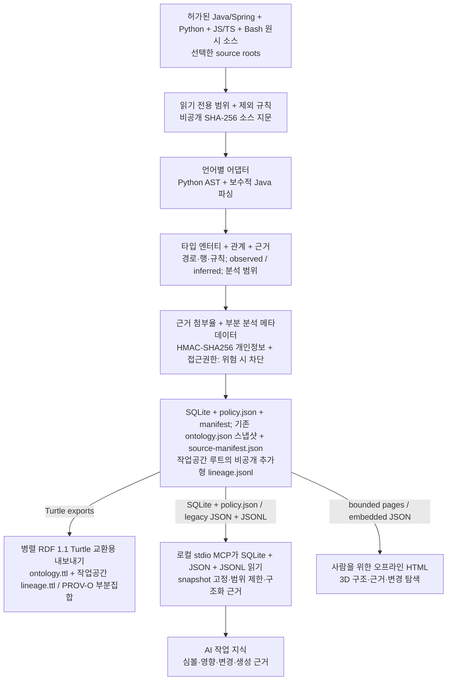

# Code Ontology Companion

[English](README.md) | [한국어](README.ko.md) | [日本語](README.ja.md) | [简体中文](README.zh-CN.md) | [Русский](README.ru.md)

Code Ontology Companion은 **AI 데이터 파이프라인 플랫폼의 초기 MVP**로, 허가된 Java/Spring·Python·JavaScript/TypeScript·Bash 및 지원 수준이 명시된 추가 언어의 원시 코드를 온톨로지로 만드는 로컬 데이터 파이프라인입니다. 타입 엔터티·근거가 있는 관계·스냅샷 계보를 생성하고 RDF 표준 파일로 내보내며, 로컬 MCP로 AI 작업에 필요한 근거를 전달합니다. 사람은 같은 온톨로지를 생성된 오프라인 3D HTML에서 탐색합니다.

**0.9.0** · 선택하신 GPT-6 Astra 또는 GPT-6.1 Sol 모델과 추론 강도를 유지합니다.

## 0.9.0 로컬 파이프라인

디스크 기반 SQLite 파티션, 파일 분석 재사용, 중단 복구와 제한된 조회로 대량 소스를 처리합니다. Bash의 함수·source·파이프라인을 정적으로 분석합니다. Python의 형식화된 정책과 Java/TypeScript의 순수 불리언 정책은 소스를 다시 열지 않고 조회합니다. 기본 소유자 전용 권한에서 구조·정책·근거·내보내기를 구분합니다. 전체 패키지는 **읽기 전용 MCP 도구 19개**를 제공합니다. 기존 12개와 파이프라인 7개입니다.

[구현 범위·간편 시작·접근권한](docs/ko/PIPELINE_0_9_0.md) · [보존된 설계 기준](docs/ko/NEXT_ARCHITECTURE_0_9_0.md)

```sh
python3 skills/manage-code-ontology/scripts/companion.py analyze --repo /path/to/source --workspace /path/to/knowledge --authorized --language ko
python3 skills/manage-code-ontology/scripts/companion.py refresh --workspace /path/to/knowledge --language ko
```

HTML 내보내기 전에 `CODE_ONTOLOGY_PRIVACY_FILE`을 소스·출력 외부의 비공개 신원 차단 프로필로 설정합니다. 새 흐름은 목록·정책·3D를 페이지 단위로 제공합니다. 기존 `init`/`sync` 작업공간과 확대/전체 탐색 및 아래 호환 명령은 유지하며 자동 변환하지 않습니다. 실제 기기·용량 검증은 단위 테스트와 구분합니다.

## 원시 소스부터 AI 작업 지식까지

Companion 작업공간 모드의 결정적 파이프라인은 선택한 소스를 읽고 대상 코드를 실행하지 않습니다. 파일별 SHA-256 값은 비공개 source manifest에 보관하고, 선택 범위의 종합 지문으로 스냅샷을 식별합니다. 별도로 설정한 HMAC-SHA256 신원 프로필로 지원 출력물을 검사합니다.



`ontology.ttl`은 코드의 타입 그래프와 `RelationshipEvidence`를 RDF 1.1 Turtle로 내보냅니다. 작업공간의 `lineage.ttl`은 PROV-O 부분집합으로 journal 기록을 정보 엔터티로, 대조된 로컬 snapshot build를 Activity/Source/Snapshot 생성 관계로 표현합니다. 저장된 snapshot metadata·source manifest와 대조한 근거이며 완전한 계보·인간 귀속·실행 성공을 증명하지 않습니다. 새 파이프라인 MCP는 SQLite 파티션과 확정된 `policy.json`을 읽습니다. 기존 MCP는 `ontology.json`과 작업공간의 `lineage.jsonl`을 읽어 AI 작업에 필요한 구조화 근거를 선별합니다. 사람용 `graph.html`도 같은 JSON 온톨로지에서 만든 이식 가능한 payload를 내장합니다. 품질·부분 분석 진단은 스냅샷을 자동 거부하지 않으며 정확도나 실제 실행의 증거가 아닙니다. 개인정보 거부 또는 분석 중 소스 변경이 발생하면 출력이나 스냅샷 확정을 중단하고, 선택적 신원 프로필이 없으면 실명을 검출하지 않습니다.

보존한 소스 범위·분석기 버전·분석 전후 소스 지문·추가형 계보가 파이프라인 전반의 재현성을 지원합니다. 온톨로지 품질·HTML·문서·패키지·개인정보 회귀 검사는 별도 릴리스 검증입니다. 도면은 Companion 흐름이며 독립 index는 JSON/Turtle/report를 생성하고 HTML은 별도 시각화 명령으로 만듭니다.

> 선택적 로컬 모델 보강은 별도 동의가 필요하며 관측된 소스 근거와 분리한 비공개 `inferred` sidecar에 보관합니다. 결정적 파이프라인에는 모델이 필요하지 않습니다.

**플랫폼 확장 방향:** 추가 입력 어댑터와 명시적인 변환·전달 계약을 연결합니다. 기존 모드 입력은 Java/Spring·Python 코드이고 새 파이프라인은 구현 안내서의 언어군을 지원이며 더 넓은 데이터 플랫폼 기능은 설계 방향으로 구분합니다.

## 지금 하는 작업에 적용하기

> Code Ontology Companion 여기에 적용하고, 이 프로젝트 작업에 계속 활용해줘.

Codex가 실제 사용할 수 있는 도구와 기존 작업공간을 확인하고, 현재 상태와 작업에 관련된 심볼 검색 또는 영향 조회부터 실행합니다. 연결된 조회는 같은 스냅샷을 사용합니다. 의미 있는 Java/Python 변경 뒤에는 허가된 범위에서 갱신하고 최신 상태·분석 범위·경고를 확인합니다. 기본 적용 범위는 현재 대화이며, 프로젝트에 지침을 저장하는 일은 명시적으로 요청했을 때만 합니다.

> 온톨로지 여기 설정해줘.

일반적인 요청에는 Code·Context·Contracts 중 실제 실행 가능한 제품을 확인합니다. Code만 있어도 사용할 수 있으며, 제품을 지목하면 그 제품을 우선합니다. 없는 제품을 자동 설치하지 않습니다. Context는 사용자가 선택하고 확정한 결정·제약만 저장한 뒤 다시 읽어 확인하고, Contracts는 선택한 실제 교환 JSON을 검사하며 미지원·정보 손실·미검사 결과를 유지합니다.

[적용 흐름](skills/apply-code-ontology/SKILL.md)

## 설치 / 사용

[플러그인 디렉터리에서 설치](https://chatgpt.com/plugins/plugins_6a6a23c0434c8191aec6a38bb590fd3c) · [GitHub 패키지 다운로드](https://github.com/battle-doll/code-ontology-companion/releases)

이 소스는 0.9.0입니다. 디렉터리는 별도 심사·게시 절차를 거치므로 제공 버전이 다를 수 있습니다. 공식 스킬 전용 패키지에는 적용·관리 두 스킬과 분석기·화면·로컬 MCP 설정 안내가 들어 있습니다. MCP 서버는 포함하지 않으며, GitHub 전체 패키지에는 읽기 전용 stdio MCP 서버도 포함됩니다. 클라우드 엔드포인트는 필요하지 않습니다.

## 실제 자체 온톨로지 탐색

[**3D 탐색기 바로 열기 →**](https://battle-doll.github.io/code-ontology-companion/)

플러그인 자체의 지원 소스로 생성한 실제 온톨로지입니다. 모듈과 심볼을 선택해 연결과 소스 근거를 확인할 수 있습니다. 분석한 커밋과 기준 스냅샷도 공개합니다. 새 탭으로 열려면 ⌘ 클릭 또는 Ctrl 클릭을 사용하세요.

[스냅샷 생성 근거](https://battle-doll.github.io/code-ontology-companion/snapshot.json) · [아키텍처](docs/ko/ARCHITECTURE_AND_ROADMAP.md)

## 버전 0.9.0 지원 기능

- 현재 대화에 적용하고 실제 첫 조회부터 시작하며, 변경 뒤 허가된 갱신과 상태 확인까지 연결.
- 구조·영향·변경을 탐색하는 3D 중심 오프라인 화면과 부드러운 카메라 포커스.
- 정확한 심볼 우선 검색, 구조 필터, 이어서 조회, 스냅샷을 고정한 읽기.
- 방향별 의존 경로와 단계별 근거, 명확한 탐색 범위.
- 추가·삭제·수정과 근거 변경을 일관되게 비교.
- Java/Spring 타입·임포트·보수적 호출 해석·주입·프록시 신호, Python 모듈·함수·호출·파이프라인 역할 추정.
- 원본 근거를 보존하는 Code 참조와 Context용 불변 로케이터, 명시적인 Contracts 호환 범위.
- 키보드·텍스트 탐색, 움직임 감소 설정, 안전한 페이지형 목록 대안.

## 빠른 시작

### 기존 형식 호환 흐름

Python 3.9+가 필요합니다. 먼저 쓰기 없이 지원 범위를 확인합니다. 본인 소유 또는 분석 허가를 받은 코드만 사용하고, 생성할 자료를 확인한 뒤 저장소 바깥의 작업공간을 초기화합니다.

```bash
python3 skills/manage-code-ontology/scripts/companion.py doctor --repo "/path/to/repo"
python3 skills/manage-code-ontology/scripts/companion.py preflight --repo "/path/to/repo"
```

```bash
python3 skills/manage-code-ontology/scripts/companion.py init --repo "/path/to/repo" --workspace "/path/outside/repo/ontology" --authorized
python3 skills/manage-code-ontology/scripts/companion.py query --workspace "/path/outside/repo/ontology" --term "OrderService"
python3 skills/manage-code-ontology/scripts/companion.py impact --workspace "/path/outside/repo/ontology" --symbol "OrderService" --direction incoming
python3 skills/manage-code-ontology/scripts/companion.py diff --workspace "/path/outside/repo/ontology"
```

테스트나 코드 사본이 함께 있으면 운영 소스 폴더를 명시하세요. 여러 상대 폴더는 `--source-root`를 반복 지정합니다. 갱신 시 범위가 유지되며 `sync --source-root .`으로 저장소 전체 탐색을 명시적으로 복원합니다. 서로 다른 파일의 충돌 선언은 합치지 않고 분석을 중단합니다. 화면에서 모든 그룹을 검색·페이지 이동으로 찾고 구성 요소와 소스 관계로 확장할 수 있습니다. 요약 연결은 집계로 표시하며 경로 필터는 배포 증거가 아닌 추정입니다.

노출 단계는 전체 모듈 → 선택 모듈의 구성요소 → 선택 구성요소의 멤버입니다. 다른 영역은 접힌 채 유지됩니다. 호출 강조는 별도로 코드에서 확인된 1·2·3차 CALLS 경로를 따릅니다. 임의 표본을 뽑지 않으며 분석된 모든 요소와 관계를 펼치기·페이지 이동으로 확인하고 접힘·다른 페이지 개수도 표시합니다.

```bash
python3 skills/manage-code-ontology/scripts/companion.py preflight --repo "/path/to/repo" --source-root src/main
python3 skills/manage-code-ontology/scripts/companion.py sync --workspace "/path/outside/repo/ontology" --source-root src/main
```

## 근거와 호환성

`graph.html`, `ontology.json`, `ontology.ttl`은 같은 소스 온톨로지를 사용합니다. RDF 1.1 Turtle의 `RelationshipEvidence`와 PROV-O 계보로 근거를 보존합니다. `inferred`는 검증 완료가 아니며 `runtime_unknown`은 실제 실행의 증거가 아닙니다. 근거 첨부율은 분석 정확도가 아닙니다.

Code는 코드 구조, Context는 결정과 유효 시점, Contracts는 지원 교환 규격 검증을 담당합니다. 각 제품은 독립적으로 사용할 수 있습니다. [AI용 데이터 계약](skills/manage-code-ontology/references/ai-data-contract.md) · [참조 교환](skills/manage-code-ontology/references/code-reference.md).

Context에는 원본 자료를 가리키는 참조를 전달합니다. 실제 스냅샷을 엄격한 Contracts draft로 직접 변환하는 기능은 아직 미지원입니다. 검증한 범위는 참조 교환 가이드에 명시했습니다.

기존 Ollama의 `127.0.0.1:11434` 연결은 별도 동의를 받은 경우에만 사용하며, 제안은 관찰된 근거와 분리합니다. 결정적 분석에는 모델이 필요하지 않습니다.

## 새 모델 환경의 로컬 사용 흐름

선택하신 GPT-6 Astra 또는 GPT-6.1 Sol 모델과 추론 강도를 유지합니다. Windows·macOS·Linux에서 AI는 로컬 MCP 근거를, 사람은 오프라인 HTML을 사용합니다. 전체 패키지는 기존 7개에 `ontology_large_modules`, `ontology_large_search`, `ontology_large_neighbors`, `ontology_evidence_bundle`, `ontology_evidence_pack`을 추가한 기존 읽기 전용 12개 도구와 파이프라인 7개를 합쳐 총 19개를 제공합니다. 관련 조회는 고정된 스냅샷을 사용하고 대규모 경로는 선택한 단일 모듈 안으로 제한합니다. 모델 성능 우위나 운영 성공을 입증했다고 주장하지 않습니다.

[5언어 사용 가이드](docs/ko/MODEL_ERA_WORKFLOW.md) · [번역 범위](docs/TRANSLATION_COVERAGE.md)

## 개인정보 운영

설정된 로컬 HMAC-SHA256 개인정보 검사는 지원하는 생성 출력을 보호하며 선택 프로필이 없으면 실명을 검출하지 않습니다. `CODE_ONTOLOGY_PRIVACY_FILE`은 보호 루트 밖에 두고 키·지문을 공개하지 않습니다. 공개 PR에는 최신의 신뢰할 수 있는 GitHub 계정 보호 확인 기록과 선택된 서비스 ref 감사가 필요합니다. 공식 신원은 battle-doll만 표시되어야 하며 그렇지 않으면 HOLD합니다. 기존 보관 ref는 서비스 삭제 확인이 필요하므로 전체 개인정보0을 주장하지 않습니다.

[개인정보 운영](docs/ko/PRIVACY_OPERATIONS.md)

## 라이선스와 개인정보

Apache-2.0. 분석기는 대상 코드를 실행하거나 텔레메트리를 전송하거나 직접 네트워크에 연결하지 않습니다. 사용자 작업공간은 로컬에 남고, 공개 데모는 이 공개 저장소만 명시적으로 게시합니다. 소스 본문·주석·비밀정보는 보관하지 않습니다.

[개인정보](PRIVACY.md) · [보안](SECURITY.md) · [지원](SUPPORT.md) · [약관](TERMS.md) · [변경 이력](CHANGELOG.md)
