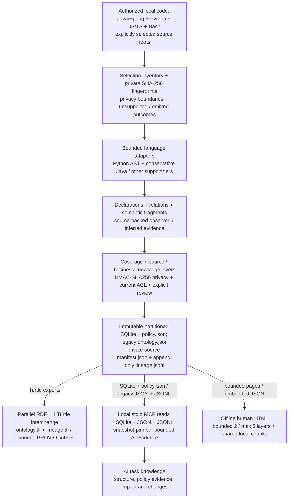

# Code Ontology Companion

[English](README.md) | [한국어](README.ko.md) | [日本語](README.ja.md) | [简体中文](README.zh-CN.md) | [Русский](README.ru.md)

Code Ontology Companion is an **initial MVP of an AI data-pipeline platform**: it turns authorized local code into source-linked knowledge for AI and a lightweight offline overview for people. It analyzes code statically, without executing the target project or requiring a model or cloud service.

**0.9.3 release candidate** · Developer: **battle-doll** · English, Korean, Japanese, Simplified Chinese and Russian · Windows, macOS and Linux. Keep your selected GPT-6 Astra or GPT-6.1 Sol model and reasoning effort; this plugin does not switch them.

## Version 0.9.3 capabilities

- Select source folders, inventory the complete selected scope, and generate immutable, partitioned source and business knowledge snapshots.
- Find declarations, relationships, call candidates and semantic fragments; inspect their source bindings, support limits, changes and coverage through local read-only MCP.
- Connect business concepts and typed properties to source evidence, review or revoke claims explicitly, and query supported policy fragments with typed context.
- Open an offline 3D overview, or explicitly export record pages, a portable SQLite/JSON bundle and a parallel RDF 1.1 Turtle graph.

Java/Spring, Python, JavaScript/TypeScript and Bash have different supported analyses. Other adapters have explicit declaration/import or partial support levels. Neither a recognized file nor an extracted expression implies complete language or business semantics. See the [implementation guide](docs/PIPELINE_0_9_0.md) and [quality workflow](docs/QUALITY_0_9_3.md).

## Start with your code

Use Python 3.9 or newer. On Windows, use `py -3` in place of `python3`. Choose a new knowledge workspace outside the source tree. Before generating HTML or a portable export, configure `CODE_ONTOLOGY_PRIVACY_FILE` with a private identity-deny profile outside the source and output roots; follow the [privacy setup](skills/manage-code-ontology/references/privacy-operations.md).

```sh
python3 skills/manage-code-ontology/scripts/companion.py analyze --repo /path/to/source --workspace /path/outside/source/knowledge --authorized --language en
python3 skills/manage-code-ontology/scripts/companion.py pipeline-status --workspace /path/outside/source/knowledge
python3 skills/manage-code-ontology/scripts/companion.py pipeline-search --workspace /path/outside/source/knowledge --snapshot SNAPSHOT_ID --term Service --limit 20
```

Replace `SNAPSHOT_ID` with the returned concrete ID. Repeat `--source-root` on `analyze` to select relative source directories. The result reports source, business and HTML stages separately; open the returned HTML `entrypoint` directly with `file://`. A successful source build does not guarantee that a later business or HTML stage completed.

After code changes, run `refresh --workspace /path/outside/source/knowledge --language en`. Refresh retains the selected scope and earlier snapshots. Add `--no-html` to analyze/refresh when you only need sealed knowledge. Status checks saved artifacts without rereading source; it does not establish fresh source or runtime behavior.

In an AI task, ask: **“Apply Code Ontology Companion here and use the authorized workspace while we work.”** The [application skill](skills/apply-code-ontology/SKILL.md) checks available tools, performs a real first lookup and keeps related reads on one snapshot. Sending local MCP results to a remote model requires separate authorization.

## Human overview, exact AI knowledge

Public `analyze`, `refresh` and ordinary `pipeline-html` default to `--presentation human`: area → major structural module → core flow/evidence, with default depth 2 and maximum depth 3. The first page is bounded to 32 nodes, 64 aggregate edges and 128 KiB of data. Five UI languages share one data set; local script chunks load only the chosen view. There is no initial full-corpus or whole-search-index parsing, network dependency or required HTTP server. Search covers the current page.

Whole mode summarizes the full scope; focus mode shows a bounded selection. 3D animation, a separate whole-scope link, reduced motion, mobile/text fallback and camera controls remain. Unknown groups and explicit remainder counts stay visible. Source policy cards are opaque evidence tiles with **UNKNOWN** meaning, not complete narratives of policy conditions, calculations or exceptions.

Original source-record count, file outcomes, displayed groups/nodes and evidence references use separate units. A hidden group is not an omitted ontology record; a privacy-withheld relationship count is not a count of people or whole records. Summary selection never changes ontology/MCP coverage. Native browser/OS results and workload capacity must be verified separately.

For exact/deep knowledge use MCP; `--presentation records` retains complete record presentation. Existing legacy and explicit partitioned routes remain available, and business HTML has its own projection contracts. To export an existing snapshot to a new directory:

```sh
python3 skills/manage-code-ontology/scripts/companion.py pipeline-html --workspace /path/outside/source/knowledge --snapshot SNAPSHOT_ID --output /path/to/new-html --language en
```

## From local code to usable knowledge



The source layer preserves declarations, evidence and limitations; the business layer adds source-linked concepts, typed properties and explicit review states. `observed`, `inferred` and `runtime_unknown` are distinct. Exact calls, candidates and unresolved calls keep separate status: an unresolved call is not silently removed or promoted to exact. Constructor/component, caller/provider and helper transfers are bounded structural evidence, not automatically complete policy meaning or runtime values.

Selection inventory, declarations/types, exact calls, policy semantics, MCP delivery and policy-document coverage have separate denominators. Unsupported, omitted, redacted, PARTIAL and UNKNOWN outcomes remain visible. Before policy prose, map essential conditions, AND/OR, state/effect, units, formulas, rounding, exceptions, authority, ownership and time bounds to evidence; keep unsupported meaning UNKNOWN. The repeatable feedback loop is evidence worksheet → coverage/meaning checks → supported corrections or explicit review → refreshed snapshot → pinned queries. A worksheet or a small HTML summary is not proof of complete policy prose.

Snapshots bind source fingerprints, analysis specifications and artifact hashes. Private `source-manifest.json` and append-only `lineage.jsonl` support local checks; `lineage.ttl` uses a bounded PROV-O subset. RDF `RelationshipEvidence` and shape validation do not certify truth, full source reconstruction, a complete provenance chain, human identity or runtime success. MCP reads sealed SQLite/JSON/JSONL, not the RDF branch. The legacy `graph.html` / `ontology.json` / `ontology.ttl` workflow remains supported separately.

## Policy knowledge and export choices

Business knowledge is source-linked and typed. Approval/revocation and current source/business snapshot pins are checked separately from extraction. `verified_implemented` is not `approved_business`; `DECLARED` is not proof of source enforcement. Supported static policy evaluation requires explicit context and complete supported inputs. Missing context, ambiguous composition, unsupported effects and unknown units stay UNKNOWN. A source match or raw IR does not establish authorization or business correctness.

`business-html` defaults to the existing lossy `business_only` view. Explicit `--projection policy_projection` preserves the exact authorized MCP policy view, including selected identities, source candidates, typed mappings, UNKNOWN states and aggregate snapshot bindings, with `read_policy` and `export_html`:

```sh
python3 skills/manage-code-ontology/scripts/companion.py business-html --workspace /path/outside/source/knowledge --snapshot SNAPSHOT_ID --business-snapshot BUSINESS_ID --business-digest BUSINESS_DIGEST --output /path/to/new-policy-view --projection policy_projection
```

The ordinary policy projection is limited to 10,000 records and 1 GiB. For an explicitly larger schema2 business snapshot, add `--partitioned --partition-size 10000`; physical windows preserve the original selected denominator and remain within the trusted workspace budget. A compatible, isolated Python/SQLite worker is required; `--export-python PATH` selects an already trusted interpreter, without automatic installation/discovery. Its 128 MiB SQLite allocation cap is not a total process-memory guarantee. Resource failure retains incomplete counts/frontiers; storage completion does not mean complete business semantics.

`pipeline-html --presentation records --partitioned` selects the existing partitioned source-atlas/record route. `pipeline-export` creates the authorized portable bundle. SQLite/JSON retains full authorized records; RDF is a defined projection, not a universal lossless reconstruction. Every export keeps its own permissions, limits and withholding rules. Unsigned copies do not authenticate an issuer, confer publication permission or support remote revocation.

## Local installation and compatibility

[GitHub packages](https://github.com/battle-doll/code-ontology-companion/releases) · [Directory entry](https://chatgpt.com/plugins/plugins_6a6a23c0434c8191aec6a38bb590fd3c) · [Local MCP setup](skills/manage-code-ontology/references/local-mcp.md)

The full package includes the read-only stdio MCP server: 12 legacy tools plus 8 pipeline tools, 20 total. **Skills-only** contains the application/management skills, analyzer, workbench and setup guidance, but no MCP server. No cloud endpoint is required. Directory availability/version has a separate review process; this source candidate does not claim official submission, approval, endorsement or eligibility.

Legacy `init`/`sync`, `query`, `impact` and `diff` workspaces are not silently converted. Legacy large-query tools include `ontology_large_modules`, `ontology_large_search`, `ontology_large_neighbors`, `ontology_evidence_bundle` and `ontology_evidence_pack`. Code handles source structure; optional Context and Contracts companions retain their own responsibilities and verified compatibility limits. [Model-era workflow](skills/manage-code-ontology/references/model-era-workflow.md) · [Reference exchange](skills/manage-code-ontology/references/code-reference.md).

Optional existing Ollama at `127.0.0.1:11434` requires separate consent; suggestions remain `inferred` sidecars outside observed evidence. Deterministic analysis needs no model, model installation or automatic model switch.

## Privacy and trust

Local analysis authorization, ACL grants, knowledge review and publication permission are separate. Current ACL/profile/binding checks remain mandatory. Personal information and registered protected values are hard denies: administrator approval, aliases, `manage_knowledge` and review basis cannot bypass them. HMAC-SHA256 profile keys and protected fingerprints must never be published. Missing required protection or unverifiable publication identity means **HOLD**; the public developer alias is **battle-doll** only.

Comments/literals are opaque by default. Explicit private occurrence permissions may retain permitted local evidence; this is not semantic approval, instruction authority or permission to publish it. Revocation affects subsequent authorized reads, not copies already exported. The analyzer does not execute target code, send telemetry or make direct network requests. A host may forward selected MCP results, so approve recipients separately.

## More information

[Quality workflow](docs/QUALITY_0_9_3.md) · [Coverage](docs/COVERAGE_0_9_2.md) · [Pipeline guide](docs/PIPELINE_0_9_0.md) · [Public self-ontology demo](https://battle-doll.github.io/code-ontology-companion/) · [Translation coverage](docs/TRANSLATION_COVERAGE.md)

Apache-2.0 · [Privacy](PRIVACY.md) · [Security](SECURITY.md) · [Support](SUPPORT.md) · [Terms](TERMS.md) · [Changelog](CHANGELOG.md)
