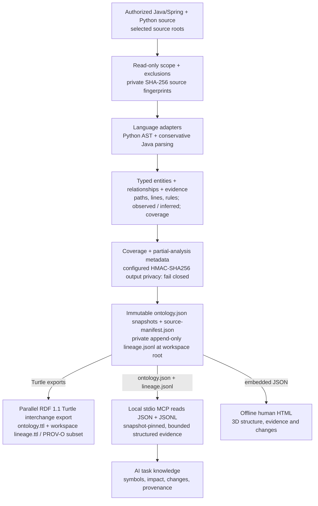

# Code Ontology Companion

[English](README.md) | [한국어](README.ko.md) | [日本語](README.ja.md) | [简体中文](README.zh-CN.md) | [Русский](README.ru.md)

Code Ontology Companion is an **initial MVP of an AI data-pipeline platform**, implemented as a local code-to-ontology pipeline for authorized Java/Spring and Python source. It creates typed entities, evidence-backed relationships and snapshot lineage, exports RDF standard files, and delivers bounded source knowledge to AI through local MCP. People explore the same ontology in the generated offline 3D HTML.

**0.8.3** · Keep your selected GPT-6 Astra or GPT-6.1 Sol model and reasoning effort.

## 0.8.3 workflow

Recoverable snapshot promotion, a private incremental cache with Windows full-analysis fallback, and the opt-in twelfth MCP tool `ontology_evidence_pack` strengthen the local pipeline. The offline HTML adds five-language map/list exploration and before/after comparisons. Source freshness and generator freshness are reported separately; RDF parser/SHACL checks are optional development validation. No measured model advantage is claimed.

The generated offline HTML starts in **Focus mode**, alongside a separate **Full mode**. Focus level 1 shows module entrances; select an item in the map or list and enter it to show only that item's declared children, up to level 4. Breadcrumb buttons return to a parent. A focused map page contains at most **60 nodes and 160 displayed edges** on mobile and desktop; remaining items and relationships remain accessible through explicit pages and the text list. These are display limits, not source-analysis limits. Existing full/cumulative exploration keeps its own bounds and confirmation at level 4 or deeper.

[Workflow, budgets and boundaries](skills/manage-code-ontology/references/v090-workflow.md)

[Planned 0.9.0 architecture](docs/NEXT_ARCHITECTURE_0_9_0.md) — Design only: scalable multilingual analysis and source-backed policy knowledge; current runtime remains 0.8.3.

## From raw source to AI task knowledge

In Companion workspace mode, the deterministic pipeline reads selected source without executing target code. Per-file SHA-256 values stay in a private source manifest; the scoped aggregate fingerprint identifies the snapshot. A separately configured HMAC-SHA256 identity profile checks supported outputs.



`ontology.ttl` exports the typed code graph and `RelationshipEvidence` in RDF 1.1 Turtle. Workspace `lineage.ttl` represents journal records as information entities and corroborated local snapshot builds as Activity/Source/Snapshot generation links using a bounded PROV-O subset. Corroboration checks stored snapshot metadata and source manifests; it does not establish a complete provenance chain, human attribution or runtime success. MCP reads `ontology.json` and workspace `lineage.jsonl`, returning selected structured evidence for an AI task. The human `graph.html` view embeds a portable payload from the same JSON ontology. Quality/partial-analysis diagnostics do not automatically reject a snapshot and are not accuracy or runtime proof. Privacy rejection and source changes during analysis stop output or snapshot promotion; a missing optional identity profile does not detect personal names.

Retained source roots, analyzer versions, before/after source fingerprints and append-only lineage support reproducibility across the pipeline. Ontology quality, HTML, documentation, package and privacy regression checks are separate release validation. The diagram shows the Companion workflow; standalone indexing creates JSON/Turtle/report, with HTML generated by a separate visualization command.

> Optional local-model enrichment requires separate consent and stays in private `inferred` sidecars outside observed source evidence. No model is required for this deterministic pipeline.

**Platform direction:** extend input adapters and explicit transformation/serving contracts. The implemented MVP currently accepts Java/Spring and Python code; broader data-platform capabilities remain design directions.

## Use it in your current task

> Apply Code Ontology Companion here and use it while we work on this project.

Codex checks the available tools, reuses your authorized workspace, and starts with its current status plus a relevant symbol search or impact lookup. Related reads use one snapshot. After meaningful Java/Python changes, it refreshes within the authorized scope and reports freshness, coverage and warnings. The default scope is this conversation; project-wide guidance is saved only when you explicitly request it.

> Set up ontology here for this task.

For a general request, it checks which of Code, Context and Contracts can actually run. Code works on its own. An explicitly named product takes priority; a missing product is reported without automatic installation. Context saves only your selected, confirmed decisions or constraints and verifies them by reading them back. Contracts checks the actual selected exchange JSON and preserves unsupported, loss and not-checked results.

[Application workflow](skills/apply-code-ontology/SKILL.md)

## Install / Use

[Install from the plugin directory](https://chatgpt.com/plugins/plugins_6a6a23c0434c8191aec6a38bb590fd3c) · [Download GitHub packages](https://github.com/battle-doll/code-ontology-companion/releases)

This source is version 0.8.3. The directory has a separate review and publication process; its available version may differ. Both application and management skills are included in the skills-only bundle, with the analyzer, workbench and local MCP setup guidance; it does not include an MCP server. The complete GitHub package also contains the read-only stdio MCP server. No cloud endpoint is required.

## Explore the actual self-ontology

[**Open the 3D explorer →**](https://battle-doll.github.io/code-ontology-companion/)

Generated from this plugin’s own supported source, with a committed revision and inspectable evidence. Select a module, focus a symbol, then inspect its connections and source locations. The scene shows a static snapshot. Command-click or Ctrl-click opens the demo in another tab.

[Snapshot provenance](https://battle-doll.github.io/code-ontology-companion/snapshot.json) · [Architecture](docs/ARCHITECTURE_AND_ROADMAP.md)

## Version 0.8.3 capabilities

- Apply ontology to the current conversation with a real first lookup and authorized change checkpoints.
- A 3D-first offline workbench with structure, impact and changes views, camera focus and progressive exploration.
- Ranked exact-symbol search, structural filters, pagination and snapshot-pinned reads.
- Directional dependency paths with evidence for each step and explicit traversal limits.
- Consistent additions, removals and modifications, including changed evidence.
- Java/Spring types, imports, conservative calls, injection and proxy signals; Python modules, functions, calls and pipeline-role heuristics.
- Selected Code references with immutable evidence locators for Context and explicit Contracts compatibility.
- Keyboard and text exploration, reduced-motion support and a safe text-list fallback.

## Quick start

Requires Python 3.9+. First inspect support without writing. Initialize an outside-repository workspace only for code you own or are authorized to analyze, after approving the proposed local artifacts.

```bash
python3 skills/manage-code-ontology/scripts/companion.py doctor --repo "/path/to/repo"
python3 skills/manage-code-ontology/scripts/companion.py preflight --repo "/path/to/repo"
```

```bash
python3 skills/manage-code-ontology/scripts/companion.py init --repo "/path/to/repo" --workspace "/path/outside/repo/ontology" --authorized
python3 skills/manage-code-ontology/scripts/companion.py query --workspace "/path/outside/repo/ontology" --term "OrderService"
python3 skills/manage-code-ontology/scripts/companion.py impact --workspace "/path/outside/repo/ontology" --symbol "OrderService" --direction incoming
python3 skills/manage-code-ontology/scripts/companion.py diff --workspace "/path/outside/repo/ontology"
```

Select production source explicitly when a repository also contains tests or copied code. Repeat `--source-root` for multiple relative directories. The scope is retained on refresh; `sync --source-root .` explicitly restores whole-repository discovery. Conflicting declarations from different files stop analysis instead of merging. The workbench exposes all groups through paging and search, then drills into members and source-backed relationships; overview connections are labeled aggregates, and path filters are heuristics, not deployment evidence.

Display depth has three levels: all modules, the selected module’s components, and the selected component’s members. Other areas stay collapsed. Call highlighting independently follows one, two or three actual static CALLS hops. Complete indexed inventory remains available through explicit expansion and pages, with collapsed and off-page counts.

```bash
python3 skills/manage-code-ontology/scripts/companion.py preflight --repo "/path/to/repo" --source-root src/main
python3 skills/manage-code-ontology/scripts/companion.py sync --workspace "/path/outside/repo/ontology" --source-root src/main
```

## Evidence and compatibility

`graph.html`, `ontology.json` and `ontology.ttl` share the same source ontology. RDF 1.1 Turtle includes `RelationshipEvidence`; PROV-O-compatible lineage preserves evidence history. `inferred` is not validated, and `runtime_unknown` is not proof of execution. Evidence attachment coverage is not accuracy.

Code owns source structure; Context owns decisions and their validity over time; Contracts validates supported exchange shapes. Products remain independently usable. [AI data contract](skills/manage-code-ontology/references/ai-data-contract.md) · [Reference exchange](skills/manage-code-ontology/references/code-reference.md).

Context handoff retains a reference to the original artifact. Direct conversion of real snapshots into the stricter Contracts draft remains unsupported; see the reference guide for the verified scope.

Optional existing Ollama at `127.0.0.1:11434` requires separate consent and keeps suggestions outside observed evidence. No model is needed for deterministic analysis.

## Model-era local workflow

Keep your selected GPT-6 Astra or GPT-6.1 Sol model and reasoning effort. Use local MCP for AI evidence and the offline HTML for people on Windows, macOS and Linux. The complete package preserves seven tools and adds `ontology_large_modules`, `ontology_large_search`, `ontology_large_neighbors`, `ontology_evidence_bundle` and `ontology_evidence_pack` for twelve bounded read-only tools. Related reads stay pinned; large-project paths stay within one selected module. No measured model advantage or runtime success is claimed.

[Five-language workflow guide](skills/manage-code-ontology/references/model-era-workflow.md) · [Translation coverage](docs/TRANSLATION_COVERAGE.md)

## Privacy operations

Configured local HMAC-SHA256 privacy checks protect supported generated outputs; a missing optional profile does not detect personal names. Keep `CODE_ONTOLOGY_PRIVACY_FILE` outside protected roots and never publish its key or fingerprints. A public PR requires a fresh trusted GitHub account privacy receipt and selected provider-ref audit; official identity must show battle-doll only, otherwise HOLD. Existing retained-ref exposures require provider confirmation, so no global privacy-zero claim is made.

[Privacy operations](skills/manage-code-ontology/references/privacy-operations.md)

## License and privacy

Apache-2.0. The analyzer does not execute target code, send telemetry or make direct network requests. User workspaces stay local; the public demo is an explicit publication of this public repository only. Source bodies, comments and secrets are not retained.

[Privacy](PRIVACY.md) · [Security](SECURITY.md) · [Support](SUPPORT.md) · [Terms](TERMS.md) · [Changelog](CHANGELOG.md)
