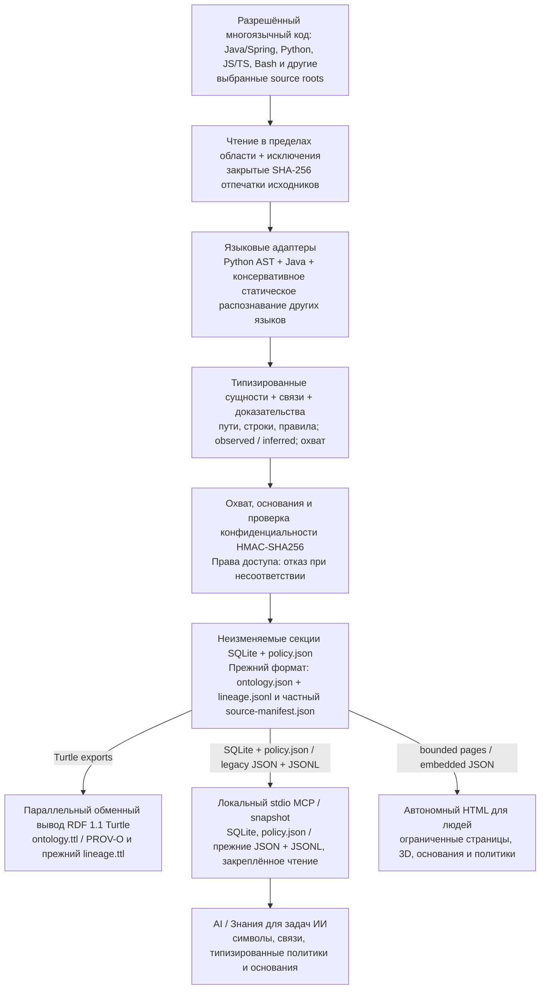

# Code Ontology Companion

[English](README.md) | [한국어](README.ko.md) | [日本語](README.ja.md) | [简体中文](README.zh-CN.md) | [Русский](README.ru.md)

Code Ontology Companion — **ранний MVP платформы конвейеров данных AI**: локальный конвейер, который превращает разрешённый многоязычный код в онтологию с основаниями и типизированные знания о политиках. Помимо Java/Spring и Python он анализирует JavaScript/TypeScript, Bash и другие языки в явно ограниченной области поддержки. Закреплённые снимки SQLite и типизированные политики передают знания ИИ через локальный MCP. Происхождение RDF экспортируется как параллельный формат обмена; люди исследуют те же знания в автономном HTML на пяти языках.

**0.9.0** · Сохраняйте выбранную GPT-6 Astra или GPT-6.1 Sol и уровень рассуждения. В Windows, macOS и Linux ИИ использует локальный MCP, а человек — автономный HTML. Полный пакет предоставляет 19 инструментов MCP только для чтения: 12 прежних и 7 конвейерных. Связанные чтения закрепляются за снимком; прежние пути крупных проектов по-прежнему ограничены одним выбранным модулем. Преимущество модели, работа на реальном устройстве и неизмеренная крупномасштабная ёмкость не заявляются.

## Рабочий процесс 0.9.0

`analyze` и `refresh` предоставляют неизменяемые секционированные снимки SQLite, повторное использование фактов неизменённых файлов, восстанавливаемую публикацию, типизированные политики, доступ по умолчанию только владельцу и ограниченные страницы HTML на пяти языках. Вопросы о политиках используют сохранённые знания без повторного чтения кода; неопределённость остаётся `UNKNOWN`. Политики Java/TypeScript ограничены чистыми функциями логических условий с явными типами. Сохраняется совместимость прежних `init`/`sync`, файлового кеша разбора, `ontology_evidence_pack` и сравнения изменений.

3D-страницы автономного HTML начинают работу в **режиме фокуса**; отдельно доступен **полный режим**. Первый уровень фокуса показывает входы в модули. Выберите элемент на карте или в списке и войдите в него, чтобы увидеть только объявленные им дочерние элементы, вплоть до уровня 4. Кнопки пути возвращают к родителю. Одна страница карты выбранной области содержит не более **60 узлов и 160 отображаемых рёбер** и на мобильном, и на настольном устройстве; остальные элементы и связи доступны через явные страницы и текстовый список. Это пределы отображения, а не анализа исходников. Прежний полный/накопительный обзор сохраняет свои пределы и подтверждение перехода на уровень 4 и глубже.

[Процесс, бюджеты и границы](docs/ru/references/v090-workflow.md)

[Руководство реализованного конвейера 0.9.0](docs/ru/PIPELINE_0_9_0.md) · [Сохранённая базовая архитектура](docs/ru/NEXT_ARCHITECTURE_0_9_0.md) — Проект фиксирует цели и будущие направления; фактическая поддержка определяется руководством реализации и результатами проверок.

## От сырых исходников к знаниям для задач AI

В рабочей области Companion детерминированный конвейер читает выбранные исходники без выполнения целевого кода. SHA-256 каждого файла остаётся в закрытом source manifest; общий отпечаток выбранной области идентифицирует снимок. Отдельно настроенный профиль HMAC-SHA256 проверяет поддерживаемый вывод.



MCP нового конвейера читает закреплённые структуру, политики и основания из запечатанных SQLite и `policy.json`. HTML для людей содержит статические страницы по 50 записей и точные якоря оснований; необходимая навигация не использует `fetch`. RDF 1.1 Turtle и PROV-O — параллельные представления для обмена и происхождения, а не исполнение RDF сервером MCP. В прежнем формате MCP продолжает читать `ontology.json` и `lineage.jsonl` рабочей области, а `graph.html` встраивает данные отображения того же JSON. Сохраняются `RelationshipEvidence` в `ontology.ttl` и ограниченное представление PROV-O в `lineage.ttl`. Качество и охват не доказывают успех выполнения или бизнес-одобрение. Ошибки конфиденциальности, доступа и целостности приводят к отказу; новый HTML и переносимый экспорт требуют частного профиля запрета идентификаторов.

Область исходного кода, версии анализатора, отпечатки и закреплённые снимки поддерживают воспроизводимость. Проверка состояния нового конвейера не перечитывает исходный код; повторную проверку выполняет `refresh`. Прежний отдельный index создаёт JSON/Turtle/report, а отдельная команда визуализации может создать HTML. Проверки онтологии, HTML, документации, пакетов и конфиденциальности отделены от проверок реального браузера и нативной ОС.

> Необязательное дополнение локальной моделью требует отдельного согласия и остаётся в закрытых `inferred` sidecar отдельно от наблюдаемых доказательств исходников. Детерминированному конвейеру модель не нужна.

**Направление платформы:** реализованы документированные многоязычные исходники, ограниченные статические связи и типизированные политики. Более широкие источники данных, полная семантика языков и неизмеренная крупномасштабная ёмкость остаются будущими проектными целями, а не завершёнными функциями.

## Применить к текущей задаче

> Примени Code Ontology Companion к этому проекту и используй его в нашей работе.

Codex проверяет доступные инструменты, использует уже разрешённую рабочую область и выполняет проверку состояния и поиск символа или зависимостей по текущей задаче. Связанные запросы используют один снимок. После существенных изменений Java/Python он обновляет снимок в разрешённых пределах и проверяет актуальность, охват и предупреждения. По умолчанию настройка действует в текущем разговоре; сохранение инструкций для проекта требует явного запроса.

> Настрой онтологию здесь для этой задачи.

Для общего запроса выбираются реально работающие Code, Context и Contracts. Code работает самостоятельно; явно названный продукт имеет приоритет. Отсутствующие продукты автоматически не устанавливаются. Context сохраняет только выбранные и подтверждённые решения или ограничения и проверяет их повторным чтением. Contracts проверяет выбранный реальный JSON обмена, сохраняя сведения о потерях, неподдерживаемых и непроверенных частях.

[Процесс применения](skills/apply-code-ontology/SKILL.md)

## Установка / Использование

[Каталог плагинов](https://chatgpt.com/plugins/plugins_6a6a23c0434c8191aec6a38bb590fd3c) · [Пакеты GitHub](https://github.com/battle-doll/code-ontology-companion/releases)

Версия исходного кода — 0.9.0. Каталог проходит отдельную проверку и публикацию, поэтому доступная версия может отличаться. Пакет навыков содержит оба навыка — применение и управление — вместе с анализатором, интерфейсом и инструкциями настройки локального MCP, но без MCP-сервера. Полный пакет GitHub также содержит stdio MCP-сервер только для чтения. Облачный адрес не требуется.

## Настоящая онтология самого плагина

[**Открыть 3D-карту →**](https://battle-doll.github.io/code-ontology-companion/)

Создана из поддерживаемого исходного кода этого плагина с указанием коммита и оснований. Выберите модуль или символ, чтобы увидеть связи и места в исходном коде. Это статический снимок. Для новой вкладки используйте Command-click или Ctrl-click.

[Происхождение снимка](https://battle-doll.github.io/code-ontology-companion/snapshot.json) · [Архитектура](docs/ARCHITECTURE_AND_ROADMAP.md)

## Возможности версии 0.9.0

- Ограниченный многоязычный конвейер, закреплённые снимки SQLite, явный частичный охват и восстанавливаемое обновление.
- Типизированные знания о политиках без перечитывания кода, MCP с контролем доступа и HTML на пяти языках с точными основаниями.
- Также сохранены следующие прежние возможности и совместимость ссылок.
- Применение к текущему разговору с реальным первым запросом и разрешёнными проверками после изменений.
- Основной офлайн-интерфейс 3D со структурой, зависимостями, изменениями и фокусировкой камеры.
- Приоритет точных символов, структурные фильтры, страницы результатов и чтение фиксированного снимка.
- Направленные пути зависимостей с основаниями каждого шага и явными ограничениями.
- Единое сравнение добавлений, удалений, изменений и их оснований.
- Типы, импорты, консервативный анализ вызовов, внедрение и сигналы прокси Java/Spring; модули, функции, вызовы и эвристические роли Python.
- Ссылки Code с сохранением исходных оснований, неизменяемые локаторы для Context и явная область совместимости Contracts.
- Клавиатура, текстовый просмотр, уменьшение движения и доступный резервный текстовый список.

## Быстрый старт

Используйте Python 3.9+ и новую рабочую область вне разрешённого исходного кода. Перед созданием HTML задайте `CODE_ONTOLOGY_PRIVACY_FILE`, указав существующий частный профиль запрета идентификаторов вне корневых каталогов исходного кода и результатов. Порядок работы и поддерживаемые границы описаны в [руководстве конвейера](docs/ru/PIPELINE_0_9_0.md).

```bash
python3 skills/manage-code-ontology/scripts/companion.py analyze --repo "/path/to/repo" --workspace "/path/outside/repo/knowledge" --authorized --language ru
python3 skills/manage-code-ontology/scripts/companion.py refresh --workspace "/path/outside/repo/knowledge" --language ru
python3 skills/manage-code-ontology/scripts/companion.py pipeline-status --workspace "/path/outside/repo/knowledge"
```

### Совместимый процесс прежнего формата

Следующие `init`/`sync`, `query`, `impact` и `diff` предназначены для прежних рабочих областей JSON; новый конвейер не преобразуется неявно.

Требуется Python 3.9+. Сначала проверьте поддержку без записи файлов. Анализируйте только собственный или разрешённый код; после согласования создаваемых материалов инициализируйте рабочую область вне репозитория.

```bash
python3 skills/manage-code-ontology/scripts/companion.py doctor --repo "/path/to/repo"
python3 skills/manage-code-ontology/scripts/companion.py preflight --repo "/path/to/repo"
```

```bash
python3 skills/manage-code-ontology/scripts/companion.py init --repo "/path/to/repo" --workspace "/path/outside/repo/ontology" --authorized
python3 skills/manage-code-ontology/scripts/companion.py query --workspace "/path/outside/repo/ontology" --term "OrderService"
python3 skills/manage-code-ontology/scripts/companion.py impact --workspace "/path/outside/repo/ontology" --symbol "OrderService" --direction incoming
python3 skills/manage-code-ontology/scripts/companion.py diff --workspace "/path/outside/repo/ontology"
```

Если в репозитории есть тесты или копии кода, явно выберите каталоги рабочего исходного кода. Повторите `--source-root` для нескольких относительных каталогов. Обновление сохраняет область; `sync --source-root .` явно возвращает анализ всего репозитория. Конфликтующие объявления из разных файлов останавливают анализ вместо объединения. Все группы доступны через поиск и страницы с переходом к элементам и связям исходного кода. Связи обзора обозначены как агрегированные, а фильтры путей являются эвристикой, не доказательством развертывания.

Глубина отображения: все модули, компоненты выбранного модуля, затем члены выбранного компонента. Остальные области свернуты. Подсветка вызовов независимо следует одному, двум или трем переходам статических CALLS. Все индексированные элементы и связи доступны через раскрытие и страницы со счетчиками свернутых и находящихся на других страницах данных, без произвольной выборки.

```bash
python3 skills/manage-code-ontology/scripts/companion.py preflight --repo "/path/to/repo" --source-root src/main
python3 skills/manage-code-ontology/scripts/companion.py sync --workspace "/path/outside/repo/ontology" --source-root src/main
```

## Основания и совместимость

Новый конвейер предоставляет SQLite, `policy.json`, RDF и ограниченные страницы HTML из одного запечатанного снимка. Описание прежнего формата: `graph.html`, `ontology.json` и `ontology.ttl` используют одну онтологию исходного кода. RDF 1.1 Turtle содержит `RelationshipEvidence`, а совместимая с PROV-O история сохраняет происхождение. `inferred` не означает проверку; `runtime_unknown` не доказывает исполнение. Доля связей с основаниями не является точностью анализа.

Code отвечает за структуру кода, Context — за решения и сроки их действия, Contracts — за проверку формата обмена. Продукты независимы. [Контракт данных ИИ](skills/manage-code-ontology/references/ai-data-contract.md) · [Обмен ссылками](skills/manage-code-ontology/references/code-reference.md).

В Context передаётся ссылка на исходный артефакт. Прямое преобразование реальных снимков в строгий формат Contracts draft пока не поддерживается; проверенная область описана в руководстве по обмену ссылками.

Существующий Ollama по `127.0.0.1:11434` используется только после отдельного согласия; предположения отделяются от наблюдений. Для детерминированного анализа модель не нужна.

## Локальный процесс для новых моделей

Сохраняйте выбранную GPT-6 Astra или GPT-6.1 Sol и уровень рассуждения. В Windows, macOS и Linux ИИ использует локальный MCP, а человек — автономный HTML. Полный пакет предоставляет 19 инструментов MCP только для чтения: 12 прежних и 7 конвейерных. Связанные чтения закрепляются за снимком; прежние пути крупных проектов по-прежнему ограничены одним выбранным модулем. Преимущество модели, работа на реальном устройстве и неизмеренная крупномасштабная ёмкость не заявляются.

[Гид на пяти языках](docs/ru/MODEL_ERA_WORKFLOW.md) · [Охват переводов](docs/TRANSLATION_COVERAGE.md)

## Операции конфиденциальности

HTML и переносимый экспорт требуют защищённый профиль запрета идентификаторов, заданный через `CODE_ONTOLOGY_PRIVACY_FILE`. Храните его вне корневых каталогов исходного кода и результатов, не публикуйте ключи и отпечатки; при отсутствии защиты экспорт отклоняется. Прежние пути без необязательного профиля не гарантируют выявление настоящих имён. Чтение знаний и экспорт разрешаются отдельно; передача ответов локального MCP удалённой модели также требует отдельного разрешения. Публичное имя разработчика — только battle-doll (배틀돌). Проверка артефактов не доказывает удаление данных внешним сервисом или глобальную конфиденциальность; эта работа не выполняет официальную отправку или публикацию.

[Операции конфиденциальности](docs/ru/PRIVACY_OPERATIONS.md)

## Лицензия и конфиденциальность

Apache-2.0. Анализатор не исполняет целевой код, не отправляет телеметрию и не делает прямых сетевых запросов. Пользовательские области остаются локальными; публичная демонстрация относится только к этому открытому репозиторию. Тела исходного кода, комментарии и секреты не сохраняются.

[Конфиденциальность](PRIVACY.md) · [Безопасность](SECURITY.md) · [Поддержка](SUPPORT.md) · [Условия](TERMS.md) · [Изменения](CHANGELOG.md)


Среди прежних 12 инструментов — `ontology_large_modules`, `ontology_large_search`, `ontology_large_neighbors`, `ontology_evidence_bundle`, `ontology_evidence_pack`. Публичная личность — только battle-doll. Неразрешённые вопросы раскрытия личных данных сохраняют статус HOLD; локальная проверка не означает разрешение внешней публикации.
