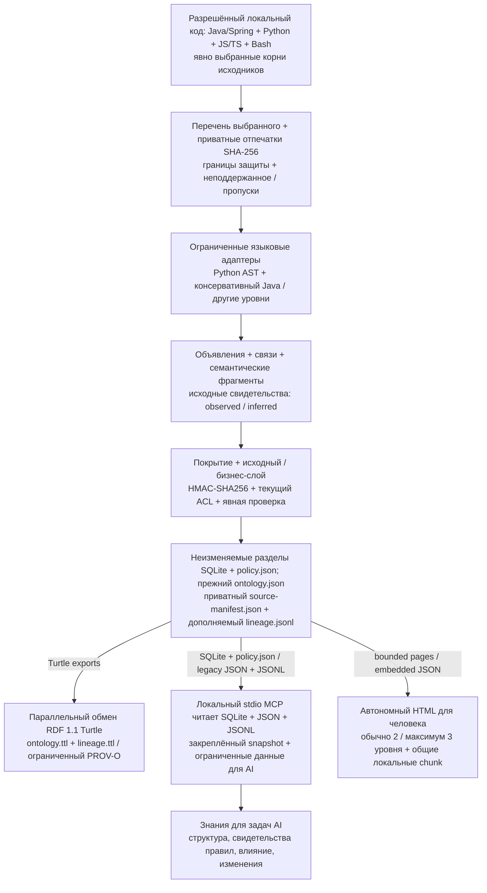

# Code Ontology Companion

[English](README.md) | [한국어](README.ko.md) | [日本語](README.ja.md) | [简体中文](README.zh-CN.md) | [Русский](README.ru.md)

Code Ontology Companion — **начальный MVP платформы конвейеров данных для ИИ**. Он превращает разрешённый локальный код в знания со связями с исходниками для ИИ и лёгкий автономный обзор для человека. Анализ статический: целевой проект не исполняется, модель и облачная служба не обязательны.

**Кандидат выпуска 0.9.3** · Разработчик: **battle-doll** · Русский, английский, корейский, японский и упрощённый китайский · Windows, macOS и Linux. Выбранные GPT-6 Astra или GPT-6.1 Sol и уровень рассуждения сохраняются; автоматического переключения нет.

## Возможности версии 0.9.3

- Выбрать каталоги исходников, учесть всю выбранную область и создать неизменяемые разделённые снимки исходного и бизнес-знания.
- Через локальный MCP только для чтения искать объявления, связи, кандидатов вызовов и семантические фрагменты, проверять привязки, ограничения поддержки, изменения и покрытие.
- Связать бизнес-понятия и типизированные свойства с исходными свидетельствами, явно проверять/отзывать утверждения и запрашивать поддерживаемые фрагменты правил с типизированным контекстом.
- Открыть автономный 3D-обзор или явно экспортировать страницы записей, переносимый SQLite/JSON-пакет и отдельный граф RDF 1.1 Turtle.

У Java/Spring, Python, JavaScript/TypeScript и Bash разные границы анализа. Другие адаптеры явно указывают поддержку объявлений/import либо частичную поддержку. Распознанный файл или выражение не означают полного понимания языка или бизнес-смысла. См. [руководство](docs/ru/PIPELINE_0_9_0.md) и [процесс качества](docs/ru/QUALITY_0_9_3.md).

## Начать со своего кода

Нужен Python 3.9 или новее. В Windows вместо `python3` можно использовать `py -3`. Выберите новую рабочую область вне дерева исходников. До HTML или переносимого экспорта задайте `CODE_ONTOLOGY_PRIVACY_FILE`: приватный профиль запрета идентифицирующих сведений вне корней исходников и экспорта. См. [настройку приватности](docs/ru/PRIVACY_OPERATIONS.md).

```sh
python3 skills/manage-code-ontology/scripts/companion.py analyze --repo /path/to/source --workspace /path/outside/source/knowledge --authorized --language ru
python3 skills/manage-code-ontology/scripts/companion.py pipeline-status --workspace /path/outside/source/knowledge
python3 skills/manage-code-ontology/scripts/companion.py pipeline-search --workspace /path/outside/source/knowledge --snapshot SNAPSHOT_ID --term Service --limit 20
```

Замените `SNAPSHOT_ID` конкретным ID из результата. Повторяйте `--source-root` у `analyze`, чтобы выбрать относительные каталоги. Результат отдельно сообщает этапы исходников, бизнес-знания и HTML. Откройте возвращённый HTML `entrypoint` напрямую через `file://`. Успех исходного снимка не гарантирует завершения следующих этапов.

После изменения кода выполните `refresh --workspace /path/outside/source/knowledge --language ru`. Выбранная область и прежние снимки сохраняются. Для одних запечатанных знаний добавьте `--no-html` к analyze/refresh. Проверка состояния читает сохранённые артефакты без повторного чтения исходников и не подтверждает их актуальность или поведение при исполнении.

В задаче ИИ можно попросить: **«Примени Code Ontology Companion здесь и используй разрешённую рабочую область»**. [Навык применения](skills/apply-code-ontology/SKILL.md) проверит доступные инструменты, выполнит первый реальный запрос и закрепит связанные чтения за одним снимком. Передача локальных ответов MCP удалённой модели требует отдельного разрешения.

## Обзор для человека, точные знания для ИИ

Публичные `analyze`, `refresh` и обычный `pipeline-html` по умолчанию используют `--presentation human`: область → основной структурный модуль → ключевой поток/свидетельства, обычно 2 уровня, максимум 3. Первая страница ограничена 32 узлами, 64 агрегированными рёбрами и 128 KiB данных. Пять языков интерфейса разделяют один набор данных; локальные script chunk загружают только выбранное представление. Первоначального разбора всех записей или полного поискового индекса нет; сеть и HTTP-сервер не нужны. Поиск относится к текущей странице.

Общий режим обобщает всю область, фокус — ограниченную выборку. Сохраняются 3D-анимация, отдельная ссылка на всю область, уменьшение движения, мобильный/текстовый вариант и управление камерой. Неизвестные группы и остаточные количества видны явно. Текущие карточки исходных правил — непрозрачные плитки свидетельств со смыслом **UNKNOWN**, а не полное изложение условий, вычислений и исключений.

Число исходных записей, результаты обработки файлов, показанные группы/узлы и ссылки на свидетельства имеют разные единицы. Скрытая группа не означает потерю записи онтологии; число удержанных ради приватности связей не равно числу людей или целых записей. Обзор не меняет покрытие онтологии/MCP. Нативные браузеры/ОС и ёмкость для нагрузки проверяются отдельно.

Для точных глубоких данных используйте MCP. `--presentation records` сохраняет полное представление записей. Старые и явные разделённые маршруты остаются, а у бизнес-HTML отдельные контракты проекции. Чтобы вывести существующий снимок в новый каталог:

```sh
python3 skills/manage-code-ontology/scripts/companion.py pipeline-html --workspace /path/outside/source/knowledge --snapshot SNAPSHOT_ID --output /path/to/new-html --language ru
```

## От локального кода к полезным знаниям



Исходный слой сохраняет объявления, свидетельства и ограничения; бизнес-слой добавляет связанные с кодом понятия, типизированные свойства и явные состояния проверки. `observed`, `inferred` и `runtime_unknown` различаются. Точные вызовы, кандидаты и неразрешённые вызовы учитываются отдельно; неразрешённые не исчезают и не становятся точными автоматически. Передачи через конструкторы/компоненты, вызывающие/предоставляющие стороны и helper — ограниченные структурные свидетельства, а не готовый бизнес-смысл или значения исполнения.

Перечень выбранного, объявления/типы, точные вызовы, смысл правил, доставка MCP и текст политики имеют отдельные знаменатели. Неподдержанное, пропуски, сокрытие, PARTIAL и UNKNOWN остаются видимыми. До написания текста свяжите с доказательствами необходимые условия, AND/OR, состояния/эффекты, единицы, формулы, округление, исключения, полномочия, владение и границы времени; неподтверждённое оставьте UNKNOWN. Повторяемый цикл: таблица фактов → проверка покрытия/смысла → допустимые исправления или явная проверка → новый снимок → закреплённые запросы. Таблица или небольшой HTML-обзор не доказывают полноту текста политики.

Снимки связаны с отпечатками исходников, спецификациями анализа и хешами артефактов. Приватный `source-manifest.json` и дополняемый `lineage.jsonl` поддерживают локальные проверки; `lineage.ttl` использует ограниченное подмножество PROV-O. RDF `RelationshipEvidence` и проверка формы не удостоверяют истину, полное восстановление исходников, всю цепочку происхождения, личность человека или успех исполнения. MCP читает запечатанные SQLite/JSON/JSONL, а не ветку RDF. Прежний маршрут `graph.html` / `ontology.json` / `ontology.ttl` сохраняется отдельно.

## Бизнес-правила и варианты экспорта

Бизнес-знание связано с исходниками и типизировано. Одобрение/отзыв и текущие pin исходного/бизнес-снимка проверяются отдельно от извлечения. `verified_implemented` не равно `approved_business`; `DECLARED` не доказывает принуждение в коде. Для поддерживаемого статического вычисления нужны явный контекст и полные поддерживаемые входы. Нехватка контекста, неоднозначная композиция, неподдержанные эффекты и неизвестные единицы остаются UNKNOWN. Совпадение кода или сырой IR не подтверждают полномочия и бизнес-корректность.

По умолчанию `business-html` сохраняет прежнее представление с потерями `business_only`. Явное `--projection policy_projection` с `read_policy` и `export_html` сохраняет точное разрешённое представление правил MCP: выбранные ID, исходные кандидаты, типизированные соответствия, UNKNOWN и агрегированные привязки снимков:

```sh
python3 skills/manage-code-ontology/scripts/companion.py business-html --workspace /path/outside/source/knowledge --snapshot SNAPSHOT_ID --business-snapshot BUSINESS_ID --business-digest BUSINESS_DIGEST --output /path/to/new-policy-view --projection policy_projection
```

Обычная проекция ограничена 10,000 записями и 1 GiB. Для большего бизнес-снимка schema2 явно добавьте `--partitioned --partition-size 10000`: физические окна сохраняют исходный знаменатель и соблюдают доверенный бюджет рабочей области. Нужен совместимый изолированный Python/SQLite; `--export-python PATH` выбирает уже доверенный интерпретатор без автоматического поиска/установки. Лимит выделений SQLite 128 MiB не является лимитом всей памяти процесса. При нехватке ресурсов сохраняются незавершённые количества/границы; успешное хранение не означает полной бизнес-семантики.

`pipeline-html --presentation records --partitioned` выбирает прежний разделённый source atlas/маршрут записей. `pipeline-export` создаёт разрешённый переносимый пакет. SQLite/JSON хранит все разрешённые записи; RDF — определённая проекция, не универсальное восстановление без потерь. Права, лимиты и правила сокрытия каждого экспорта сохраняются. Неподписанные копии не удостоверяют издателя, не разрешают публикацию и не отзываются удалённо.

## Локальная установка и совместимость

[Пакеты GitHub](https://github.com/battle-doll/code-ontology-companion/releases) · [Страница каталога](https://chatgpt.com/plugins/plugins_6a6a23c0434c8191aec6a38bb590fd3c) · [Настройка локального MCP](skills/manage-code-ontology/references/local-mcp.md)

Полный пакет содержит stdio MCP-сервер только для чтения: 12 прежних и 8 конвейерных инструментов, всего 20. **Skills-only** содержит навыки применения/управления, анализатор, workbench и инструкции настройки, но не MCP-сервер. Облачный endpoint не требуется. Доступность/версия каталога проходит отдельное рассмотрение; этот кандидат не заявляет официальную подачу, одобрение, поддержку или право на подачу.

Рабочие области `init`/`sync`, `query`, `impact`, `diff` не преобразуются автоматически. Прежние инструменты крупных запросов: `ontology_large_modules`, `ontology_large_search`, `ontology_large_neighbors`, `ontology_evidence_bundle`, `ontology_evidence_pack`. Code отвечает за структуру кода; необязательные Context и Contracts сохраняют свои роли и проверенные пределы совместимости. [Современный процесс](docs/ru/MODEL_ERA_WORKFLOW.md) · [Обмен ссылками](skills/manage-code-ontology/references/code-reference.md).

Использование существующего Ollama `127.0.0.1:11434` требует отдельного согласия. Предложения остаются в `inferred` sidecar вне наблюдаемых свидетельств. Детерминированный анализ не требует установки или автоматической смены модели.

## Приватность и границы доверия

Разрешение локального анализа, ACL, проверка знаний и разрешение публикации независимы. Текущие проверки ACL/профиля/привязок обязательны. Личные данные и зарегистрированные защищённые значения нельзя разрешить одобрением администратора, псевдонимом, `manage_knowledge` или основанием проверки. Не публикуйте ключи HMAC-SHA256 и защищённые отпечатки. Без необходимой защиты или проверенной публичной идентичности сохраняется **HOLD**; публичный псевдоним разработчика — только **battle-doll**.

Комментарии/литералы по умолчанию непрозрачны. Явные приватные разрешения occurrence могут сохранять допустимые локальные свидетельства, но не дают семантического одобрения, силы инструкции или права публикации. Отзыв действует на последующие разрешённые чтения, не удаляет уже экспортированные копии. Анализатор не исполняет целевой код, не отправляет telemetry или прямые сетевые запросы. Хост может передавать выбранные ответы MCP: получателей нужно разрешать отдельно.

## Подробнее

[Процесс качества](docs/ru/QUALITY_0_9_3.md) · [Покрытие](docs/ru/COVERAGE_0_9_2.md) · [Конвейер](docs/ru/PIPELINE_0_9_0.md) · [Публичная демонстрация собственной онтологии](https://battle-doll.github.io/code-ontology-companion/) · [Переводы](docs/TRANSLATION_COVERAGE.md)

Apache-2.0 · [Приватность](PRIVACY.md) · [Безопасность](SECURITY.md) · [Поддержка](SUPPORT.md) · [Условия](TERMS.md) · [История](CHANGELOG.md)
