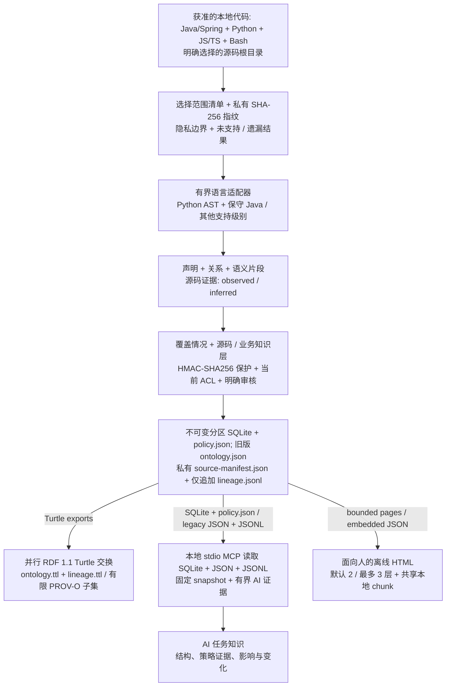

# Code Ontology Companion

[English](README.md) | [한국어](README.ko.md) | [日本語](README.ja.md) | [简体中文](README.zh-CN.md) | [Русский](README.ru.md)

Code Ontology Companion 是 **AI 数据管道平台的初始 MVP**，将获准的本地代码转换为供 AI 查询、与源码关联的知识，以及供人阅读的轻量离线概览。它进行静态分析，不执行目标项目，也不要求模型或云服务。

**0.9.3 发布候选版本** · 开发者：**battle-doll** · 简体中文、英语、韩语、日语、俄语 · Windows、macOS、Linux。保留用户选择的 GPT-6 Astra 或 GPT-6.1 Sol 及推理强度，不自动切换。

## 版本 0.9.3 的支持功能

- 选择源码目录，登记完整选择范围，生成不可变的分区源码及业务知识快照。
- 通过本地只读 MCP 查询声明、关系、调用候选、语义片段及其源码绑定、支持边界、变化和覆盖情况。
- 将业务概念和类型化属性关联到源码证据，明确审核或撤销声明，并使用类型化上下文查询受支持的策略片段。
- 打开离线 3D 概览，或明确导出记录页面、可移植 SQLite/JSON 包及独立的 RDF 1.1 Turtle 图。

Java/Spring、Python、JavaScript/TypeScript、Bash 的支持范围不同。其他适配器也有明确的声明/import 或部分支持级别。识别文件或表达式不代表完整理解语言或业务含义。参见[实现指南](docs/zh-CN/PIPELINE_0_9_0.md)和[质量流程](docs/zh-CN/QUALITY_0_9_3.md)。

## 从自己的代码开始

使用 Python 3.9 或更高版本。Windows 可用 `py -3` 替代 `python3`。在源码树外选择新的知识工作区。生成 HTML 或可移植导出前，将源码及输出根目录之外的私有身份信息拒绝配置设为 `CODE_ONTOLOGY_PRIVACY_FILE`；参见[隐私设置](docs/zh-CN/PRIVACY_OPERATIONS.md)。

```sh
python3 skills/manage-code-ontology/scripts/companion.py analyze --repo /path/to/source --workspace /path/outside/source/knowledge --authorized --language zh-CN
python3 skills/manage-code-ontology/scripts/companion.py pipeline-status --workspace /path/outside/source/knowledge
python3 skills/manage-code-ontology/scripts/companion.py pipeline-search --workspace /path/outside/source/knowledge --snapshot SNAPSHOT_ID --term Service --limit 20
```

将 `SNAPSHOT_ID` 换成结果中的具体 ID。可重复使用 `analyze --source-root` 选择相对源码目录。结果分别报告源码、业务、HTML 阶段；用 `file://` 直接打开返回的 HTML `entrypoint`。源码生成成功并不代表后续业务或 HTML 阶段也已完成。

修改代码后运行 `refresh --workspace /path/outside/source/knowledge --language zh-CN`，保留所选范围及历史快照。只需要封存知识时，为 analyze/refresh 添加 `--no-html`。状态查询只检查已保存产物，不重新读取源码，因此不能证明源码当前性或运行行为。

可向 AI 说明：**“在此任务中应用 Code Ontology Companion，使用我授权的工作区。”** [应用技能](skills/apply-code-ontology/SKILL.md)会检查工具是否可用、执行真实首次查询，并将相关读取固定到同一快照。本地 MCP 结果传给远程模型需要单独授权。

## 面向人的概览与面向 AI 的精确知识

公开的 `analyze`、`refresh`、普通 `pipeline-html` 默认采用 `--presentation human`：领域 → 主要结构模块 → 核心流程/证据，默认 2 层、最多 3 层。首屏不超过 32 个节点、64 条聚合边、128 KiB 数据。五种界面语言共用一套数据，只通过本地 script chunk 加载所选视图。不在首次加载时解析全部记录或完整搜索索引，无需网络或 HTTP 服务。搜索仅覆盖当前页面。

全局模式概括完整范围，聚焦模式展示有界选择。保留 3D 动画、独立的全范围链接、减少动态效果、移动/文本备用视图及相机控制。未分类和剩余数量明确显示。目前源码策略卡片是不透明证据块，其含义为 **UNKNOWN**，不是完整叙述条件、计算和例外的策略说明。

原始源码记录数、文件处理结果、显示组/节点数、证据引用数使用不同单位。隐藏分组不等于本体遗漏；因隐私而保留的关系数量不是人数或整条记录数。摘要选择不改变本体/MCP 覆盖情况。原生浏览器/OS 与工作负载容量需另行验证。

深入、精确查询使用 MCP。`--presentation records` 保留完整记录展示。旧格式、显式分区路径及业务 HTML 独立投影契约仍然保留。将现有快照输出到新目录：

```sh
python3 skills/manage-code-ontology/scripts/companion.py pipeline-html --workspace /path/outside/source/knowledge --snapshot SNAPSHOT_ID --output /path/to/new-html --language zh-CN
```

## 从本地代码到可用知识



源码层保留声明、证据与限制；业务层补充源码关联概念、类型化属性及明确审核状态。区分 `observed`、`inferred`、`runtime_unknown`。确定调用、候选调用、未解析调用保留独立状态，不悄然删除或升级未解析项。构造器/组件、调用方/提供方、helper 传递仅是有限结构证据，不自动完成策略含义或运行值。

所选清单、声明/类型、确定调用、策略语义、MCP 交付、策略文档分别保留分母。未支持、遗漏、隐去、PARTIAL、UNKNOWN 均保持可见。写策略文字前，把必要条件、AND/OR、状态/效果、单位、公式、舍入、例外、权限、所有权及时间边界对应到证据；未证明的含义保持 UNKNOWN。可重复流程是证据工作表 → 覆盖/含义检查 → 支持范围内修正或明确审核 → 新快照 → 固定查询。工作表或简短 HTML 不证明策略文档完整。

快照绑定源码指纹、分析规格及产物哈希。私有 `source-manifest.json`、仅追加的 `lineage.jsonl` 支持本地核查；`lineage.ttl` 使用有限 PROV-O 子集。RDF `RelationshipEvidence` 与形状验证不认证事实、全源码重建、完整谱系、人的身份或运行成功。MCP 读取封存的 SQLite/JSON/JSONL，不读取 RDF 分支。旧版 `graph.html` / `ontology.json` / `ontology.ttl` 流程独立保留。

## 策略知识与导出选择

业务知识关联源码并保留类型。批准/撤销、当前源码/业务快照 pin 与提取分开检查。`verified_implemented` 不等于 `approved_business`；`DECLARED` 不证明源码已强制执行。受支持的静态策略计算也要求明确上下文及完整受支持输入。缺失上下文、组合歧义、未支持效果、不明单位保持 UNKNOWN。源码匹配或原始 IR 不证明权限及业务正确性。

`business-html` 默认保留已有的有损 `business_only` 视图。显式 `--projection policy_projection` 在 `read_policy` 和 `export_html` 权限下，保留精确的授权 MCP 策略视图，包括所选 ID、源码候选、类型映射、UNKNOWN、聚合快照绑定：

```sh
python3 skills/manage-code-ontology/scripts/companion.py business-html --workspace /path/outside/source/knowledge --snapshot SNAPSHOT_ID --business-snapshot BUSINESS_ID --business-digest BUSINESS_DIGEST --output /path/to/new-policy-view --projection policy_projection
```

普通策略投影上限为 10,000 条记录、1 GiB。较大的 schema2 业务快照需显式添加 `--partitioned --partition-size 10000`；物理窗口保留原始选择分母，并遵守可信工作区预算。隔离工作进程要求兼容 Python/SQLite，可用 `--export-python PATH` 指定已信任的解释器，不自动发现或安装。SQLite 分配上限 128 MiB 不代表整个进程内存上限。资源失败保留未完成数量/边界；保存完成不等于业务语义完整。

`pipeline-html --presentation records --partitioned` 使用已有分区源码 atlas/记录路径。`pipeline-export` 创建授权可移植包。SQLite/JSON 保留全部授权记录；RDF 是定义好的投影，不是通用无损重建。每种导出仍受各自权限、上限和隐去规则约束。未签名副本不能认证发布者、授予公开权限或远程撤销既有副本。

## 本地安装与兼容性

[GitHub 包](https://github.com/battle-doll/code-ontology-companion/releases) · [目录条目](https://chatgpt.com/plugins/plugins_6a6a23c0434c8191aec6a38bb590fd3c) · [本地 MCP 设置](skills/manage-code-ontology/references/local-mcp.md)

完整包包含只读 stdio MCP 服务器，共有旧版 12 个+管道 8 个，合计 20 个工具。**Skills-only** 包含应用/管理技能、分析器、workbench、设置指南，不包含 MCP 服务器。无需云端 endpoint。目录可用版本有独立审核流程；此源码候选不声称已正式提交、批准、获背书或具备提交资格。

旧的 `init`/`sync`、`query`、`impact`、`diff` 工作区不自动转换。旧版大规模查询工具包括 `ontology_large_modules`、`ontology_large_search`、`ontology_large_neighbors`、`ontology_evidence_bundle`、`ontology_evidence_pack`。Code 负责源码结构；可选 Context、Contracts 保持各自职责及已验证兼容范围。[模型时代流程](docs/zh-CN/MODEL_ERA_WORKFLOW.md) · [引用交换](skills/manage-code-ontology/references/code-reference.md)。

使用已有 Ollama `127.0.0.1:11434` 需单独同意；建议保存在观测证据之外的 `inferred` sidecar。确定性分析不需要安装模型或自动切换模型。

## 隐私与信任边界

本地分析许可、ACL、知识审核和公开许可相互独立。必须保留当前 ACL/配置/绑定检查。个人信息与已登记保护值不能通过管理员批准、别名、`manage_knowledge` 或审核理由绕过。不要公开 HMAC-SHA256 配置密钥及保护指纹。缺少必要保护或无法验证公开身份时保持 **HOLD**；公开开发者别名仅为 **battle-doll**。

注释/字面量默认不透明。明确的私有 occurrence 许可可保留获准的本地证据，但不代表语义批准、指令权限或公开许可。撤销适用于后续授权读取，无法删除已导出副本。分析器不执行目标代码、不发送 telemetry 或直接网络请求。宿主可能转发选定 MCP 结果，接收方需另行授权。

## 更多资料

[质量流程](docs/zh-CN/QUALITY_0_9_3.md) · [覆盖情况](docs/zh-CN/COVERAGE_0_9_2.md) · [管道指南](docs/zh-CN/PIPELINE_0_9_0.md) · [公开自身本体演示](https://battle-doll.github.io/code-ontology-companion/) · [翻译覆盖](docs/TRANSLATION_COVERAGE.md)

Apache-2.0 · [隐私](PRIVACY.md) · [安全](SECURITY.md) · [支持](SUPPORT.md) · [条款](TERMS.md) · [变更记录](CHANGELOG.md)
