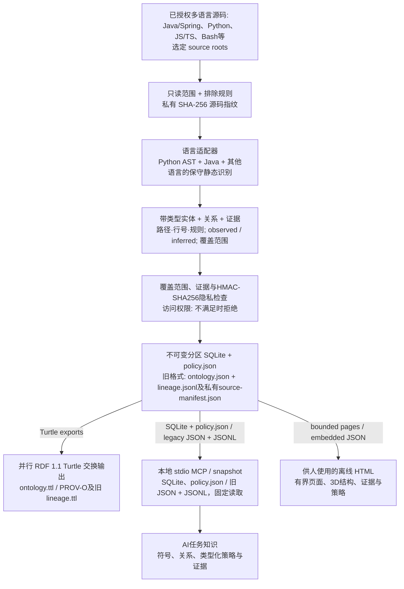

# Code Ontology Companion

[English](README.md) | [한국어](README.ko.md) | [日本語](README.ja.md) | [简体中文](README.zh-CN.md) | [Русский](README.ru.md)

Code Ontology Companion 是 **AI数据流水线平台的早期MVP**，通过本地流水线将已授权的多语言代码转为有证据的本体和类型化策略知识。在明确的部分支持范围内分析Java/Spring、Python、JavaScript/TypeScript、Bash等代码。固定SQLite快照与类型化策略通过本地MCP为AI提供知识；RDF血缘作为并行交换格式导出，人使用同一知识生成的五语言离线HTML。

**0.9.0** · 保留所选 GPT-6 Astra 或 GPT-6.1 Sol 模型及推理强度。Windows、macOS、Linux上，AI使用本地MCP，人使用离线HTML。完整包提供19个只读MCP工具：原有12个加流水线7个。相关读取固定快照，旧大型项目路径仍限于选定单个模块。不声称已证明模型优势、原生设备运行或未经测量的大规模容量。

## 0.9.0 工作流程

`analyze`与`refresh`提供不可变分区SQLite快照、未变更文件事实复用、可恢复发布、类型化策略、默认所有者访问权限，以及五语言有界HTML页面。策略问答使用已存储知识，不重读源代码，未确认信息保持`UNKNOWN`。Java/TypeScript策略限于具有显式类型的纯布尔条件函数。原有`init`/`sync`、逐文件解析缓存、`ontology_evidence_pack`和变更比较继续兼容。

离线HTML中的3D页面默认进入**聚焦模式**，同时提供独立的**全图模式**。聚焦第 1 级显示模块入口；在地图或列表中选择并进入某项后，仅显示该项声明的子项，最多 4 级。路径按钮可以返回父级。移动端与桌面端的每个聚焦地图页面均最多显示 **60 个节点和 160 条边**；其他项目与关系可通过明确分页和文本列表访问。这是显示上限，不是源码分析上限。既有全图与累积探索保留各自限制以及第 4 级及更深层级的确认操作。

[工作流程、预算与支持边界](docs/zh-CN/references/v090-workflow.md)

[已实现的0.9.0流水线指南](docs/zh-CN/PIPELINE_0_9_0.md) · [保留的设计基线](docs/zh-CN/NEXT_ARCHITECTURE_0_9_0.md) — 设计记录目标与后续方向，实际支持范围以实现指南和验证记录为准。

## 从原始源码到AI任务知识

Companion工作区的确定性流水线读取选定源码，不执行目标代码。每文件SHA-256保存在私有source manifest中，选定范围的综合指纹用于标识快照。另行配置的HMAC-SHA256身份配置检查受支持的输出。



新流水线的MCP从已封存SQLite和`policy.json`读取固定的结构、策略和证据。人用HTML采用每页50条记录的静态页面和精确证据锚点，必要导航不使用`fetch`。RDF 1.1 Turtle与PROV-O是并行的交换和血缘表示，不表示MCP执行RDF。旧格式仍由MCP读取`ontology.json`与工作区`lineage.jsonl`，并在`graph.html`嵌入同一JSON的显示数据；保留`ontology.ttl`的`RelationshipEvidence`和`lineage.ttl`的受限PROV-O表示。质量与覆盖范围不证明运行成功或业务批准。隐私、权限或完整性检查失败时拒绝输出；新的HTML和可移植导出必须使用私有身份配置。

源范围、分析器版本、源指纹和固定快照支撑可复现性。新流水线状态检查不重读源代码，`refresh`才重新验证。旧独立index仍生成JSON/Turtle/report，可用单独可视化命令生成HTML。本体、HTML、文档、包和隐私检查与真实浏览器、原生OS验证分开记录。

> 可选本地模型补充需单独同意，并保留在与观测源码证据分开的私有 `inferred` sidecar中。确定性流水线不需要模型。

**平台扩展方向：** 当前实现处理已文档化的多语言代码、有界静态关系和类型化策略。更广泛的数据源、完整语言语义和未实测的大规模容量属于后续设计目标，不代表已经实现。

## 应用于当前任务

> 在这个项目中应用 Code Ontology Companion，协助我们接下来的工作。

Codex 检查实际可运行的工具，复用已授权的工作区，先执行状态检查以及相关符号检索或影响查询。相关查询使用同一快照。重要的 Java/Python 变更后，在授权范围内刷新，并报告新鲜度、分析范围和警告。默认仅用于当前对话；只有明确要求时才保存项目级指引。

> 在这里为当前任务设置本体。

对于一般请求，它选择 Code、Context 和 Contracts 中实际可运行的产品。Code 可以单独使用，明确指定的产品优先；不会自动安装缺少的产品。Context 只保存用户选择并确认的决策或约束，再次读取以核对；Contracts 检查选定的实际交换 JSON，并保留未支持、信息损失及未检查的结果。

[应用流程](skills/apply-code-ontology/SKILL.md)

## 安装 / 使用

[插件目录](https://chatgpt.com/plugins/plugins_6a6a23c0434c8191aec6a38bb590fd3c) · [GitHub 软件包](https://github.com/battle-doll/code-ontology-companion/releases)

此源码版本为0.9.0。目录有单独的审核与发布流程，因此可用版本可能不同。官方技能包包含应用与管理两项技能、分析器、界面及本地 MCP 设置说明，不包含MCP服务器；GitHub 完整包还包含只读stdio MCP服务器。无需云端接口。

## 探索真实的自身本体

[**打开3D探索器 →**](https://battle-doll.github.io/code-ontology-companion/)

由本插件自身受支持的源码生成，提供对应提交和证据。选择模块与符号即可查看连接和源码位置。界面呈现静态快照。按住Command或Ctrl点击可在新标签页打开。

[快照来源](https://battle-doll.github.io/code-ontology-companion/snapshot.json) · [架构](docs/zh-CN/ARCHITECTURE_AND_ROADMAP.md)

## 版本 0.9.0 的支持功能

- 有界多语言流水线、固定SQLite快照、明确部分覆盖和可恢复更新。
- 无需重读源代码的类型化策略知识、有权限控制的MCP、带精确证据的五语言HTML页面。
- 同时保留以下旧功能及引用兼容性。
- 在当前对话中执行首次实际查询，并衔接变更后的授权刷新和状态检查。
- 以3D为主的离线结构、影响和变更视图，带相机聚焦和渐进探索。
- 精确符号优先检索、结构筛选、分页以及固定快照读取。
- 按方向追踪依赖路径，提供每一步的证据和明确的遍历限制。
- 统一比较新增、删除、修改以及证据变化。
- Java/Spring 类型、导入、保守调用解析、注入和代理信号；Python 模块、函数、调用和流水线角色启发式分析。
- 保留原始证据的Code引用、供Context使用的不可变定位符，以及明确的Contracts兼容范围。
- 键盘与文本探索、减少动态效果和安全的文本备用列表。

## 快速开始

使用Python 3.9+，在已授权源代码之外创建新工作区。生成HTML前，将`CODE_ONTOLOGY_PRIVACY_FILE`设置为已有的私有身份拒绝配置，并放在源代码和输出根目录之外。步骤和支持范围见[流水线指南](docs/zh-CN/PIPELINE_0_9_0.md)。

```bash
python3 skills/manage-code-ontology/scripts/companion.py analyze --repo "/path/to/repo" --workspace "/path/outside/repo/knowledge" --authorized --language zh-CN
python3 skills/manage-code-ontology/scripts/companion.py refresh --workspace "/path/outside/repo/knowledge" --language zh-CN
python3 skills/manage-code-ontology/scripts/companion.py pipeline-status --workspace "/path/outside/repo/knowledge"
```

### 旧格式兼容流程

以下`init`/`sync`、`query`、`impact`和`diff`针对旧JSON工作区，不会悄悄转换新的流水线。

需要 Python 3.9+。首先在不写入文件的情况下检查支持范围。仅分析自己拥有或已获授权的代码；确认拟生成的资料后，在代码库之外初始化工作区。

```bash
python3 skills/manage-code-ontology/scripts/companion.py doctor --repo "/path/to/repo"
python3 skills/manage-code-ontology/scripts/companion.py preflight --repo "/path/to/repo"
```

```bash
python3 skills/manage-code-ontology/scripts/companion.py init --repo "/path/to/repo" --workspace "/path/outside/repo/ontology" --authorized
python3 skills/manage-code-ontology/scripts/companion.py query --workspace "/path/outside/repo/ontology" --term "OrderService"
python3 skills/manage-code-ontology/scripts/companion.py impact --workspace "/path/outside/repo/ontology" --symbol "OrderService" --direction incoming
python3 skills/manage-code-ontology/scripts/companion.py diff --workspace "/path/outside/repo/ontology"
```

仓库包含测试或代码副本时，请明确选择生产源码目录。多个相对目录可重复使用 `--source-root`。刷新会保留范围，`sync --source-root .` 可明确恢复全仓库发现。不同文件的冲突声明会停止分析而非合并。可通过搜索和分页找到所有分组，再展开成员和源码关系。概览连接明确标为聚合，路径筛选属于推断，不是部署证据。

显示深度分为全部模块、所选模块的组件、所选组件的成员三层，其他区域保持折叠。调用高亮独立沿静态 CALLS 的1、2、3跳路径计算。不随意抽样；通过展开和分页可访问索引中的全部元素与关系，并显示折叠和其他页面的数量。

```bash
python3 skills/manage-code-ontology/scripts/companion.py preflight --repo "/path/to/repo" --source-root src/main
python3 skills/manage-code-ontology/scripts/companion.py sync --workspace "/path/outside/repo/ontology" --source-root src/main
```

## 证据与兼容性

新流水线从同一封存快照提供SQLite、`policy.json`、RDF和有界HTML页面。以下为旧格式说明：`graph.html`、`ontology.json` 和 `ontology.ttl` 使用同一源码本体。RDF 1.1 Turtle 的 `RelationshipEvidence` 与 PROV-O 谱系保留证据历史。`inferred` 不等于已验证，`runtime_unknown` 不是执行证明。证据附加率不是分析准确率。

Code负责代码结构，Context负责决策及有效时间，Contracts验证受支持的交换格式。各产品可以独立使用。[AI数据契约](skills/manage-code-ontology/references/ai-data-contract.md) · [引用交换](skills/manage-code-ontology/references/code-reference.md)。

向 Context 传递的是原始制品引用。真实快照尚不支持直接转换为严格的 Contracts draft；已验证范围见引用交换指南。

现有 Ollama `127.0.0.1:11434` 仅在单独同意后使用，建议与观测证据分开保存。确定性分析无需模型。

## 新模型环境的本地工作流

保留所选 GPT-6 Astra 或 GPT-6.1 Sol 模型及推理强度。Windows、macOS、Linux上，AI使用本地MCP，人使用离线HTML。完整包提供19个只读MCP工具：原有12个加流水线7个。相关读取固定快照，旧大型项目路径仍限于选定单个模块。不声称已证明模型优势、原生设备运行或未经测量的大规模容量。

[5语言使用指南](docs/zh-CN/MODEL_ERA_WORKFLOW.md) · [翻译覆盖](docs/TRANSLATION_COVERAGE.md)

## 隐私操作

HTML和可移植导出要求使用`CODE_ONTOLOGY_PRIVACY_FILE`指定的受保护身份拒绝配置。将其放在源代码和输出根目录之外，不公开密钥或指纹；缺少保护时拒绝导出。旧流程若不使用可选配置，则不能保证实名检测。知识读取和导出分别授权，宿主将本地MCP响应转发给远程模型仍需另行许可。公开开发者名称仅为battle-doll（배틀돌）。产物检查不代表外部服务已删除信息，也不保证全局隐私清除；本次工作不执行官方提交或发布。

[隐私操作](docs/zh-CN/PRIVACY_OPERATIONS.md)

## 许可与隐私

Apache-2.0。分析器不会执行目标代码、发送遥测或直接发起网络请求。用户工作区保持本地；公开演示仅发布这个公开代码库的资料。不保留源码正文、注释或秘密信息。

[隐私](PRIVACY.md) · [安全](SECURITY.md) · [支持](SUPPORT.md) · [条款](TERMS.md) · [更新记录](CHANGELOG.md)


既有12个工具包括 `ontology_large_modules`、`ontology_large_search`、`ontology_large_neighbors`、`ontology_evidence_bundle`、`ontology_evidence_pack`。公开身份仅为 battle-doll。尚未解决的公开隐私问题保持 HOLD；本地检查通过不代表外部发布批准。
