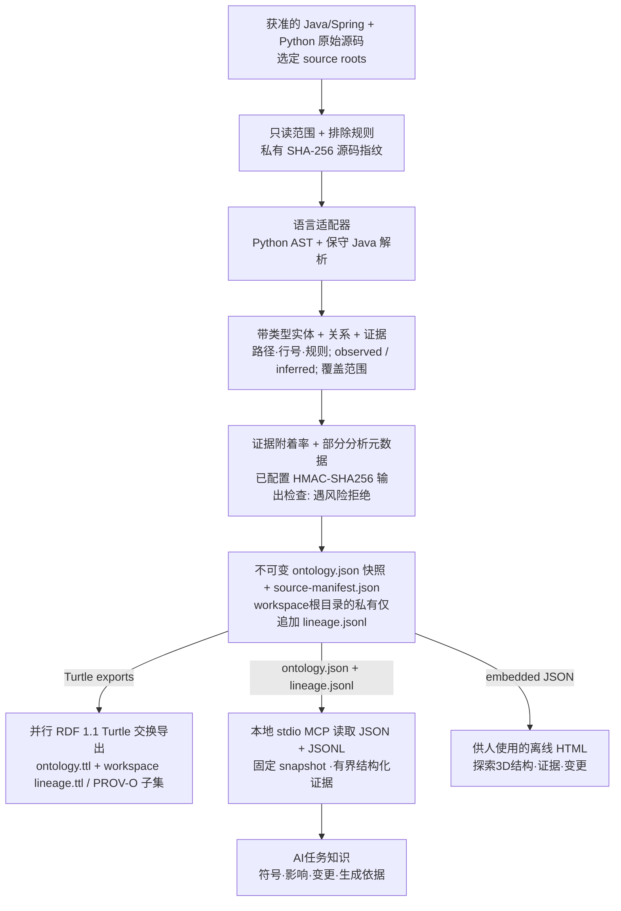

# Code Ontology Companion

[English](README.md) | [한국어](README.ko.md) | [日本語](README.ja.md) | [简体中文](README.zh-CN.md) | [Русский](README.ru.md)

Code Ontology Companion 是 **AI数据流水线平台的早期MVP**，以本地流水线将获准的 Java/Spring、Python 原始源码生成本体。它创建带类型实体、有证据的关系和快照谱系，导出RDF标准文件，并通过本地 MCP 为AI任务提供有界源码知识。人使用同一本体生成的离线3D HTML进行探索。

**0.8.1** · 保留所选 GPT-6 Astra 或 GPT-6.1 Sol 模型及推理强度。在 Windows、macOS、Linux 上，AI使用本地 MCP 证据，人使用离线 HTML。完整包保留原7个工具并增加 `ontology_large_modules`、`ontology_large_search`、`ontology_large_neighbors`、`ontology_evidence_bundle`，共11个有界只读工具。相关读取固定快照，大型项目路径限于选定单个模块。不声称已证明模型优势或运行成功。

## 从原始源码到AI任务知识

Companion工作区的确定性流水线读取选定源码，不执行目标代码。每文件SHA-256保存在私有source manifest中，选定范围的综合指纹用于标识快照。另行配置的HMAC-SHA256身份配置检查受支持的输出。



`ontology.ttl` 用RDF 1.1 Turtle导出带类型代码图及 `RelationshipEvidence`。workspace的 `lineage.ttl` 用有界PROV-O子集将journal记录表示为信息Entity，将已校对本地snapshot build表示为Activity/Source/Snapshot生成关系。依据是存储的snapshot metadata及source manifest，不证明完整谱系、人员归属或运行成功。MCP读取 `ontology.json` 和workspace的 `lineage.jsonl`，返回AI任务所需的选定结构化证据。人用的 `graph.html` 也内嵌同一JSON本体生成的portable payload。质量及部分分析诊断不会自动拒绝快照，也不等于准确率或实际执行证据。隐私拒绝或分析期间源码变化会停止输出或快照确认；缺少可选身份配置时不能检测实名。

保留的源码范围、分析器版本、分析前后指纹和仅追加谱系支持全流水线的可重现性。本体质量、HTML、文档、包和隐私回归属于独立发行验证。图中展示Companion流程；独立index生成JSON/Turtle/report，HTML由单独可视化命令生成。

> 可选本地模型补充需单独同意，并保留在与观测源码证据分开的私有 `inferred` sidecar中。确定性流水线不需要模型。

**平台扩展方向:** 增加输入适配器及明确的转换/服务契约。已实现MVP的输入仍为Java/Spring和Python代码，更广泛数据平台功能与当前实现分开描述。

## 应用于当前任务

> 在这个项目中应用 Code Ontology Companion，协助我们接下来的工作。

Codex 检查实际可运行的工具，复用已授权的工作区，先执行状态检查以及相关符号检索或影响查询。相关查询使用同一快照。重要的 Java/Python 变更后，在授权范围内刷新，并报告新鲜度、分析范围和警告。默认仅用于当前对话；只有明确要求时才保存项目级指引。

> 在这里为当前任务设置本体。

对于一般请求，它选择 Code、Context 和 Contracts 中实际可运行的产品。Code 可以单独使用，明确指定的产品优先；不会自动安装缺少的产品。Context 只保存用户选择并确认的决策或约束，再次读取以核对；Contracts 检查选定的实际交换 JSON，并保留未支持、信息损失及未检查的结果。

[应用流程](skills/apply-code-ontology/SKILL.md)

## 安装 / 使用

[插件目录](https://chatgpt.com/plugins/plugins_6a6a23c0434c8191aec6a38bb590fd3c) · [GitHub 软件包](https://github.com/battle-doll/code-ontology-companion/releases)

此源码版本为0.8.1。目录有单独的审核与发布流程，因此可用版本可能不同。官方技能包包含应用与管理两项技能、分析器、界面及本地 MCP 设置说明，不包含MCP服务器；GitHub 完整包还包含只读stdio MCP服务器。无需云端接口。

## 探索真实的自身本体

[**打开3D探索器 →**](https://battle-doll.github.io/code-ontology-companion/)

由本插件自身受支持的源码生成，提供对应提交和证据。选择模块与符号即可查看连接和源码位置。界面呈现静态快照。按住Command或Ctrl点击可在新标签页打开。

[快照来源](https://battle-doll.github.io/code-ontology-companion/snapshot.json) · [架构](docs/zh-CN/ARCHITECTURE_AND_ROADMAP.md)

## 版本 0.8.1 的支持功能

- 在当前对话中执行首次实际查询，并衔接变更后的授权刷新和状态检查。
- 以3D为主的离线结构、影响和变更视图，带相机聚焦和渐进探索。
- 精确符号优先检索、结构筛选、分页以及固定快照读取。
- 按方向追踪依赖路径，提供每一步的证据和明确的遍历限制。
- 统一比较新增、删除、修改以及证据变化。
- Java/Spring 类型、导入、保守调用解析、注入和代理信号；Python 模块、函数、调用和流水线角色启发式分析。
- 保留原始证据的Code引用、供Context使用的不可变定位符，以及明确的Contracts兼容范围。
- 键盘与文本探索、减少动态效果和安全的文本备用列表。

## 快速开始

需要 Python 3.9+。首先在不写入文件的情况下检查支持范围。仅分析自己拥有或已获授权的代码；确认拟生成的资料后，在代码库之外初始化工作区。

```bash
python3 skills/manage-code-ontology/scripts/companion.py doctor --repo "/path/to/repo"
python3 skills/manage-code-ontology/scripts/companion.py preflight --repo "/path/to/repo"
```

```bash
python3 skills/manage-code-ontology/scripts/companion.py init --repo "/path/to/repo" --workspace "/path/outside/repo/ontology" --authorized
python3 skills/manage-code-ontology/scripts/companion.py query --workspace "/path/outside/repo/ontology" --term "OrderService"
python3 skills/manage-code-ontology/scripts/companion.py impact --workspace "/path/outside/repo/ontology" --symbol "OrderService" --direction incoming
python3 skills/manage-code-ontology/scripts/companion.py diff --workspace "/path/outside/repo/ontology"
```

仓库包含测试或代码副本时，请明确选择生产源码目录。多个相对目录可重复使用 `--source-root`。刷新会保留范围，`sync --source-root .` 可明确恢复全仓库发现。不同文件的冲突声明会停止分析而非合并。可通过搜索和分页找到所有分组，再展开成员和源码关系。概览连接明确标为聚合，路径筛选属于推断，不是部署证据。

显示深度分为全部模块、所选模块的组件、所选组件的成员三层，其他区域保持折叠。调用高亮独立沿静态 CALLS 的1、2、3跳路径计算。不随意抽样；通过展开和分页可访问索引中的全部元素与关系，并显示折叠和其他页面的数量。

```bash
python3 skills/manage-code-ontology/scripts/companion.py preflight --repo "/path/to/repo" --source-root src/main
python3 skills/manage-code-ontology/scripts/companion.py sync --workspace "/path/outside/repo/ontology" --source-root src/main
```

## 证据与兼容性

`graph.html`、`ontology.json` 和 `ontology.ttl` 使用同一源码本体。RDF 1.1 Turtle 的 `RelationshipEvidence` 与 PROV-O 谱系保留证据历史。`inferred` 不等于已验证，`runtime_unknown` 不是执行证明。证据附加率不是分析准确率。

Code负责代码结构，Context负责决策及有效时间，Contracts验证受支持的交换格式。各产品可以独立使用。[AI数据契约](skills/manage-code-ontology/references/ai-data-contract.md) · [引用交换](skills/manage-code-ontology/references/code-reference.md)。

向 Context 传递的是原始制品引用。真实快照尚不支持直接转换为严格的 Contracts draft；已验证范围见引用交换指南。

现有 Ollama `127.0.0.1:11434` 仅在单独同意后使用，建议与观测证据分开保存。确定性分析无需模型。

## 新模型环境的本地工作流

保留所选 GPT-6 Astra 或 GPT-6.1 Sol 模型及推理强度。在 Windows、macOS、Linux 上，AI使用本地 MCP 证据，人使用离线 HTML。完整包保留原7个工具并增加 `ontology_large_modules`、`ontology_large_search`、`ontology_large_neighbors`、`ontology_evidence_bundle`，共11个有界只读工具。相关读取固定快照，大型项目路径限于选定单个模块。不声称已证明模型优势或运行成功。

[5语言使用指南](docs/zh-CN/MODEL_ERA_WORKFLOW.md) · [翻译覆盖](docs/TRANSLATION_COVERAGE.md)

## 隐私操作

配置的本地 HMAC-SHA256 检查保护受支持生成输出；缺少可选配置不检测实名。将`CODE_ONTOLOGY_PRIVACY_FILE`放在受保护根之外，不公开密钥或指纹。公开PR要求最新、可信的GitHub账户保护记录及选定服务ref审计。官方身份只显示battle-doll，否则HOLD。保留ref删除须服务确认，不声称全局隐私清零。

[隐私操作](docs/zh-CN/PRIVACY_OPERATIONS.md)

## 许可与隐私

Apache-2.0。分析器不会执行目标代码、发送遥测或直接发起网络请求。用户工作区保持本地；公开演示仅发布这个公开代码库的资料。不保留源码正文、注释或秘密信息。

[隐私](PRIVACY.md) · [安全](SECURITY.md) · [支持](SUPPORT.md) · [条款](TERMS.md) · [更新记录](CHANGELOG.md)
