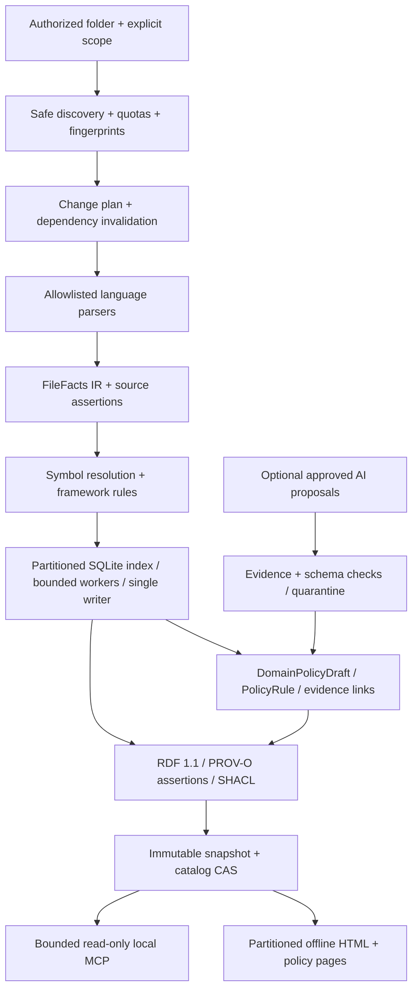
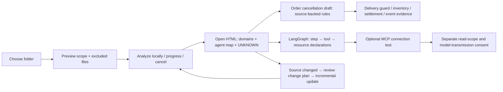

# Next architecture: planned 0.9.0

[English](NEXT_ARCHITECTURE_0_9_0.md) | [한국어](ko/NEXT_ARCHITECTURE_0_9_0.md) | [日本語](ja/NEXT_ARCHITECTURE_0_9_0.md) | [简体中文](zh-CN/NEXT_ARCHITECTURE_0_9_0.md) | [Русский](ru/NEXT_ARCHITECTURE_0_9_0.md)

**Design status: DESIGN_ONLY · NOT_IMPLEMENTED_IN_0_8_3 · 2026-10-22.** Current runtime/package version remains **0.8.3**. This document proposes a future major change within the same product, hence the B increase to **0.9.0** under the A.B.C product policy. The previous *unpublished* development label 0.9.0 was reclassified as 0.8.2; that historical alias is not this future milestone or evidence of publication. No new language, AI-framework, Kafka or Redis adapter described here is implemented in 0.8.3.

## 1. Product promise and current boundary

**Choose folder → analyze → open results.** The planned results are (1) a system/agent map, (2) domain policy documents with evidence, and (3) policy answers without rereading code.

An individual or team should choose a folder, confirm scope, run analysis and open results; advanced options stay optional. The same local engine should handle large repositories without requiring an enterprise platform. It should describe ordinary applications, AI agents themselves and AI data pipelines, and derive **DomainPolicyDraft** documents for product, order, merchandising/display, claims, settlement and delivery domains.

Current 0.8.3 has partial Java/Spring and Python static analysis; policy extraction reaches policy-key/branch impact, not complete business-rule reconstruction. The official Skills-only profile contains no MCP server; the complete local package supplies the read-only server. Per-module safety limits are 25,000 files, 512 MiB, 500,000 nodes and 1,000,000 edges; these are guards, not measured capacity. Large mode accepts at most 128 independent modules and does not resolve cross-module calls. Its HTML still reads the complete embedded payload and builds the hierarchy; focus pages limit only the displayed graph to 60 nodes/160 edges. Neither that cap nor native-test configuration proves large-repository performance. Native Windows validation remains **UNKNOWN**; Windows, macOS and Linux stay required targets.

## 2. Local engine and durable storage



- Discovery opens only approved files below registered roots. A private source manifest records content fingerprints; the planner compares files, public signatures, imports/exports and configuration. Delete, rename and scope changes invalidate dependants, not just edited files. Missing fingerprints yield UNKNOWN.
- Parsers emit versioned **FileFacts IR**: declarations, references, imports/exports, typed literals, source spans and parse diagnostics. Deterministic merging precedes semantic and framework rules. Unresolved references stay unresolved; a syntactic match is not a resolved call.
- Portable immutable bundles carry source revision/digest, schema/contracts, coverage, lineage, integrity and compatibility metadata for ordinary interchange. A catalog identifies immutable partition databases and their schema/rule versions. Suggested tables are files, symbols, references, assertions, domain memberships, policy rules, dependencies and jobs, indexed by stable opaque IDs and scope. Parameterized queries read bounded rows without loading a whole JSON graph. Global export/import resolution links partitions while retaining unresolved and ambiguous targets.
- A bounded worker pool parses isolated file batches; one writer commits each partition generation, and one publisher owns catalog promotion. Jobs have idempotency keys, checkpoints and cancellation. Final hashes, artifact manifest and durable receipt precede atomic catalog compare-and-swap (CAS) against the expected predecessor. Source drift or a failed CAS cannot promote stale output. Before exporting an immutable SQLite bundle, stop its writer, checkpoint the WAL and seal the database consistently with any required sidecars; never export a mismatched live set. Migrations preserve the original and build a new verified generation. Readers pin a generation; garbage collection deletes only unreferenced generations after reader/lease checks.
- Each stage has independent file/byte, memory, queue, time and output budgets: discovery, parse, resolve, index, export, query and render. Quota exhaustion produces explicit partial coverage or quarantine; it never silently asserts completeness. SQLite and partition counts do not remove total disk or memory limits.

## 3. Adapter contract and priorities

Every adapter declares supported versions and levels: **syntax / symbol / resolved / framework**. Report **detected / analyzed / unsupported / excluded** counts per language, level and reason; file counts alone do not prove semantic coverage.

| Priority | Planned scope | Boundary |
| --- | --- | --- |
| Core | Java, Python, JavaScript/TypeScript, SQL | Freeze a versioned vertical slice before release; unsupported syntax/dialects remain visible. |
| Next | Kotlin, C#, Go, Rust, C/C++, PHP | Separate adapter gates; not promised by the initial 0.9.0 release. |
| Later | Swift, Dart, Ruby, Scala, Shell/PowerShell | Backlog, not current support. |
| Application | Spring/Boot, MyBatis, React, Vue, Node ESM/CJS | Resolve annotations, XML mappings, SFC sections, imports and declared routes conservatively. .NET, FastAPI and Django are separate optional slices. |
| Data pipeline | SQL lineage; later dbt, Airflow, Dagster, Spark, Flink | Record declared transformations and dependencies, not successful execution or live data values. |
| Contracts | OpenAPI, GraphQL, Protobuf, Avro, JSON Schema | Link declared schemas, operations and serializers; preserve version mismatches and unresolved bindings. |

Tree-sitter is a syntax candidate, not whole-program semantic proof ([project](https://github.com/tree-sitter/tree-sitter)). A TypeScript semantic adapter needs an allowlisted compiler host; `noResolve` alone is not a filesystem sandbox ([Compiler API](https://github.com/microsoft/TypeScript/wiki/Using-the-Compiler-API)). Vue analysis separates SFC blocks ([SFC specification](https://vuejs.org/api/sfc-spec.html)). MyBatis parses mapper statements and dynamic conditions with external entities/DTDs disabled; dynamic SQL remains conditional ([mapper specification](https://mybatis.org/mybatis-3/sqlmap-xml.html)). No build, dependency installation or target import is required.

**Kafka/Redis priority slice:** model Kafka producer/topic/consumer/group/serializer and offset declarations; model Redis cache/key-shape/TTL/pubsub/stream relationships. Topic names alone cannot merge brokers or environments: missing environment scope produces separate unresolved identities. Use local HMAC-derived IDs and safe aliases; never retain raw keys, values or secret-bearing connection URIs. Dynamic SpEL, conditional configuration and runtime-created resources remain UNKNOWN. These are declared relationships, not delivery guarantees, effective TTLs or live offsets.

## 4. Analyze AI agents as software

The planned vocabulary is **Agent, WorkflowStep, ModelCall, PromptReference, Tool, Resource, Retriever, EmbeddingIndex, Memory, Checkpoint, Guardrail, Evaluation, Handoff**. Prioritize LangChain/LangGraph in Python and TypeScript; then OpenAI Agents SDK and LlamaIndex, with other frameworks in the adapter backlog. LangGraph documents stateful workflow orchestration ([overview](https://docs.langchain.com/oss/python/langgraph/overview)); Agents SDK documents agents, tools, guardrails and handoffs ([SDK](https://openai.github.io/openai-agents-python/)). These are modeling references, not claims of implemented compatibility.

Extract construction, graph edges, conditional branches, tool bindings and declared resource/permission scopes without executing code, importing SDKs or making network requests. PromptReference stores an opaque reference, not prompt text. Chats, prompts, tool payloads and keys are not collected by default. Separate **declared / effective / runtime** permissions: source configuration cannot establish granted or exercised authority. A future, separately consented import of selected redacted runtime traces belongs to a distinct evidence graph; it cannot turn static reachability into proof of agent action or success.



## 5. Compile once, answer from versioned policy knowledge

**Compile authorized code once → seal a versioned policy snapshot → answer through read-only policy MCP.** Policy questions must not require rereading source files. Incremental analysis produces a new policy snapshot only when the source/specification changes. A policy snapshot has its own manifest, completeness metadata, ruleset digest and atomic seal bound to its code snapshot/catalog. Evidence IDs resolve stored provenance metadata separately; optional source opening is a distinct authorized action.

Domain discovery combines packages/modules, database schemas, APIs, events and explicit user mappings with optional AI candidates. A file may belong to multiple domains. Store classification evidence, unclassified items and conflicting assignments; do not infer business authority from folder names alone.

**PolicyRule IR:** `subject / action / guard / condition / exception / stateTransition / formula / authority / sourceAssertionIds / scope / configProfile / status`. A typed allowlist **PolicyValue** may capture necessary numeric thresholds, enums and SQL/configuration conditions after credential/PII checks. This is a narrow exception to arbitrary-literal collection, not permission to retain arbitrary strings. Unapproved sensitive business literals are masked or UNKNOWN; draft completeness must reflect their absence.

Condition reconstruction requires method-local CFG and bounded def-use analysis: negation, early return, short-circuiting, reassignment, aliases, exceptions and call order. Exhausted interprocedural budgets remain unresolved; dynamic MyBatis SQL, ORM behavior, database procedures and configuration precedence outside the declared slice remain unsupported. Policy snapshots must be self-contained for supported constants, configuration, expressions, mappings and coverage closure. Record source `lastVerifiedAt` separately from snapshot `createdAt`; a newly created artifact is not proof of current source.

### Typed policy knowledge and evaluation

| PolicyRule field | Required meaning |
| --- | --- |
| Identity / scope | Stable rule ID, domain memberships, source Assertion IDs, catalog/policy snapshot IDs and ruleset digest; preserve cross-domain rules, ambiguous ownership and classification conflicts. |
| Eligibility / guard | Typed predicates over categories and explicitly supplied context; employee eligibility uses categories, never real employee identities. Uninterpreted predicates are UNKNOWN, not false. |
| Effect / formula | Restricted expression AST with permitted operators and types; explicit units, currency, minor units or Decimal, and rounding mode. No `eval`, arbitrary code or LLM-invented arithmetic. |
| Conditions / combinations | Thresholds, exceptions, precedence, stackability, exclusions, caps and ordering. Undeclared combinations are not implicitly stackable. |
| Validity / profile | Business effective-from/to time and configuration profile, separate from analysis/snapshot transaction time and extraction version. Missing or stale dates/profiles are explicit. |
| Authority / status | Extraction verification, implemented-rule, AI-proposed, owner-reviewed and approved-business-policy states remain separate; approval does not make an extraction correct. |
| Completeness / limitations | Supported/unsupported IR nodes, required runtime inputs, conflicts, coverage denominator and evidence-support verdicts. Render partial semantics visibly. |

Proposed tools (design names, not currently registered): **list_domain_policies**, **query_policy_rules**, **compare_policy_cases**, **explain_policy_result**. Read only sealed policy knowledge, with registered workspace access, privacy denial, bounded filters/pages/search and stable cursors. The backend completes the bounded policy evaluation before paginating response text; an output-byte limit must never truncate the input rules used for calculation. Responses include catalog/policy snapshot IDs, ruleset digest, coverage, business `asOf`, transaction time, assumptions, missing inputs, conflicts and evidence IDs.

The evaluator must bind **policyView** and **rulesetAuthority** before calculation. The default `verified_implemented` view includes only extraction-verified implemented rules; `AI-proposed` rules are excluded from evaluation and maximum proofs. An explicitly selected `approved_business` view requires a pinned approval version and authority binding and remains separate from implementation state. Preserve conflicting implemented/proposed/approved records, report UNKNOWN where relevant, and never mix views silently. Business approval does not verify extraction accuracy.

Closed coverage means only the explicitly named module/source-revision/config-profile/rule-family/query-domain closed-world scope, never every policy in an organization. Unresolved reflection, runtime plugins or external procedures force complete=false. Record an unknown denominator explicitly; zero extracted rules does not prove no rules exist.

For “which employee-discount types exist?”, return the analyzed types plus coverage; say “all” only for a closed, complete relevant scope. For “which case is highest?”, first fix the objective: highest percentage, largest immediate amount, lowest final payment, effective discount rate or future reward are different objectives. Enumerate only a closed, budgeted finite set of eligible promotions, stacking/order choices, products, amounts and context. A typed deterministic interpreter performs the calculation. Actual membership, prior usage and remaining caps require supplied runtime values; policy knowledge alone cannot establish eligibility, and the query does not read live DB/Kafka/Redis.

`proven_maximum` requires closed relevant policy coverage, zero unresolved semantics/conflicts, complete inputs, and exhaustive bounded search or a justified optimal upper-bound proof. A timeout returns `best_found`, never a global optimum. Otherwise return `optimum=false`, `needs_context`, `unknown_conflict` or `incomplete_coverage`, and ask for the missing context. Unknown rules must not disappear behind polished policy sentences.

The following **synthetic request/response shape** defines no real company discount or entitlement. The digest and IDs are illustrative, not verified artifacts.

```json
{
  "tool": "compare_policy_cases",
  "arguments": {
    "workspace_id": "synthetic-workspace",
    "policy_snapshot_id": "synthetic-policy-1",
    "domain": "order",
    "policyView": "verified_implemented",
    "rulesetAuthority": "synthetic-extraction-verification-v1",
    "objective": "minimize_immediate_payment",
    "eligibility_categories": ["synthetic_employee"],
    "as_of": "2030-01-01",
    "config_profile": "synthetic",
    "context": {},
    "max_cases": 100
  }
}
```

```json
{
  "status": "needs_context",
  "policyView": "verified_implemented",
  "rulesetAuthority": "synthetic-extraction-verification-v1",
  "catalogSnapshotId": "synthetic-catalog-1",
  "policySnapshotId": "synthetic-policy-1",
  "rulesetDigest": "sha256:0000000000000000000000000000000000000000000000000000000000000000",
  "asOf": "2030-01-01",
  "transactionTime": "2026-10-22T00:00:00Z",
  "analyzedPolicyTypes": ["synthetic-employee-discount"],
  "coverage": {"analyzedRules": 1, "unsupportedRules": 1, "complete": false},
  "missingInputs": ["cart", "membership_state", "usage_count", "remaining_cap"],
  "assumptions": [],
  "conflicts": [],
  "evidenceIds": ["assertion:synthetic-rule"],
  "maximum": null,
  "optimality": {"optimum": false, "scope": "not_evaluated"}
}
```

Generate a decision table, state-transition diagram, domain dependency map, rule-conflict/unknown report and change-impact view. Every policy sentence links to source Assertion IDs and exact supporting spans. The human HTML receives policy tabs/pages; planned MCP policy/evidence queries remain bounded and snapshot-pinned. A synthetic example is order cancellation → delivery-state guard → inventory/settlement/event effects; include each edge only when supported by actual selected code, and identify unobserved dynamic effects as UNKNOWN.

Keep **implemented-rule / AI-proposed / owner-reviewed / approved-business-policy** separate. Code can describe an implemented rule while conflicting with organizational policy; software never auto-approves a business policy. Record a reviewer only as an approved pseudonymous role/ID. Reviewer approval is an explicit external decision, not a confidence score or parser result.

## 6. Reproducibility and AI containment

AI semantic proposals come from the caller’s selected host model, or an explicitly permitted local model, through a bounded proposal contract. The plugin does not switch models, create cloud API configuration or transmit source by default; use redacted fact packs. If the host cannot expose an immutable model fingerprint, set `modelIdentity=unverified` and `repeatability=unverified`; identical-output guarantees and the AI repeatability gate remain unverified. Model identity and semantic validation are independent: a rule may become `extraction_verified` after independent source, typed-IR, calculation and evidence validation, preserving its AI-derived provenance. Human business approval alone is insufficient. An `AI-proposed` record itself stays excluded from calculation; only semantically verified rules can enter the selected policy view. A deterministic-only profile uses `modelNotUsed` / `N/A` and needs no model fingerprint or model-run gate.

The deterministic baseline is authoritative for extracted code facts; AI proposals live in separate inferred records and cannot overwrite it. **analysisSpecId** fingerprints source/scope, tools/rules/schema/parser versions, immutable model identity and settings, context assembly, prompt template and redaction policy. Assemble chunks in stable order with explicit token and response budgets. The same model name does not guarantee identical weights, serving configuration or output; an unavailable fingerprint is UNKNOWN.

Reuse only approved cache entries matching the complete specification. Unverified model identity uses a run-specific identity and prohibits automatic cross-run AI-proposal cache reuse; never merge different models under one unknown cache key. Reusing already sealed, verified policy snapshots and deterministic parse caches remains permitted. Validate schema, evidence-ID existence, exact source support, contradictions and coverage. Permit at most **one bounded retry**, then quarantine; no fabricated fallback evidence. Golden fixtures and repeated runs per immutable model/configuration measure unsupported-claim count, evidence precision/recall and proposal variation. Preserve variation rather than pretending stochastic output is byte-identical. No optional inference or design review sends data to an external model without separate authorization.

## 7. Assertion lineage and standards

Reify every relationship as an **Assertion** entity, retaining subject/predicate/object and provenance rather than attaching one confidence value to an entire graph. Store source-relative span or opaque source ID, source fingerprint, rule version, analysis run, model fingerprint when AI-derived, basis/time/verification/limitations and `supersedes`/tombstone links. Keep **observed / declared / inferred / validated / approved** distinct.

Use RDF 1.1 with a documented PROV-O mapping: source/snapshot/assertion as Entity, analysis/transformation as Activity and software aliases as Agent ([PROV-O](https://www.w3.org/TR/prov-o/)). Named graphs are optional; ordinary Turtle does not imply dataset/named-graph support. SHACL checks required fields, references and allowed states, not real-world truth ([SHACL](https://www.w3.org/TR/shacl/)). Reverse lineage queries explain impact, version differences and partial results. SHA hashes establish integrity, not truth. Optional signatures keep private keys local; an append-only hash chain without an external anchor is not tamper-proof.

## 8. Security and simple delivery

Treat source, comments and embedded instructions as untrusted data. Never follow source prompt injection. Allowlist parser/host reads; prohibit external XML references, executable YAML constructors, builds, installs, hooks and eval. Recheck symlinks, Windows reparse points and file identity against TOCTOU; enforce depth, recursion, byte and time-bomb limits. Validate permissions on each supported OS rather than equating offline operation with confidentiality.

Use SQLite parameterization, HTML escaping, restrictive CSP and navigation allowlists. MCP accepts registered roots/IDs only, stays read-only and enforces size, cursor and query budgets. Exports default to private, with redaction/deny profiles and explicit publication checks. No real names or personal email addresses enter public artifacts; publisher identity is **battle-doll**. Keep private source manifests, cache keys and traces out of public bundles.

The UI must explain that a **local MCP response can be sent by the host to a remote model**. Reading a folder and transmitting selected evidence require distinct consent. A local engine does not establish where the host model runs. Proposed simple setup offers a folder picker, scope preview, progress/cancel, result opening, an explicit MCP connection test and change-only refresh; it never silently changes host permissions or installs software.

Large offline HTML is a catalog → module → bounded-page collection of self-contained static pages with relative links; required navigation must work under `file://` without `fetch`. An optional local server is a separate feature, not a prerequisite. Preserve 3D focus, reduced motion, 240px minimum mobile canvas and 44px touch targets. Large-project Full mode must use aggregates/pages, not render all original symbols without limit. Verify escaping and link containment on every generated page.

## 9. Architecture decisions (ADR)

| Choice | Proposed decision | Cost / alternative boundary |
| --- | --- | --- |
| Whole JSON vs SQLite | Partitioned SQLite indexes; JSON only bounded interchange | Schema migrations and indexes cost disk; avoids whole-graph reads per query. |
| Parser-only vs semantic | Syntax baseline plus explicit semantic/framework tiers | More adapters and ambiguity handling; parsing alone cannot prove call targets. |
| All-AI vs baseline | Deterministic facts plus quarantined AI proposals | More contracts and review; avoids stochastic replacement of facts. |
| Global graph vs federation | Partitioned facts plus global export/import catalog | Cross-partition invalidation is required; neither isolated modules nor a monolithic in-memory graph suffices. |
| Offline HTML vs server | Static partitioned pages first; optional server later | Fewer live queries in offline mode; no server setup for basic use. |

## 10. Failure and recovery

| Failure | Required behavior |
| --- | --- |
| Source changes mid-run / public signature changes | Invalidate affected dependants; reject stale promotion; retain previous snapshot. |
| Parser crash / hostile nesting / quota exhaustion | Kill bounded worker, quarantine affected files, report partial coverage; do not silently skip. |
| Cancellation / process exit / disk full | Preserve a durable checkpoint; resume the same idempotent job or abandon it explicitly. Never promote incomplete artifacts. Cancellation ACK is not termination: measure worker termination, query stop, queued-work discard, no further writes/promotion and resource closure, with bounded cleanup/rollback. |
| Two publishers / stale catalog | Single publisher plus CAS; loser replans against the new catalog. |
| Corrupt partition / manifest / receipt | Fail closed, preserve evidence and previous snapshot; recovery verifies hashes and bindings before continuing. |
| AI invalid evidence / contradiction | One bounded retry, then quarantine; baseline remains unchanged. |
| Missing broker scope / dynamic policy condition | Keep separate unresolved IDs and UNKNOWN policy cells; no guessed merge or invented rule. |
| Reader pins old generation / GC interruption | Keep referenced generations; resumable GC never deletes pinned content. |

## 11. Acceptance scorecard and exit gates

All numbers below are **proposed targets, not measured capacity or completed tests**. Freeze hardware, OS, fixture seed and budgets before a comparison. Suggested synthetic sizes: 1k/10k/100k files and 50k/500k/5M LOC, with mixed languages, skewed modules and generated-code exclusions. Include no-change, 5% edits, deleted/renamed files, public-signature/configuration changes and cross-module dependencies. A proposed low-end profile is a 4-GiB machine, one worker and total RSS ≤2 GiB; larger corpora may require more partitioned disk and time. A smaller resource budget may reduce parallelism and increase time, never silently lower semantic accuracy. Unsupported work remains explicit. This profile is unverified until measured.

Measure stage wall time, p50/p95 query latency, peak RSS, disk/output bytes, cancellation and recovery time separately.

| Gate | Acceptance evidence |
| --- | --- |
| Source/graph correctness | Full and incremental builds have equal semantic assertions on declared deterministic fixtures; zero stale promotions and duplicate recovery events. Coverage denominators include excluded/unsupported inputs. |
| Policy vertical slice | Six synthetic domains cover conditions, exceptions, states, formulas, config-profile conflicts, dynamic boundaries, missing evidence and AI hallucinations. Policy-sentence citation presence is 100%; golden claim-to-source exact-support precision is assessed separately and unsupported claims must be 0. Test typed arithmetic, currency/rounding, precedence/stacking/caps, missing usage/membership inputs, business-time vs transaction-time, partial IR and timeout best_found; no false proven_maximum is allowed. Conflicting implemented/AI-proposed/approved fixtures must evaluate only the selected policyView/rulesetAuthority, with 0 unapproved-rule contamination. An unverified-model proposal stays excluded until independent source/IR/calculation/evidence validation; then its extraction_verified rule may be included while model repeatability remains unverified. Unknown dynamic parts stay UNKNOWN. After generation, deny all source-path access: identical policy snapshot/input must still yield the same policy answer. Translations must preserve policy IDs, numeric conditions and meaning. |
| Agent/event slice | Version-pinned LangChain/LangGraph plus Kafka/Redis fixtures verify declared steps/resources and environment isolation; no runtime-success claims. Other frameworks may remain explicitly unsupported. |
| AI repeatability | For AI-enabled profiles only: at least 5 runs per approved immutable model/configuration; record variation and evidence precision/recall. Unsupported claims 0; missing fingerprints or failed checks cannot pass this AI gate. Deterministic-only profiles use modelNotUsed/N/A and may pass without AI. A model-identity failure leaves repeatability unverified but does not block independent semantic promotion to extraction_verified with AI-derived provenance retained; human approval alone is insufficient. |
| Performance target | On a proposed 8-core/16-GiB/SSD reference machine: total peak RSS ≤12 GiB, bounded top-50 query p95 ≤1s, bounded page ready ≤2s, cancellation acknowledgement ≤2s and actual quiescence ≤5s are separate targets; 5% edit work ≤40% of full-build time is a target. Measure actual worker/query quiescence, queue discard, no further writes/promotion and resource closure per profile, including bounded cleanup/rollback; ACK alone cannot pass recovery. Report corpus/OS-specific misses instead of claiming support. |
| Privacy and hostile inputs | No outbound traffic in default engine tests; zero planted secret/PII leaks; malicious XML/YAML/path/link/depth/SQL/HTML fixtures rejected or safely represented. Private caches and exports checked on native OSs. |
| UX and packaging | Five languages, folder-to-result and MCP consent flows, keyboard/text alternatives, reduced motion and mobile layout checked by people on Windows/macOS/Linux. Native-unrun cases stay UNKNOWN. |

**G0 — contract freeze:** approve IR, source/permission boundaries, synthetic fixture plan and exact supported-version matrix. **G1 — engine:** durable indexed snapshots, cross-module invalidation and failure injection pass. **G2 — vertical value:** six-domain policy drafts plus the priority agent/event slice pass evidence gates; adapter coverage is declared per level, not promised for every framework. **G3 — scale/security:** publish reproducible benchmark evidence and native OS results against frozen budgets. **G4 — release candidate:** independent review, five-language docs, deterministic packages and privacy checks pass. Provider submission, approval and publication remain separately authorized steps. Additional language/framework adapters graduate through their own gates after this milestone.

## 12. Review questions and unresolved decisions

1. Which representative synthetic repository shapes and policy examples define the first six-domain slice, and which language/framework versions are mandatory?
2. What local hardware budget and SQL dialects should be release-blocking, and which targets may remain experimental?
3. Who may authorize sensitive PolicyValue fields, domain mappings and business-policy approval, using pseudonymous roles?
4. Which immutable local-model configuration, if any, is permitted for optional proposals? Default is no external-model transmission.
5. Which page sizes, packaging format and native OS permission mechanisms pass usability/security review? Until measured, capacity, browser usability and model improvement remain UNKNOWN.

This is an independent design using standards and public technical documentation. Adapter licenses and redistribution terms require review before packaging; no legal-compliance certification is claimed.

Review answers refine this design; they do not activate analysis, transmit repository content, approve business policies or publish the plugin.
