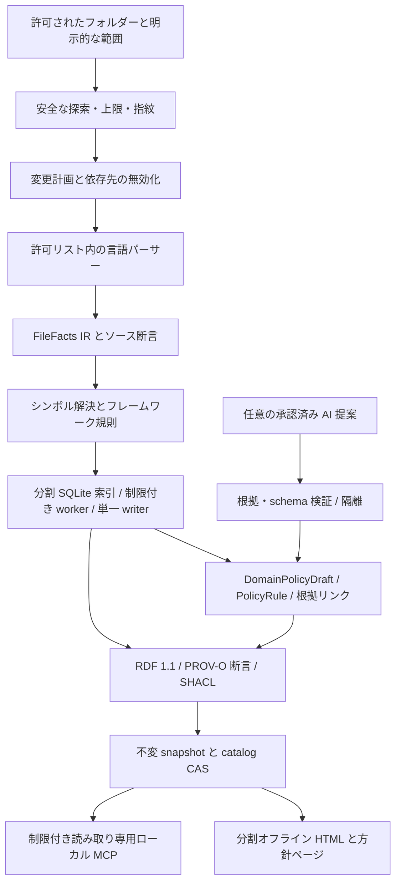
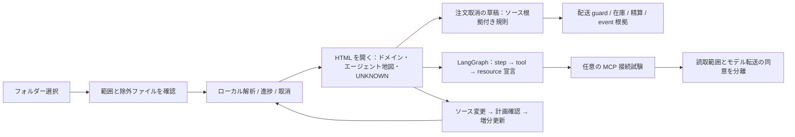

# 次期アーキテクチャ：計画中の 0.9.0

> 0.9.0ではディスク分割パイプライン、確定ポリシー、初期所有者専用アクセスを追加します。完全版は**読み取り専用MCPツール19個（既存12個＋パイプライン7個）**です。以下はパイプラインコマンドを明示しない限り既存互換の説明です。新しい多言語・規則ワークスペースは実装ガイドを参照してください。 [0.9.0](PIPELINE_0_9_0.md)

[English](../NEXT_ARCHITECTURE_0_9_0.md) | [한국어](../ko/NEXT_ARCHITECTURE_0_9_0.md) | [日本語](NEXT_ARCHITECTURE_0_9_0.md) | [简体中文](../zh-CN/NEXT_ARCHITECTURE_0_9_0.md) | [Русский](../ru/NEXT_ARCHITECTURE_0_9_0.md)

**設計状態：DESIGN_ONLY · NOT_IMPLEMENTED_IN_0_8_3 · 2026-10-22。** 現行ランタイム・パッケージは **0.8.3** です。同一製品の大規模変更として A.B.C 方針の B を上げる**将来の 0.9.0** を設計します。以前の未公開開発表記 0.9.0 は 0.8.2 に再分類されており、この将来版や公開済み状態とは異なります。以下の新言語・AI フレームワーク・Kafka・Redis アダプターは 0.8.3 に実装されていません。

## 1. 製品の目的と現状

**フォルダー選択 → 解析 → 結果を開く。** 計画する成果は、①システム・エージェント地図、②根拠付きドメイン方針書、③コードを再読しない方針照会です。

個人・チームがフォルダーを選び、範囲を確認して解析を実行し、結果を開けるようにします。高度な設定は任意です。同じローカルエンジンで大規模リポジトリを扱い、企業用プラットフォームの導入を前提にしません。通常のアプリ、AI エージェント自身、AI データパイプラインを分析し、商品・注文・陳列・クレーム・精算・配送の **DomainPolicyDraft** を導出します。

現行は Java/Spring・Python の部分的静的解析と方針キー→分岐影響の解析であり、完全な業務規則復元ではありません。公式 Skills-only に MCP サーバーはなく、完全ローカルパッケージが読み取り専用サーバーを含みます。モジュールごとの 25,000 ファイル・512 MiB・500,000 ノード・1,000,000 エッジは安全上限で、測定済み容量ではありません。最大 128 個の独立モジュール間の呼び出しは解決しません。HTML は埋め込み全データと階層を読み、フォーカス表示だけを 60 ノード/160 エッジに制限します。表示上限やテスト設定は大規模性能の証拠ではありません。Windows 実機検証は **UNKNOWN** で、Windows・macOS・Linux を対象に保ちます。

## 2. ローカルエンジンと永続化



- 登録済み許可ルート内のファイルだけを発見し、非公開 manifest に指紋を保存します。変更計画はファイル、公開シグネチャ、import/export、設定を比較し、削除・改名・範囲変更の依存先も無効化します。指紋不足は UNKNOWN です。
- バージョン付き **FileFacts IR** に宣言、参照、import/export、型付き値、ソース位置、解析診断を記録します。決定論的統合の後に意味解析・フレームワーク規則を適用します。構文一致と解決済み呼び出しを区別し、未解決参照を残します。
- 可搬な不変バンドルには source revision/digest、schema/contracts、coverage、lineage、integrity、compatibility を含めます。catalog が不変の分割 SQLite と schema/rule 版を指します。files/symbols/references/assertions/domain memberships/policy rules/dependencies/jobs を安定 opaque ID と範囲で索引化し、パラメーター化クエリは全 JSON ではなく限定行を読みます。全体の export/import catalog で分割間を接続し、曖昧・未解決を保持します。
- 制限付き worker が隔離バッチを解析し、partition generation ごとに single writer、catalog に single publisher を置きます。冪等キー、checkpoint、取消を持ち、最終 hash・artifact manifest・永続 receipt の後に、期待する先行 catalog へ atomic CAS を行います。ソース変化や CAS 失敗で古い結果を昇格しません。SQLite を出力する前に writer を終了し WAL checkpoint と整合した DB/必要 sidecar の seal を行い、稼働中の不整合な組を出力しません。migration は原本を保持して新 generation を検証します。reader は generation を固定し、GC は参照・lease がないものだけを削除します。
- 発見、parse、resolve、index、export、query、render ごとにファイル/byte、メモリー、queue、時間、出力予算を設けます。超過は明示的な partial coverage または quarantine となり、完全性を装いません。SQLite や分割も総ディスク・メモリー制限を除きません。

## 3. アダプター契約と優先度

各アダプターがバージョンと **syntax / symbol / resolved / framework** を宣言し、言語・レベル・理由別に **detected / analyzed / unsupported / excluded** を数えます。ファイル数は意味解析の完全性ではありません。

| 優先度 | 計画範囲 | 境界 |
| --- | --- | --- |
| 中核 | Java, Python, JavaScript/TypeScript, SQL | リリース前に版付き vertical slice を固定。未対応構文・方言を表示。 |
| 次 | Kotlin, C#, Go, Rust, C/C++, PHP | 個別 gate。初回 0.9.0 ですべてを約束しません。 |
| 後続 | Swift, Dart, Ruby, Scala, Shell/PowerShell | backlog、現行対応ではありません。 |
| アプリ | Spring/Boot, MyBatis, React, Vue, Node ESM/CJS | annotation/XML/SFC/import/宣言 route を保守的に結合。.NET/FastAPI/Django は別の任意範囲。 |
| データ | SQL lineage、後続 dbt/Airflow/Dagster/Spark/Flink | 宣言された変換・依存。実行成功や実データ値ではありません。 |
| 契約 | OpenAPI, GraphQL, Protobuf, Avro, JSON Schema | schema/operation/serializer を結合し、版不一致・未解決を保持。 |

[Tree-sitter](https://github.com/tree-sitter/tree-sitter) は構文候補で、全プログラムの意味的証明ではありません。[TypeScript Compiler API](https://github.com/microsoft/TypeScript/wiki/Using-the-Compiler-API) は allowlist compiler host を必要とし、`noResolve` 単独ではファイルアクセスを隔離できません。[Vue SFC](https://vuejs.org/api/sfc-spec.html) はブロック別に解析し、[MyBatis mapper](https://mybatis.org/mybatis-3/sqlmap-xml.html) は外部 entity/DTD を禁止して動的 SQL を条件付きに保ちます。build/install/対象 import は不要です。

**Kafka/Redis 優先範囲：** Kafka producer/topic/consumer/group/serializer/offset 宣言、Redis cache/key-shape/TTL/pubsub/stream の関係をモデル化します。topic 同名だけで broker・環境を統合せず、環境範囲不足は別の未解決 ID とします。ローカル HMAC ID と安全な別名を使い、raw key/value、秘密を含む URI を収集しません。動的 SpEL、条件設定、実行時生成資源は UNKNOWN。宣言は配信保証、有効 TTL、現在 offset の証明ではありません。

## 4. エージェント自体を解析する

計画語彙：**Agent, WorkflowStep, ModelCall, PromptReference, Tool, Resource, Retriever, EmbeddingIndex, Memory, Checkpoint, Guardrail, Evaluation, Handoff**。Python/TypeScript の LangChain/LangGraph を優先し、OpenAI Agents SDK/LlamaIndex を次に、その他を backlog に置きます。[LangGraph](https://docs.langchain.com/oss/python/langgraph/overview) の状態付き workflow と [Agents SDK](https://openai.github.io/openai-agents-python/) の agent/tool/guardrail/handoff はモデル化資料で、実装済み互換性の主張ではありません。

コード実行、SDK import、ネットワークなしで構築、graph edge、条件分岐、tool binding、宣言 resource/permission を抽出します。PromptReference は原文ではなく opaque reference です。prompt/chat/tool payload/key は既定で収集しません。権限の **declared / effective / runtime** を区別し、設定から実際の付与・行使を推定しません。将来、別途同意した選択済み・秘匿化 runtime trace を取り込んでも別の evidence graph とし、静的到達性を行動・成功の証明にしません。



## 5. 一度解析し、版付き方針知識から答える

**許可コードを一度解析 → 方針 snapshot を固定・seal → 読み取り専用 policy MCP**。質問ごとにコードを再読しません。ソース・仕様変更時に増分解析で新 snapshot を作ります。方針 snapshot は code snapshot/catalog と結合した独自 manifest、完全性、ruleset digest、atomic seal を持ちます。根拠 ID は保存した provenance metadata を照会し、原文を開く操作は別の許可対象です。

ドメイン分類は package/module、DB schema、API、event、明示 user mapping と任意 AI 候補を使います。ファイルの複数所属、分類根拠、未分類、ownership conflict、cross-domain rule を保持し、フォルダー名から業務上の権威を決めません。

**PolicyRule IR:** `subject / action / guard / condition / exception / stateTransition / formula / authority / sourceAssertionIds / scope / configProfile / status`。必要な数値閾値、enum、SQL/config 条件だけを型付き allowlist **PolicyValue** とし、credential/PII 検査を行います。任意文字列の収集許可ではありません。未承認の機密業務値は masked/UNKNOWN とし、完全性に反映します。

条件復元は method-local CFG と bounded def-use により、否定、early return、short-circuit、再代入、alias、例外、呼出順を扱います。関数間追跡予算の終了は unresolved。対象外の動的 MyBatis SQL、ORM、DB procedure、設定優先順位は unsupported です。snapshot は対応する定数・設定・式・mapping・coverage closure を自己完結で持ちます。source `lastVerifiedAt` と snapshot `createdAt` を区別し、新規作成をソース最新性とみなしません。

### 型付き方針と評価契約

| PolicyRule フィールド | 意味 |
| --- | --- |
| ID / scope | 安定 rule ID、domain memberships、source Assertion IDs、catalog/policy snapshot IDs、ruleset digest。曖昧さ・所有競合・領域横断を保持。 |
| Eligibility / guard | カテゴリーと明示入力に対する typed predicate。従業員実名ではなく資格カテゴリー。未解釈は false ではなく UNKNOWN。 |
| Effect / formula | 許可演算・型のみの expression AST。単位・通貨・minor units または Decimal・丸め方式を明記。`eval`、任意コード、LLM の自由計算は禁止。 |
| 条件 / 組合せ | threshold、exception、precedence、stackability、exclusion、cap、順序。未宣言の併用を仮定しません。 |
| Validity / profile | 業務有効期間と config profile を解析/snapshot transaction time・抽出版から分離。不足・古さを明示。 |
| Authority / status | 抽出検証、implemented-rule、AI-proposed、owner-reviewed、approved-business-policy は別。承認は抽出精度の証明ではありません。 |
| 完全性 / 制約 | supported/unsupported IR、必要 runtime input、conflict、分母、正確な support 判定。部分的意味を隠しません。 |

**list_domain_policies / query_policy_rules / compare_policy_cases / explain_policy_result** は設計上の仮称で、現在登録済みの tool ではありません。登録 workspace、privacy denial、bounded filter/page/search、安定 cursor により seal 済み知識を読みます。計算を完了してから応答をページ化し、出力 byte 予算で計算規則を切り捨てません。catalog/policy snapshot ID、ruleset digest、coverage、業務 asOf、transaction time、assumptions、missing inputs、conflicts、evidence IDs を返します。

評価器は計算前に **policyView** と **rulesetAuthority** を結び付ける必要があります。既定の `verified_implemented` view は、抽出検証済みの実装規則だけを含み、`AI-proposed` 規則を評価と最大値証明から除外します。明示的に選ぶ `approved_business` view は承認バージョンの固定と authority の結合を必要とし、実装状態から分離します。実装済み・提案・承認済みの競合する記録を保持し、該当箇所は UNKNOWN と報告して view を黙って混ぜません。業務上の承認は抽出精度を検証しません。

closed coverage は明示した module/source-revision/config-profile/rule-family/query-domain の closed-world 範囲だけです。組織の全方針を証明しません。reflection/runtime plugin/外部 procedure が未解決なら complete=false。分母不明を記録し、抽出規則 0 件を規則不存在と解釈しません。

「従業員割引の種類」は解析した種類と coverage を返し、閉じた完全な範囲だけで「全種類」と言えます。「最高割引」では最高率、即時割引額、最終支払額、実効率、将来ポイントを区別して目的関数を確定します。資格、promotion 組合せ/順序、商品、金額、context の閉じた有限探索を予算化し、決定論的 typed interpreter で計算します。会員状態、使用回数、残限度額は入力が必要で、方針だけで実資格を証明せず、DB/Kafka/Redis をライブ照会しません。

`proven_maximum` は関連範囲の閉鎖性と完全性、未解決/競合 0、全入力、予算内の全探索または正当な最適上界証明を要します。timeout は `best_found` であり大域最大ではありません。それ以外は `optimum=false`、`needs_context`、`unknown_conflict`、`incomplete_coverage` を返し、不足する context を尋ねます。整った方針文で未知の規則を隠してはいけません。

次は**匿名の合成リクエスト/応答形式**です。実在の割引・資格を定義せず、ID/digest も検証済み成果物ではありません。

```json
{
  "tool": "compare_policy_cases",
  "arguments": {
    "workspace_id": "synthetic-workspace",
    "policy_snapshot_id": "synthetic-policy-1",
    "domain": "order",
    "policyView": "verified_implemented",
    "rulesetAuthority": "synthetic-extraction-verification-v1",
    "objective": "minimize_immediate_payment",
    "eligibility_categories": ["synthetic_employee"],
    "as_of": "2030-01-01",
    "config_profile": "synthetic",
    "context": {},
    "max_cases": 100
  }
}
```

```json
{
  "status": "needs_context",
  "policyView": "verified_implemented",
  "rulesetAuthority": "synthetic-extraction-verification-v1",
  "catalogSnapshotId": "synthetic-catalog-1",
  "policySnapshotId": "synthetic-policy-1",
  "rulesetDigest": "sha256:0000000000000000000000000000000000000000000000000000000000000000",
  "asOf": "2030-01-01",
  "transactionTime": "2026-10-22T00:00:00Z",
  "analyzedPolicyTypes": ["synthetic-employee-discount"],
  "coverage": {"analyzedRules": 1, "unsupportedRules": 1, "complete": false},
  "missingInputs": ["cart", "membership_state", "usage_count", "remaining_cap"],
  "assumptions": [],
  "conflicts": [],
  "evidenceIds": ["assertion:synthetic-rule"],
  "maximum": null,
  "optimality": {"optimum": false, "scope": "not_evaluated"}
}
```

決定表、状態遷移図、domain dependency、conflict/unknown、変更影響を生成し、全方針文を source Assertion ID と正確な span へ結びます。HTML に方針ページ、MCP に bounded snapshot-pinned 方針/根拠照会を計画します。合成の注文取消→配送状態 guard→在庫/精算/event も、選択コードの根拠がある edge だけを含め、動的部分は UNKNOWN にします。

**implemented-rule / AI-proposed / owner-reviewed / approved-business-policy** は別です。実装規則が組織方針と矛盾する場合があり、自動承認しません。reviewer は承認済みの仮名 role/ID だけを保存します。業務承認は明示的な外部判断で、confidence/parser 結果ではありません。

## 6. 再現性と AI の制約

意味提案は、呼出元が選択した host model または明示許可された local model から、制限付き提案契約を通じて受け取ります。プラグインは既定で model switch、cloud API 設定、ソース転送を行わず、秘匿化 fact pack を使います。host が immutable fingerprint を出せない場合は `modelIdentity=unverified` と `repeatability=unverified` とし、同一出力の保証と AI 再現性 gate は未検証のままです。モデルの識別と意味検証は独立しています。ソース・型付き IR・計算・根拠の独立検証を通過した規則は、AI 由来の provenance を保持して `extraction_verified` になれます。人による業務承認だけでは不十分です。`AI-proposed` 記録自体は計算から除外し、意味検証済みの規則だけを選択された policy view に含めます。決定論的処理のみの profile は `modelNotUsed` / `N/A` を使い、モデル指紋やモデル実行 gate を必要としません。

決定論的事実と inferred 提案を分け、AI に baseline を上書きさせません。**analysisSpecId** は source/scope、tool/rule/schema/parser 版、immutable model/settings、context assembly、prompt template、redaction policy の指紋を含みます。chunk 順と token/response 予算を固定します。同じモデル名だけで重み・提供設定・出力は一致せず、指紋不足は UNKNOWN です。

全仕様に一致する承認 cache のみ再利用します。モデル識別が未検証なら実行ごとの識別子を使い、異なる実行間の AI 提案 cache の自動再利用を禁止します。複数のモデルを一つの unknown cache key にまとめません。すでに封存・検証された policy snapshot と決定論的 parse cache の再利用は認めます。schema、根拠 ID の存在、正確な source support、矛盾、coverage を検証し、**制限付き再試行は最大 1 回**、その後は quarantine。架空の代替根拠は禁止です。不変モデル/設定ごとの golden fixture と反復で unsupported claim、precision/recall、提案差を測り、差を残して確率的出力を byte-identical と主張しません。別途許可なしで任意の AI 推論や設計レビューのデータを外部モデルへ送信しません。

## 7. Assertion の系譜と標準

各関係を subject/predicate/object と系譜を持つ **Assertion entity** として表し、グラフ全体に単一の confidence を付ける方法は採りません。source-relative span/opaque ID、source fingerprint、rule version、analysis run、AI 派生時の model fingerprint、basis/time/verification/limitations、`supersedes`/tombstone を記録し、**observed / declared / inferred / validated / approved** を分離します。

RDF 1.1 と文書化した [PROV-O](https://www.w3.org/TR/prov-o/) mapping では source/snapshot/assertion が Entity、analysis/transformation が Activity、software alias が Agent です。named graph は任意で、通常の Turtle は dataset 対応を意味しません。[SHACL](https://www.w3.org/TR/shacl/) は必須項目・参照・状態の検証であり真実の認証ではありません。逆系譜 query で影響・版差・部分結果を説明します。SHA は完全性であって真実ではありません。署名は任意で秘密鍵はローカル、外部 anchor のない append-only hash chain は tamper-proof ではありません。

## 8. セキュリティと簡単な利用

ソース・注釈・埋込指示は非信頼データです。prompt injection を実行しません。parser/host read allowlist、外部 XML 参照・実行 YAML constructor・build/install/hook/eval の禁止、symlink/Windows reparse/file identity 再検査による TOCTOU 対策、深度/再帰/byte/time bomb 制限を設けます。offline を機密性証明とせず OS ごとの権限を検証します。

SQLite parameterization、HTML escaping、厳格 CSP/navigation allowlist を使います。MCP は登録 root/ID、read-only、size/cursor/query budget。export は private が既定で redaction/deny profile と明示的な公開検査を要します。公開物に実名・個人メールを入れず、公開者名は **battle-doll**。private manifest/cache key/trace は公開 bundle に含めません。

**ローカル MCP の応答も host が remote model へ送信し得る**ことを UI で説明します。読取範囲と証拠転送の同意を分離し、local engine から host model の位置は証明しません。folder picker、scope preview、progress/cancel、結果、明示 MCP 接続試験、変更分更新を提供し、権限やインストールを黙って変更しません。

大規模 HTML は catalog→module→bounded page の自己完結静的ページと相対リンクです。必要な移動は `file://` で `fetch` なしに動作します。任意 local server は別機能です。3D focus、reduced motion、mobile canvas 最小 240px、touch 44px を維持します。Full mode も集約/ページを用い、全シンボルを無制限描画しません。ページごとに escape とリンク境界を検証します。

## 9. アーキテクチャ判断 ADR

| 比較 | 提案 | 費用・境界 |
| --- | --- | --- |
| Whole JSON / SQLite | 分割 SQLite、JSON は bounded interchange | migration/index のディスク費用。全グラフ再読を避けます。 |
| Parser-only / semantic | syntax baseline と明示 semantic/framework tier | adapter と曖昧さ処理。parse だけでは target を確定できません。 |
| All-AI / baseline | 決定論的事実と隔離 AI 提案 | 契約・レビュー費用。確率的な事実上書きを防ぎます。 |
| Global / federation | 分割事実＋全域 export/import catalog | cross-partition invalidation。独立 module や単一メモリー graph だけでは不足。 |
| Offline HTML / server | 静的分割を優先、server は後続任意 | offline live-query 制限の代わりに基本 server 不要。 |

## 10. 失敗と復旧

| 失敗 | 必須動作 |
| --- | --- |
| 解析中のソース/公開 signature 変更 | 依存先無効化、stale promotion 拒否、旧 snapshot 保持。 |
| parser crash/悪意ある深度/予算超過 | worker 停止、ファイル quarantine、partial coverage 明示。 |
| cancel/exit/disk full | durable checkpoint を保持して同じ冪等 job を再開または明示破棄。不完全な成果物を昇格しません。取消 ACK は終了ではありません。worker 終了、query 停止、待機作業破棄、以後の書込・昇格停止、資源解放を測定し、制限付き cleanup/rollback を含めます。 |
| 同時 publisher/古い catalog | single publisher+CAS。敗者は新基準で再計画。 |
| partition/manifest/receipt 破損 | fail closed、旧 snapshot/根拠保持、hash/binding 検証後復旧。 |
| AI 根拠不正/矛盾 | retry 1 回後 quarantine、baseline 保持。 |
| broker scope 不足/動的条件 | 別の unresolved ID、UNKNOWN セル。推測統合や規則創作は禁止。 |
| reader pin/GC 中断 | 参照 generation 保持。再開可能 GC は pin 内容を消しません。 |

## 11. 受入基準と終了 gate

数値は**提案目標であり測定済み容量・完了テストではありません**。hardware/OS/seed/budget を固定します。合成 1k/10k/100k ファイル、50k/500k/5M LOC に混合言語、偏った module、生成コード除外を含め、無変更、5%編集、削除/改名、公開 signature/config、module 間依存を試します。stage 時間、query p50/p95、最大 RSS、disk/output bytes、cancel/recovery を別々に記録します。

低仕様案は 4GiB、worker 1、総 RSS≤2GiB。大きい corpus は分割 disk と時間を要し得ます。予算削減は並列性と時間を変えるもので、意味精度を黙って下げません。未対応を明示し、測定前は未検証です。

| Gate | 必要な証拠 |
| --- | --- |
| Source/graph | 決定論的 fixture で full/incremental の semantic assertion 一致。stale promotion/重複 recovery 0。excluded/unsupported を分母に含める。 |
| 6 domain policy | 6 つの合成ドメインで条件、例外、状態、式、profile conflict、動的境界、欠落根拠、AI hallucination を扱います。引用存在 100% と golden exact-support precision を別検証し、unsupported claim は 0。型付き算術/通貨/丸め/優先/併用/上限、会員/使用回数不足、業務時間と transaction time、partial IR、timeout best_found を試し、偽 proven_maximum を認めません。競合する implemented/AI-proposed/approved fixture は選択された policyView/rulesetAuthority だけを評価し、未承認規則の混入は 0。未検証モデルの提案は独立した source/IR/計算/根拠検証を通るまで除外し、その後は model repeatability を unverified のまま保ちつつ extraction_verified 規則を含められます。動的な未知部分は UNKNOWN のままです。生成後すべてのソースパスへのアクセスを禁止しても、同一 policy snapshot/input は同一回答を返す必要があります。翻訳は policy ID・数値条件・意味を保持します。 |
| Agent/event | 版固定 LangChain/LangGraph と Kafka/Redis の宣言 step/resource、環境隔離を検証。実行成功を主張せず他 framework は未対応でも明示。 |
| AI反復 | AI 有効 profile のみ：承認 immutable model/config ごと最低 5 回。差と根拠 precision/recall を記録します。unsupported claim は 0。指紋不足/検証失敗はこの AI gate を通過できません。決定論的処理のみの profile は modelNotUsed/N/A とし、AI なしで通過できます。モデル識別が失敗すると repeatability は unverified のままですが、AI 由来の provenance を保持した独立の意味検証による extraction_verified への昇格は妨げません。人の承認だけでは不十分です。 |
| 性能目標 | 提案 8-core/16-GiB/SSD：総最大 RSS ≤12 GiB、bounded top-50 query p95 ≤1s、bounded page 準備 ≤2s、取消受付 ≤2s と実際の静止状態（quiescence）到達 ≤5s は別の目標です。5% 編集作業 ≤full-build 時間の 40% も目標です。profile ごとに実際の worker/query 停止、queue 破棄、以後の書込・昇格停止、資源解放を測り、制限付き cleanup/rollback を含めます。ACK だけでは recovery を通過できません。未達は corpus/OS 別に報告し、対応済みとは主張しません。 |
| Privacy/攻撃 | 既定 engine outbound 0、埋込 secret/PII leak 0。XML/YAML/path/link/depth/SQL/HTML fixture を拒否/安全処理。native OS で cache/export 権限を確認。 |
| UX/package | 5言語、folder-to-result、MCP同意、keyboard/text、reduced motion、mobile を Windows/macOS/Linux で人が確認。未実行 native は UNKNOWN。 |

**G0 契約:** IR、source/permission 境界、fixture、正確な対応版を固定。**G1 engine:** durable index snapshot、cross-module invalidation、failure injection を通過。**G2 value:** 6 domain policy と優先 agent/event を根拠 gate で検証し、全 framework 完了は約束しません。**G3 scale/security:** 固定予算の再現 benchmark/native OS 結果。**G4 candidate:** 独立 review、5言語、決定論的 package、privacy。提出・承認・公開は別の許可です。後続 adapter は個別 gate を通します。

## 12. レビュー質問と未決定事項

1. 最初の6 domain を定義する合成 repository/policy と必須 language/framework 版は何か。
2. release-blocking hardware/SQL dialect と実験目標の境界は何か。
3. 仮名 role の誰が機密 PolicyValue、domain mapping、業務承認を許可するか。
4. 任意提案に許可する immutable local model 設定はあるか。既定は外部モデル転送なし。
5. page size、package、native OS 権限方式が審査に通るか。測定前の容量、browser 使用性、model 改善は UNKNOWN。

標準と公開技術資料に基づく独立設計です。adapter license/再配布条件は梱包前に確認し、法的適合の認証を主張しません。回答は設計を具体化するだけで、解析実行、repository 転送、業務承認、公開を行いません。
