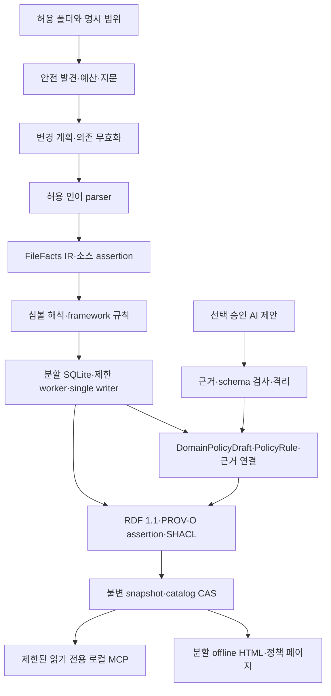
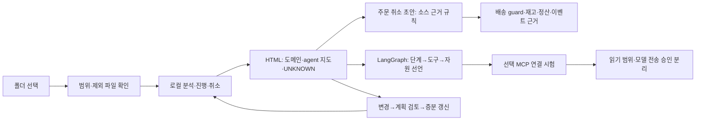

# 다음 아키텍처: 계획된 0.9.0

> 0.9.0은 디스크 파티션 파이프라인·확정된 정책 지식·기본 소유자 전용 접근권한을 추가합니다. 전체 패키지는 **읽기 전용 MCP 도구 19개(기존 12개 + 파이프라인 7개)**입니다. 아래 설명은 파이프라인 명령을 명시하지 않으면 기존 모드 호환 흐름이며, 새 다언어·정책 작업공간은 구현 안내서를 따릅니다. [0.9.0](PIPELINE_0_9_0.md)

[English](../NEXT_ARCHITECTURE_0_9_0.md) | [한국어](NEXT_ARCHITECTURE_0_9_0.md) | [日本語](../ja/NEXT_ARCHITECTURE_0_9_0.md) | [简体中文](../zh-CN/NEXT_ARCHITECTURE_0_9_0.md) | [Русский](../ru/NEXT_ARCHITECTURE_0_9_0.md)

**설계 상태: DESIGN_ONLY · NOT_IMPLEMENTED_IN_0_8_3 · 2026-10-22.** 현재 런타임·패키지는 **0.8.3**입니다. 같은 제품의 대규모 변경이므로 A.B.C 정책의 B를 올리는 **향후 0.9.0** 설계입니다. 과거 미공개 개발 표기 0.9.0은 0.8.2로 재분류됐으며, 그 별칭은 이번 미래 버전이나 공개 완료를 뜻하지 않습니다. 아래 신규 언어·AI 프레임워크·Kafka·Redis 어댑터는 0.8.3에 구현돼 있지 않습니다.

## 1. 제품 목표와 현재 경계

**폴더 선택 → 분석 → 결과 열기.** 계획하는 결과는 ① 시스템·에이전트 지도 ② 근거가 있는 도메인 정책서 ③ 코드 재읽기 없는 정책 질의입니다.

개인과 팀은 폴더 선택 → 범위 확인 → 분석 → 결과 열기만으로 시작하고 고급 설정은 필요할 때 사용합니다. 같은 로컬 엔진이 기업용 플랫폼 설치 없이 큰 저장소를 처리하도록 설계합니다. 일반 애플리케이션·AI 에이전트 자체·AI 데이터 파이프라인을 분석하고 상품·주문·전시·클레임·정산·배송 도메인의 **DomainPolicyDraft**를 도출하는 것이 목표입니다.

현재는 Java/Spring·Python의 부분 정적 분석과 정책 키→분기 영향 분석이며 완전한 업무 규칙 복원은 아닙니다. 공식 Skills-only에는 MCP 서버가 없고 전체 로컬 패키지에 읽기 전용 서버가 있습니다. 모듈당 25,000파일·512 MiB·500,000노드·1,000,000관계는 안전 상한이며 실측 처리 용량이 아닙니다. 최대 128개 독립 모듈 사이의 호출은 해석하지 않습니다. HTML은 전체 내장 데이터를 읽고 계층을 구성한 뒤 선택 확대 표시만 60노드·160관계로 제한합니다. 이 한도나 테스트 설정이 대규모 성능을 입증하지 않습니다. Windows 실제 검증은 **UNKNOWN**이며 Windows·macOS·Linux 지원 목표를 유지합니다.

## 2. 로컬 엔진과 영속 저장



- 등록된 허용 루트 아래 파일만 발견합니다. 비공개 소스 매니페스트에 지문을 기록하고 파일·공개 시그니처·import/export·설정 변경을 비교합니다. 삭제·이름 변경·범위 변경은 의존 대상까지 무효화하며 지문이 없으면 UNKNOWN입니다.
- 버전이 있는 **FileFacts IR**에 선언·참조·import/export·형식화 값·소스 위치·파싱 진단을 기록합니다. 결정론적 병합 뒤 심볼·프레임워크 규칙을 적용합니다. 구문 일치와 확인된 호출 대상을 구분하고 미해석 참조를 그대로 남깁니다.
- 이동 가능한 불변 번들은 source revision/digest·schema/contracts·coverage·lineage·integrity·compatibility 정보를 포함합니다. 카탈로그가 불변 분할 SQLite와 스키마·규칙 버전을 가리킵니다. 제안 테이블은 파일·심볼·참조·assertion·도메인 소속·정책·의존·작업이며 안정된 opaque ID와 범위로 색인합니다. 매개변수화된 쿼리는 전체 JSON 대신 제한된 행을 읽습니다. 전역 export/import 카탈로그로 분할 간 연결을 해석하되 모호하거나 없는 대상을 숨기지 않습니다.
- 제한된 worker가 격리된 파일 배치를 파싱하고 partition generation마다 single writer, 카탈로그에는 single publisher를 둡니다. 작업에는 멱등 키·체크포인트·취소가 있습니다. 최종 해시·산출물 매니페스트·영속 receipt를 완료한 뒤 예상 이전 카탈로그에 atomic CAS를 수행합니다. 소스 변경이나 CAS 실패 시 오래된 결과를 승격하지 않습니다. 불변 SQLite 번들 내보내기 전 writer를 종료하고 WAL checkpoint 후 DB와 필요한 sidecar를 일관되게 봉인합니다. 실행 중 불일치 파일 집합을 내보내지 않습니다. migration은 원본을 보존하고 새 generation을 검증해 만듭니다. 읽기는 generation에 고정하며 GC는 참조·lease를 확인한 뒤 참조 없는 generation만 지웁니다.
- 발견·파싱·해석·색인·내보내기·질의·렌더 각각에 파일/바이트·메모리·큐·시간·출력 예산을 둡니다. 초과 시 부분 범위나 격리를 명시하고 완전하다고 간주하지 않습니다. SQLite와 분할도 총 메모리·디스크 한도를 없애지 않습니다.

## 3. 어댑터 계약과 우선순위

어댑터별 지원 버전과 **syntax / symbol / resolved / framework** 수준, 언어·수준·이유별 **detected / analyzed / unsupported / excluded** 수를 제공합니다. 파일 개수는 의미 분석 완전도의 증거가 아닙니다.

| 순위 | 계획 범위 | 경계 |
| --- | --- | --- |
| 핵심 | Java, Python, JavaScript/TypeScript, SQL | 출시 전 버전별 수직 범위를 고정하고 미지원 구문·방언을 표시합니다. |
| 다음 | Kotlin, C#, Go, Rust, C/C++, PHP | 개별 어댑터 통과 기준이며 초기 0.9.0 전체 지원 약속이 아닙니다. |
| 후속 | Swift, Dart, Ruby, Scala, Shell/PowerShell | 백로그이며 현재 지원이 아닙니다. |
| 애플리케이션 | Spring/Boot, MyBatis, React, Vue, Node ESM/CJS | annotation·XML·SFC·import·선언 route를 보수적으로 연결합니다. .NET·FastAPI·Django는 별도 선택 범위입니다. |
| 데이터 파이프라인 | SQL 계보; 후속 dbt, Airflow, Dagster, Spark, Flink | 선언된 변환·의존이며 실행 성공이나 실제 데이터 값이 아닙니다. |
| 계약 | OpenAPI, GraphQL, Protobuf, Avro, JSON Schema | 스키마·operation·serializer 선언을 연결하고 버전 불일치·미해석 연결을 보존합니다. |

[Tree-sitter](https://github.com/tree-sitter/tree-sitter)는 구문 후보이지 전체 프로그램 의미 증명이 아닙니다. [TypeScript Compiler API](https://github.com/microsoft/TypeScript/wiki/Using-the-Compiler-API)는 허용 목록 compiler host가 필요하며 `noResolve`만으로 파일 접근을 격리할 수 없습니다. [Vue SFC](https://vuejs.org/api/sfc-spec.html)는 블록을 분리합니다. [MyBatis mapper](https://mybatis.org/mybatis-3/sqlmap-xml.html)는 외부 entity/DTD를 금지하고 동적 SQL 조건을 미확정으로 보존합니다. 빌드·패키지 설치·대상 import는 요구하지 않습니다.

**Kafka/Redis 우선 범위:** Kafka producer/topic/consumer/group/serializer/offset 선언과 Redis cache/key-shape/TTL/pubsub/stream 관계를 모델링합니다. 같은 topic 이름만으로 broker·환경을 합치지 않으며 환경 범위가 없으면 별도 미해석 ID를 둡니다. 로컬 HMAC ID와 안전한 별칭을 사용하고 raw key/value·비밀이 포함된 연결 URI를 저장하지 않습니다. 동적 SpEL·조건 설정·실행 중 생성 자원은 UNKNOWN입니다. 선언된 관계가 전달 보장·실제 TTL·라이브 offset을 증명하지 않습니다.

## 4. AI 에이전트 자체 분석

계획 어휘는 **Agent, WorkflowStep, ModelCall, PromptReference, Tool, Resource, Retriever, EmbeddingIndex, Memory, Checkpoint, Guardrail, Evaluation, Handoff**입니다. Python·TypeScript의 LangChain/LangGraph를 우선하고 OpenAI Agents SDK·LlamaIndex를 다음으로 둡니다. 나머지는 어댑터 백로그입니다. [LangGraph](https://docs.langchain.com/oss/python/langgraph/overview)의 상태 기반 워크플로와 [Agents SDK](https://openai.github.io/openai-agents-python/)의 agent/tool/guardrail/handoff는 모델링 참고이며 구현 완료 주장이 아닙니다.

코드 실행·SDK import·네트워크 요청 없이 구성·그래프 연결·조건 분기·도구 연결·자원/권한 선언을 추출합니다. PromptReference는 원문 대신 불투명 참조를 저장합니다. prompt·대화·tool payload·키 원문은 기본 미수집입니다. 권한의 **declared / effective / runtime**을 분리하고 설정만으로 실제 부여·행사를 주장하지 않습니다. 향후 사용자가 선택한 비식별 runtime trace를 별도 동의로 가져오더라도 별도 근거 그래프에 두며 정적 도달성을 에이전트 행동·성공 증거로 바꾸지 않습니다.



## 5. 한 번 컴파일한 정책 지식으로 답하기

**허용된 코드 최초 분석 → 버전 고정 정책 스냅샷 봉인 → 읽기 전용 정책 MCP 응답**이 중심입니다. 질문마다 코드 파일을 다시 읽지 않습니다. 소스·분석 명세가 바뀔 때만 증분 분석으로 새 정책 스냅샷을 만듭니다. 정책 스냅샷은 코드 스냅샷·카탈로그에 결합된 독립 manifest·완전도·ruleset digest·atomic seal을 가집니다. 근거 ID는 저장된 계보 메타데이터를 별도로 조회하며 원문 열기는 별도 허용 작업입니다.

도메인은 패키지/모듈·DB 스키마·API·이벤트·명시 사용자 mapping과 선택 AI 후보를 조합합니다. 한 파일의 다중 도메인, 분류 근거·미분류·소유권 충돌·교차 도메인 규칙을 보존합니다. 폴더명만으로 업무 권위를 정하지 않습니다.

**PolicyRule IR:** `subject / action / guard / condition / exception / stateTransition / formula / authority / sourceAssertionIds / scope / configProfile / status`. 필요한 수치 임계값·enum·SQL/설정 조건만 형식화 허용 목록 **PolicyValue**로 추출하고 credential/PII 검사를 적용합니다. 임의 문자열 수집의 허가가 아닙니다. 승인되지 않은 민감 업무 값은 masked/UNKNOWN으로 두고 완전도에 반영합니다.

조건 복원에는 method-local CFG와 제한된 def-use가 필요합니다. 부정·조기 return·단락 평가·재할당·alias·exception·호출 순서를 다룹니다. 함수 간 추적 예산이 끝나면 unresolved이며 선택 범위 밖 동적 MyBatis SQL·ORM·DB procedure·설정 우선순위는 unsupported입니다. 지원하는 상수·설정·식·mapping·범위 완전성은 정책 스냅샷 안에서 자기완결이어야 합니다. 소스 `lastVerifiedAt`와 스냅샷 `createdAt`을 분리하여 새 생성 시간을 최신 소스 증거로 오인하지 않습니다.

### 형식화 정책과 계산 계약

| PolicyRule 필드 | 의미 |
| --- | --- |
| 식별·범위 | 안정 rule ID, 도메인 소속, source Assertion IDs, catalog/policy snapshot IDs, ruleset digest; 모호한 분류·소유권과 교차 도메인을 보존합니다. |
| 자격·guard | 범주와 명시 입력을 사용하는 typed predicate. 임직원 실명 대신 자격 범주만 다룹니다. 미해석 조건은 false가 아닌 UNKNOWN입니다. |
| 효과·식 | 허용 연산·타입만 있는 제한 expression AST, 단위·통화·minor units 또는 Decimal·반올림 방식. `eval`·임의 코드·LLM 임의 계산은 금지합니다. |
| 조건·조합 | threshold·exception·precedence·stackability·exclusion·cap·적용 순서. 선언되지 않은 조합을 중복 적용 가능하다고 가정하지 않습니다. |
| 유효성·profile | 업무 적용 시작/종료 시간과 설정 profile을 분석/스냅샷 transaction time·추출 버전과 분리합니다. 누락·오래됨을 표시합니다. |
| 권위·상태 | 추출 검증, implemented-rule, AI-proposed, owner-reviewed, approved-business-policy를 분리합니다. 업무 승인이 추출 정확도를 증명하지 않습니다. |
| 완전도·한계 | 지원/미지원 IR, 필요한 runtime 입력, 충돌·분모·정확한 근거 지원 판정. 부분 의미를 문장에 숨기지 않습니다. |

**list_domain_policies / query_policy_rules / compare_policy_cases / explain_policy_result**는 제안 API명이며 현재 등록된 도구가 아닙니다. 등록 workspace 접근·개인정보 거부·제한 filter/page/search·안정 cursor로 봉인된 정책만 읽습니다. 백엔드가 제한된 정책 계산을 완료한 뒤 출력을 페이지화하며 응답 바이트 때문에 계산에 필요한 규칙을 잘라서는 안 됩니다. catalog/policy snapshot ID·ruleset digest·coverage·업무 asOf·transaction time·assumptions·missing inputs·conflicts·evidence IDs를 응답합니다.

계산 전에 **policyView**와 **rulesetAuthority**를 고정해야 합니다. 기본 `verified_implemented`는 추출 검증된 구현 규칙만 포함하며 `AI-proposed`는 계산·최댓값 증명에서 제외합니다. 명시적으로 선택한 `approved_business`는 승인 버전·권위 연결을 고정하고 코드 구현 상태와 분리합니다. 구현/제안/승인 규칙이 충돌하면 모두 보존하고 관련 UNKNOWN을 표시하며 view를 묵시적으로 섞지 않습니다. 업무 승인이 추출 정확도를 검증하지 않습니다.

닫힌 coverage는 명시한 module/source-revision/config-profile/rule-family/query-domain의 closed-world 범위일 뿐 조직의 모든 정책을 증명하지 않습니다. reflection·runtime plugin·외부 procedure가 미해석이면 complete=false이며 분모 미확인을 따로 기록합니다. 추출 규칙 0개는 규칙이 없다는 뜻이 아닙니다.

“임직원 할인 종류”는 분석된 종류와 coverage를 답하고 관련 범위가 닫혀 완전할 때만 “모든 종류”라고 합니다. “최고 할인”은 최고 비율·즉시 할인액·최종 결제액·유효 할인율·미래 적립 중 목적함수를 먼저 정합니다. 자격·프로모션 조합/순서·상품·금액·문맥의 닫힌 유한 탐색에 예산을 적용하고 결정론적 typed interpreter로 계산합니다. 회원 상태·이미 사용한 횟수·잔여 한도는 입력이 필요합니다. 정책만으로 실제 자격을 증명할 수 없으며 DB/Kafka/Redis 라이브 조회는 하지 않습니다.

`proven_maximum`은 관련 정책 범위 완전, 미해석/충돌 0, 입력 완전, 제한된 전체 탐색 완료 또는 정당한 최적 상한 증명이 모두 필요합니다. timeout이면 `best_found`이며 전역 최댓값이 아닙니다. 나머지는 `optimum=false`, `needs_context`, `unknown_conflict`, `incomplete_coverage`로 표시하고 필요한 문맥을 질문합니다.

다음은 **익명 합성 요청·응답 형식**입니다. 실제 회사 할인·자격을 제시하지 않으며 ID·digest도 검증 산출물이 아닌 예시입니다.

```json
{
  "tool": "compare_policy_cases",
  "arguments": {
    "workspace_id": "synthetic-workspace",
    "policy_snapshot_id": "synthetic-policy-1",
    "domain": "order",
    "policyView": "verified_implemented",
    "rulesetAuthority": "synthetic-extraction-verification-v1",
    "objective": "minimize_immediate_payment",
    "eligibility_categories": ["synthetic_employee"],
    "as_of": "2030-01-01",
    "config_profile": "synthetic",
    "context": {},
    "max_cases": 100
  }
}
```

```json
{
  "status": "needs_context",
  "policyView": "verified_implemented",
  "rulesetAuthority": "synthetic-extraction-verification-v1",
  "catalogSnapshotId": "synthetic-catalog-1",
  "policySnapshotId": "synthetic-policy-1",
  "rulesetDigest": "sha256:0000000000000000000000000000000000000000000000000000000000000000",
  "asOf": "2030-01-01",
  "transactionTime": "2026-10-22T00:00:00Z",
  "analyzedPolicyTypes": ["synthetic-employee-discount"],
  "coverage": {"analyzedRules": 1, "unsupportedRules": 1, "complete": false},
  "missingInputs": ["cart", "membership_state", "usage_count", "remaining_cap"],
  "assumptions": [],
  "conflicts": [],
  "evidenceIds": ["assertion:synthetic-rule"],
  "maximum": null,
  "optimality": {"optimum": false, "scope": "not_evaluated"}
}
```

의사결정표·상태 전이도·도메인 의존도·충돌/미확인 보고·변경 영향을 생성합니다. 정책 문장마다 source Assertion ID와 정확한 소스 위치를 연결합니다. HTML에는 정책 탭/페이지, MCP에는 제한된 스냅샷 고정 정책/근거 질의를 계획합니다. 합성 주문 취소→배송 상태 guard→재고/정산/이벤트 예시도 선택 코드의 실제 근거가 있는 연결만 포함하고 동적 부분은 UNKNOWN입니다.

**implemented-rule / AI-proposed / owner-reviewed / approved-business-policy**를 분리합니다. 구현 규칙이 조직 정책과 다를 수 있으며 자동 승인하지 않습니다. 검토자는 승인된 가명 역할/ID만 기록합니다. 업무 승인은 외부의 명시적 결정이며 confidence나 parser 결과가 아닙니다.

## 6. 재현성과 AI 제한

AI 의미 해석은 사용자가 선택한 호스트 모델의 bounded proposal 또는 명시적으로 허용한 로컬 모델을 사용합니다. 플러그인이 모델을 바꾸거나 cloud API를 설정하거나 소스를 기본 전송하지 않습니다. 비식별 fact pack을 우선합니다. 호스트가 불변 model fingerprint를 제공하지 않으면 `modelIdentity=unverified`, `repeatability=unverified`이며 동일 출력 보증과 AI 재현성 gate는 미확인입니다. 모델 신원과 의미 검증은 독립적입니다. 소스·typed-IR·계산·근거를 독립 검증하면 AI-derived 계보를 보존한 채 `extraction_verified`로 승격할 수 있으며 인간 업무 승인만으로는 부족합니다. `AI-proposed` 자체는 계산에서 제외하고 의미 검증된 규칙만 선택한 policy view에 포함합니다. 결정론적 전용 profile은 `modelNotUsed` / `N/A`로 표시하고 모델 지문·반복 실행 gate가 필요하지 않습니다.

결정론적 코드 사실과 AI의 inferred 제안을 분리하고 AI가 baseline을 덮어쓰지 못하게 합니다. **analysisSpecId**에는 source/scope·도구/규칙/스키마/parser 버전·불변 모델 식별자/설정·context assembly·prompt template·redaction policy 지문을 포함합니다. chunk 순서와 token/response 예산을 고정합니다. 같은 모델명만으로 가중치·서빙 설정·출력이 같아지지 않으며 지문 누락은 UNKNOWN입니다.

전체 명세가 일치하는 승인 cache만 재사용합니다. 모델 신원 미확인 시 run-specific identity를 쓰고 실행 간 AI 제안 cache를 자동 재사용하지 않으며 서로 다른 모델을 unknown cache key 하나로 합치지 않습니다. 이미 봉인·검증된 정책 스냅샷 조회와 결정론적 parse cache 재사용은 허용합니다. schema·근거 ID 존재·정확한 source support·모순·coverage를 검사하고 **제한된 재시도 1회** 후 격리합니다. 근거를 꾸며 fallback하지 않습니다. 모델/설정별 golden과 반복 실행으로 unsupported claim·근거 precision/recall·제안 편차를 측정하고 확률적 결과를 byte-identical이라고 주장하지 않습니다. 별도 승인 없이 선택 AI 추론이나 설계 검토를 외부 모델에 전송하지 않습니다.

## 7. Assertion 계보와 표준

관계마다 subject/predicate/object와 계보를 가진 **주장(Assertion) 개체로 표현**합니다. source-relative span 또는 opaque ID, source fingerprint, rule version, analysis run, AI일 때 model fingerprint, basis/time/verification/limitations, `supersedes`/tombstone을 기록합니다. **observed / declared / inferred / validated / approved**를 분리합니다.

RDF 1.1과 문서화한 [PROV-O](https://www.w3.org/TR/prov-o/) mapping은 source/snapshot/assertion을 Entity, 분석/변환을 Activity, 소프트웨어 별칭을 Agent로 둡니다. named graph는 선택이며 일반 Turtle이 named graph/dataset 지원을 뜻하지 않습니다. [SHACL](https://www.w3.org/TR/shacl/)은 필수 필드·참조·상태를 검사할 뿐 사실의 진실을 인증하지 않습니다. 역방향 계보로 영향·버전 차이·부분 결과를 설명합니다. SHA는 무결성이지 진실이 아닙니다. 서명은 선택이며 개인키는 로컬에 두고 외부 anchor 없는 append-only hash chain을 tamper-proof라 부르지 않습니다.

## 8. 보안과 간편 사용

소스·주석·내장 지시는 신뢰하지 않는 데이터입니다. prompt injection을 따르지 않습니다. parser/host 읽기 allowlist, 외부 XML 참조·실행 YAML constructor·build/install/hook/eval 금지, symlink·Windows reparse·파일 identity 재검사로 TOCTOU를 방어하고 깊이·재귀·바이트·시간 폭탄 예산을 적용합니다. 오프라인이라는 이유로 기밀성이 보장된다고 하지 않고 OS별 권한을 검증합니다.

SQLite parameterization, HTML escaping, 제한 CSP·navigation allowlist를 적용합니다. MCP는 등록 root/ID·읽기 전용·크기/cursor/query 예산을 유지합니다. export는 private 기본값이며 redaction/deny profile과 공개 검사를 요구합니다. 공개 산출물에는 실명·개인 이메일을 넣지 않고 개발자명은 **battle-doll(배틀돌)**입니다. 비공개 source manifest·cache key·trace는 공개 번들에서 제외합니다.

UI는 **로컬 MCP 응답도 호스트가 원격 모델로 전송할 수 있음**을 설명합니다. 폴더 읽기와 선택 근거 전송 승인을 분리하며 로컬 엔진이 호스트 모델 위치를 증명하지 않습니다. 폴더 선택·범위 미리보기·진행/취소·결과 열기·명시 MCP 연결 시험·변경분 갱신을 제공하되 호스트 권한이나 설치를 몰래 바꾸지 않습니다.

큰 HTML은 catalog→module→bounded page의 독립 정적 페이지와 상대 링크를 사용하며 필수 이동은 `file://`에서 `fetch` 없이 동작해야 합니다. 선택 로컬 서버는 별도 기능이며 필수가 아닙니다. 3D focus·모션 감소·모바일 최소 canvas 240px·touch 44px을 유지합니다. 전체 모드도 집계/페이지로 제한하며 원본 전체를 무제한 렌더하지 않습니다. 모든 페이지의 escape·링크 범위를 검증합니다.

## 9. 아키텍처 결정 ADR

| 비교 | 제안 결정 | 비용·대안 경계 |
| --- | --- | --- |
| 전체 JSON vs SQLite | 분할 SQLite 색인, JSON은 제한된 교환용 | 스키마 이전·색인 디스크 비용 대신 전체 그래프 재읽기를 줄입니다. |
| parser-only vs semantic | 구문 baseline+명시 semantic/framework 수준 | 어댑터·모호성 처리 비용; 파싱만으로 호출 대상 확정 불가. |
| all-AI vs baseline | 결정론적 사실+격리 AI 제안 | 계약·검토 비용; 확률적 사실 덮어쓰기 방지. |
| global graph vs federation | 분할 사실+전역 export/import catalog | 분할 간 무효화 필요; 독립 모듈이나 단일 메모리 그래프만으로 부족. |
| offline HTML vs server | 정적 분할 페이지 우선, 서버 후속 선택 | 오프라인 실시간 질의 한계 대신 기본 서버 설치 불필요. |

## 10. 실패와 복구

| 실패 | 필수 동작 |
| --- | --- |
| 분석 중 소스/공개 signature 변경 | 의존 대상 무효화, stale 승격 거부, 이전 스냅샷 유지. |
| parser crash·악성 중첩·예산 초과 | bounded worker 중지, 파일 격리, 부분 coverage 명시. |
| 취소·종료·disk full | 영속 checkpoint로 같은 멱등 작업 재개 또는 명시 폐기; 불완전 승격 금지. ACK는 실제 종료가 아니며 worker 종료·query 중단·queue 폐기·추가 쓰기/승격 없음·resource close와 제한 cleanup/rollback을 측정. |
| 동시 publisher·오래된 catalog | single publisher+CAS; 실패자는 새 기준으로 재계획. |
| partition·manifest·receipt 손상 | fail closed, 기존 스냅샷·근거 보존; hash와 결합 검증 후 복구. |
| AI 근거 오류·모순 | 재시도 1회 후 격리; baseline 보존. |
| broker scope 누락·동적 정책 조건 | 별도 미해석 ID와 UNKNOWN 셀, 추정 병합·규칙 생성 금지. |
| 이전 generation 읽기·GC 중단 | 참조 generation 보존, 재개 가능한 GC가 고정 내용을 삭제하지 않음. |

## 11. 수용 점수표와 단계별 종료 기준

아래 수치는 모두 **제안 목표이며 실측 용량·완료 테스트가 아닙니다**. 비교 전에 하드웨어·OS·fixture seed·예산을 고정합니다. 합성 규모는 1k/10k/100k파일과 50k/500k/5M LOC, 혼합 언어·편중 모듈·생성 코드 제외를 포함합니다. 무변경·5%수정·삭제/이름 변경·공개 signature/설정 변경·모듈 간 의존을 시험하며 단계별 시간·질의 p50/p95·최대 RSS·디스크/출력 바이트·취소/복구 시간을 분리합니다.

저사양 제안은 4GiB 기기·worker 1개·총 RSS≤2GiB입니다. 큰 데이터는 분할 디스크와 시간이 더 필요할 수 있습니다. 자원 예산을 낮출 때 병렬성과 시간만 달라져야 하며 의미 정확도를 몰래 낮추면 안 됩니다. 미지원은 명시하며 측정 전 이 목표는 미검증입니다.

| 기준 | 필요한 증거 |
| --- | --- |
| 소스·그래프 | 선언된 결정론적 fixture의 전체/증분 semantic assertion 일치, stale 승격·중복 복구 이벤트 0. excluded/unsupported 분모 포함. |
| 6개 도메인 정책 | 조건·예외·상태·계산·profile 충돌·동적 경계·근거 누락·AI 환각. 문장 인용 존재 100%와 golden 정확 support precision은 별도 검사, unsupported claim 0. typed 산술·통화/반올림·우선순위/중복/한도·회원/사용횟수 누락·업무시간/transaction time·부분 IR·timeout best_found를 검증하며 허위 proven_maximum은 0. 구현/AI제안/승인 충돌 fixture는 선택한 policyView/rulesetAuthority만 계산하며 미승인 규칙 혼입은 0. 모델 미확인 제안은 독립 source/IR/계산/근거 검증 전 제외하며, 통과한 extraction_verified 규칙은 모델 재현성 미확인을 유지한 채 계산에 포함 가능합니다. 동적 미확인은 UNKNOWN. 생성 후 소스 접근을 차단해도 같은 정책 snapshot/input의 응답은 같아야 하며 번역이 policy ID·수치·의미를 바꾸면 실패. |
| agent/event | 버전 고정 LangChain/LangGraph·Kafka/Redis fixture의 선언 단계·자원·환경 분리. 실행 성공 주장 금지; 다른 framework는 미지원 가능. |
| AI 반복 | AI-enabled profile에만 승인된 불변 모델/설정별 최소 5회, 편차·근거 precision/recall 기록을 요구합니다. unsupported claim 0; 지문 누락·검사 실패는 AI gate 통과 불가. deterministic-only는 modelNotUsed/N/A로 AI 없이 통과 가능하며 모델 신원 미확인은 재현성 미확인으로 남기지만 독립 의미 검증을 통한 extraction_verified 승격을 막지 않으며 AI-derived 계보를 보존합니다. 인간 승인만으로는 부족합니다. |
| 성능 목표 | 제안 8core/16GiB/SSD에서 총 최대 RSS≤12GiB, top-50 질의 p95≤1초, 제한 페이지 준비≤2초, 취소 ACK≤2초와 실제 quiescence≤5초는 별도 목표이며, 5%변경 작업≤전체 시간40% 목표. profile별 worker/query 실제 중지·queue 폐기·추가 쓰기/승격 없음·resource close 및 제한 cleanup/rollback을 측정하며 ACK만으로 복구 통과 불가. 미달은 데이터/OS별로 공개하며 지원 용량으로 포장하지 않음. |
| 개인정보·악성 입력 | 기본 엔진 outbound 0, 심은 secret/PII 유출 0. XML/YAML/path/link/depth/SQL/HTML 공격 fixture를 거부·안전 처리. 실제 OS에서 cache/export 권한 검증. |
| UX·패키지 | 5언어·폴더→결과·MCP 전송 동의·keyboard/text·모션 감소·모바일을 Windows/macOS/Linux에서 사람이 검토. 미실행 native 항목은 UNKNOWN. |

**G0 계약:** IR·소스/권한 경계·합성 계획·정확한 버전 범위를 확정합니다. **G1 엔진:** 영속 색인 스냅샷·모듈 간 무효화·실패 주입을 통과합니다. **G2 가치:** 6도메인 정책+우선 agent/event 범위를 근거 기준으로 검증하며 모든 framework 완료를 약속하지 않습니다. **G3 규모/보안:** 고정 예산 대비 재현 벤치마크와 native OS 결과를 제시합니다. **G4 후보:** 독립 검토·5언어 문서·결정론적 패키지·개인정보 검사를 통과합니다. 제출·승인·공개는 별도 허가 단계입니다. 후속 어댑터는 각자 종료 기준을 통과해야 합니다.

## 12. 검토 질문과 미결정 사항

1. 최초 6도메인 합성 저장소 형태·정책 예시·필수 언어/framework 버전은 무엇입니까?
2. 출시 차단 기준인 로컬 하드웨어·SQL 방언과 실험 목표는 무엇입니까?
3. 가명 역할 중 누가 민감 PolicyValue·도메인 mapping·업무 정책 승인을 할 수 있습니까?
4. 선택 제안에 허용할 불변 로컬 모델 설정이 있습니까? 기본은 외부 모델 전송 없음입니다.
5. 페이지 크기·패키지 형식·OS별 권한 방식 중 무엇이 검토를 통과합니까? 측정 전 용량·브라우저 사용성·모델 개선은 UNKNOWN입니다.

표준·공개 기술 문서를 참고한 독립 설계입니다. 어댑터 라이선스·재배포 조건은 배포 전 검토하며 법적 준수를 인증한다고 주장하지 않습니다. 답변은 설계를 구체화할 뿐 분석 실행·저장소 전송·업무 정책 승인·플러그인 공개를 수행하지 않습니다.
