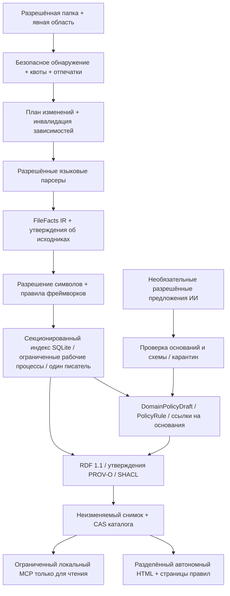
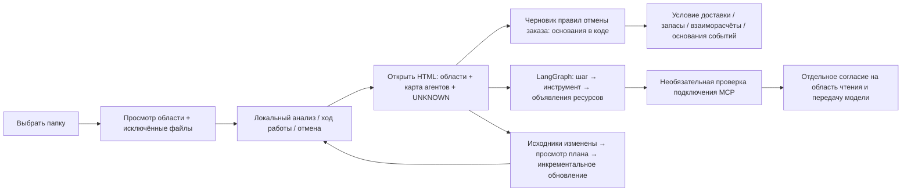

# Следующая архитектура: планируемая версия 0.9.0

[English](../NEXT_ARCHITECTURE_0_9_0.md) | [한국어](../ko/NEXT_ARCHITECTURE_0_9_0.md) | [日本語](../ja/NEXT_ARCHITECTURE_0_9_0.md) | [简体中文](../zh-CN/NEXT_ARCHITECTURE_0_9_0.md) | [Русский](NEXT_ARCHITECTURE_0_9_0.md)

**Статус проекта: DESIGN_ONLY · NOT_IMPLEMENTED_IN_0_8_3 · 2026-10-22.** Текущая версия исполняемого компонента и пакета остаётся **0.8.3**. В документе предлагается будущее крупное изменение того же продукта, поэтому по политике версий A.B.C компонент B увеличивается до **0.9.0**. Прежнее *неопубликованное* обозначение разработки 0.9.0 было переклассифицировано в 0.8.2; этот исторический псевдоним не обозначает будущий этап и не доказывает публикацию. Ни один из описанных здесь новых адаптеров языков, ИИ-фреймворков, Kafka или Redis не реализован в 0.8.3.

## 1. Назначение продукта и текущие границы

**Выбрать папку → проанализировать → открыть результаты.** Планируемые результаты: (1) карта системы и агентов, (2) документы с правилами предметных областей и подтверждающими основаниями, (3) ответы о правилах без повторного чтения кода.

Отдельному пользователю или команде достаточно выбрать папку, подтвердить область анализа, запустить анализ и открыть результаты; расширенные параметры остаются необязательными. Тот же локальный движок должен обрабатывать крупные репозитории без обязательной корпоративной платформы. Он должен описывать обычные приложения, самих ИИ-агентов и конвейеры данных для ИИ, а также формировать документы **DomainPolicyDraft** для предметных областей товаров, заказов, мерчандайзинга/витрины, претензий, взаиморасчётов и доставки.

Текущая версия 0.8.3 обеспечивает частичный статический анализ Java/Spring и Python; извлечение правил охватывает влияние ключей настроек на ветвления, но не полное восстановление бизнес-правил. Официальный профиль Skills-only не содержит MCP-сервера; полный локальный пакет предоставляет сервер только для чтения. Защитные ограничения на модуль: 25,000 файлов, 512 MiB, 500,000 узлов и 1,000,000 связей; это ограничения безопасности, а не измеренная производительность. Режим для крупных проектов допускает не более 128 независимых модулей и не разрешает вызовы между модулями. HTML по-прежнему читает весь встроенный набор данных и строит иерархию; страницы режима приближения ограничивают только отображаемый граф до 60 узлов/160 связей. Ни этот предел, ни настройка нативных тестов не доказывают производительность на крупных репозиториях. Нативная проверка Windows остаётся **UNKNOWN**; Windows, macOS и Linux по-прежнему обязательны как целевые платформы.

## 2. Локальный движок и надёжное хранение



- Обнаружение открывает только разрешённые файлы внутри зарегистрированных корневых каталогов. Закрытый манифест исходников хранит отпечатки содержимого; планировщик сравнивает файлы, публичные сигнатуры, импорты/экспорты и конфигурацию. Удаление, переименование и изменение области анализа инвалидируют зависимые элементы, а не только изменённые файлы. Отсутствие отпечатков означает UNKNOWN.
- Парсеры формируют версионный **FileFacts IR**: объявления, ссылки, импорты/экспорты, типизированные литералы, диапазоны исходного текста и диагностические сведения разбора. Детерминированное объединение предшествует семантическим правилам и правилам фреймворков. Неразрешённые ссылки остаются неразрешёнными; синтаксическое совпадение не означает разрешённый вызов.
- Переносимые неизменяемые пакеты содержат ревизию/дайджест исходников, схемы/контракты, сведения о покрытии, происхождении, целостности и совместимости для обычного обмена. Каталог идентифицирует неизменяемые базы секций и версии их схем/правил. Предлагаемые таблицы: файлы, символы, ссылки, утверждения, принадлежность к предметным областям, правила, зависимости и задания; индексация — по стабильным непрозрачным ID и области. Параметризованные запросы читают ограниченное число строк, не загружая весь JSON-граф. Глобальное разрешение экспортов/импортов связывает секции, сохраняя неразрешённые и неоднозначные цели.
- Ограниченный пул рабочих процессов разбирает изолированные пакеты файлов; один писатель фиксирует каждое поколение секции, а один процесс публикации управляет продвижением каталога. У заданий есть ключи идемпотентности, контрольные точки и отмена. Итоговые хеши, манифест артефактов и надёжно сохранённая квитанция предшествуют атомарному сравнению и замене каталога (CAS) с ожидаемым предшественником. Изменение исходников или неудачный CAS не позволяют продвинуть устаревший результат. Перед экспортом неизменяемого пакета SQLite необходимо остановить писателя, выполнить checkpoint WAL и согласованно запечатать базу со всеми необходимыми сопутствующими файлами; несогласованный набор активных файлов экспортировать нельзя. Миграции сохраняют оригинал и создают новое проверенное поколение. Читатели закрепляют поколение; сборка мусора удаляет только поколения без ссылок после проверки читателей и аренд.
- Каждый этап имеет отдельные бюджеты файлов/байтов, памяти, очереди, времени и вывода: обнаружение, разбор, разрешение, индексация, экспорт, запрос и отображение. Исчерпание квоты приводит к явно указанному частичному покрытию или карантину; полнота не заявляется молча. SQLite и число секций не устраняют общих ограничений диска или памяти.

## 3. Контракт адаптеров и приоритеты

Каждый адаптер объявляет поддерживаемые версии и уровни: **syntax / symbol / resolved / framework**. Для каждого языка, уровня и причины следует показывать количества **detected / analyzed / unsupported / excluded**; само число файлов не доказывает семантическое покрытие.

| Приоритет | Планируемая область | Граница |
| --- | --- | --- |
| Ядро | Java, Python, JavaScript/TypeScript, SQL | До выпуска зафиксировать сквозной сценарий с конкретными версиями; неподдерживаемые конструкции и диалекты остаются видимыми. |
| Следующие | Kotlin, C#, Go, Rust, C/C++, PHP | Отдельные критерии готовности адаптеров; не обещаются в первоначальном выпуске 0.9.0. |
| Позже | Swift, Dart, Ruby, Scala, Shell/PowerShell | Список будущих задач, а не текущая поддержка. |
| Приложения | Spring/Boot, MyBatis, React, Vue, Node ESM/CJS | Осторожно разрешать аннотации, XML-сопоставления, секции SFC, импорты и объявленные маршруты. .NET, FastAPI и Django — отдельные необязательные сценарии. |
| Конвейеры данных | Происхождение SQL; позже dbt, Airflow, Dagster, Spark, Flink | Записывать объявленные преобразования и зависимости, а не успешное выполнение или реальные значения данных. |
| Контракты | OpenAPI, GraphQL, Protobuf, Avro, JSON Schema | Связывать объявленные схемы, операции и сериализаторы; сохранять несовпадения версий и неразрешённые привязки. |

Tree-sitter рассматривается для синтаксического разбора, но не доказывает семантику всей программы ([проект](https://github.com/tree-sitter/tree-sitter)). Семантическому адаптеру TypeScript нужен хост компилятора с разрешительным списком; одного `noResolve` недостаточно для изоляции файловой системы ([Compiler API](https://github.com/microsoft/TypeScript/wiki/Using-the-Compiler-API)). Анализ Vue разделяет блоки SFC ([спецификация SFC](https://vuejs.org/api/sfc-spec.html)). MyBatis разбирает операторы mapper и динамические условия с отключёнными внешними сущностями/DTD; динамический SQL остаётся условным ([спецификация mapper](https://mybatis.org/mybatis-3/sqlmap-xml.html)). Сборка, установка зависимостей или импорт анализируемого кода не требуются.

**Приоритетный сценарий Kafka/Redis:** моделировать объявления producer/topic/consumer/group/serializer и offset Kafka; моделировать связи cache/key-shape/TTL/pubsub/stream Redis. Одних названий topic недостаточно для объединения брокеров или окружений: при отсутствии области окружения создаются отдельные неразрешённые идентичности. Использовать локальные ID на основе HMAC и безопасные псевдонимы; никогда не сохранять исходные ключи, значения или URI подключений с секретами. Динамический SpEL, условная конфигурация и создаваемые во время выполнения ресурсы остаются UNKNOWN. Это объявленные связи, а не гарантии доставки, действующие TTL или текущие offset.

## 4. Анализ ИИ-агентов как программного обеспечения

Планируемый словарь: **Agent, WorkflowStep, ModelCall, PromptReference, Tool, Resource, Retriever, EmbeddingIndex, Memory, Checkpoint, Guardrail, Evaluation, Handoff**. Приоритет имеют LangChain/LangGraph для Python и TypeScript; затем OpenAI Agents SDK и LlamaIndex, а остальные фреймворки остаются в списке будущих адаптеров. LangGraph описывает оркестрацию процессов с состоянием ([обзор](https://docs.langchain.com/oss/python/langgraph/overview)); Agents SDK описывает агентов, инструменты, защитные проверки и передачи управления ([SDK](https://openai.github.io/openai-agents-python/)). Это источники для моделирования, а не заявления о реализованной совместимости.

Извлекать создание объектов, рёбра графа, условные ветвления, привязки инструментов и объявленные области ресурсов/разрешений без выполнения кода, импорта SDK или сетевых запросов. PromptReference хранит непрозрачную ссылку, а не текст промпта. Чаты, промпты, содержимое вызовов инструментов и ключи по умолчанию не собираются. Разделять разрешения **declared / effective / runtime**: конфигурация в исходниках не устанавливает, какие полномочия предоставлены или использованы. Возможный будущий импорт выбранных обезличенных трасс выполнения по отдельному согласию относится к отдельному графу оснований; он не превращает статическую достижимость в доказательство действия или успеха агента.



## 5. Однократная компиляция и ответы из версионной базы правил

**Однократно скомпилировать разрешённый код → запечатать версионный снимок правил → отвечать через MCP правил только для чтения.** Вопросы о правилах не должны требовать повторного чтения исходных файлов. Инкрементальный анализ создаёт новый снимок правил только при изменении исходников или спецификации. Снимок правил имеет собственный манифест, метаданные полноты, дайджест набора правил и атомарную фиксацию, привязанную к снимку кода/каталогу. ID оснований отдельно разрешаются в сохранённые метаданные происхождения; необязательное открытие исходников является отдельным разрешённым действием.

Определение предметных областей объединяет пакеты/модули, схемы баз данных, API, события и явные пользовательские сопоставления с необязательными предложениями ИИ. Файл может относиться к нескольким областям. Следует сохранять основания классификации, неклассифицированные элементы и противоречащие назначения; нельзя выводить полномочия в отношении бизнес-правил только из названий папок.

**PolicyRule IR:** `subject / action / guard / condition / exception / stateTransition / formula / authority / sourceAssertionIds / scope / configProfile / status`. Типизированный разрешительный список **PolicyValue** может сохранять необходимые числовые пороги, перечисления и условия SQL/конфигурации после проверок учётных данных и персональных сведений. Это узкое исключение из запрета на сбор произвольных литералов, а не разрешение хранить любые строки. Неодобренные чувствительные бизнес-литералы маскируются или обозначаются UNKNOWN; их отсутствие должно отражаться в полноте черновика.

Восстановление условий требует CFG внутри метода и ограниченного анализа определений и использований: отрицания, раннего возврата, сокращённого вычисления, повторных присваиваний, псевдонимов, исключений и порядка вызовов. При исчерпании бюджета межпроцедурного анализа результаты остаются неразрешёнными; динамический SQL MyBatis, поведение ORM, процедуры базы данных и приоритеты конфигурации за пределами объявленного сценария остаются неподдерживаемыми. Снимки правил должны быть самодостаточными для поддерживаемых констант, конфигурации, выражений, сопоставлений и замкнутой области покрытия. `lastVerifiedAt` исходников следует хранить отдельно от `createdAt` снимка; новый артефакт не доказывает актуальность исходников.

### Типизированные знания о правилах и их вычисление

| Поле PolicyRule | Обязательный смысл |
| --- | --- |
| Идентичность / область | Стабильный ID правила, принадлежность к предметным областям, ID исходных Assertion, ID каталога/снимка правил и дайджест набора правил; сохранять междоменные правила, неоднозначную принадлежность и конфликты классификации. |
| Право на применение / условие | Типизированные предикаты над категориями и явно переданным контекстом; право сотрудника на применение определяется категориями, а не реальными личностями сотрудников. Неинтерпретированные предикаты имеют значение UNKNOWN, а не false. |
| Эффект / формула | Ограниченный AST выражений с разрешёнными операторами и типами; явные единицы, валюта, минимальные денежные единицы или Decimal и режим округления. Никаких `eval`, произвольного кода или арифметики, придуманной LLM. |
| Условия / комбинации | Пороги, исключения, приоритеты, совместимость применения, взаимоисключения, лимиты и порядок. Необъявленные комбинации не считаются совместимыми по умолчанию. |
| Срок действия / профиль | Время начала/окончания действия бизнес-правила и профиль конфигурации отдельно от транзакционного времени анализа/снимка и версии извлечения. Отсутствующие или устаревшие даты/профили указываются явно. |
| Полномочия / статус | Проверка извлечения и состояния implemented-rule, AI-proposed, owner-reviewed и approved-business-policy остаются раздельными; одобрение не делает извлечение корректным. |
| Полнота / ограничения | Поддерживаемые/неподдерживаемые узлы IR, необходимые входные данные времени выполнения, конфликты, знаменатель покрытия и результаты проверки оснований. Частичная семантика отображается явно. |

Предлагаемые инструменты — проектные названия, пока не зарегистрированные: **list_domain_policies**, **query_policy_rules**, **compare_policy_cases**, **explain_policy_result**. Они читают только запечатанную базу правил с доступом к зарегистрированным рабочим областям, отказом при нарушении конфиденциальности, ограниченными фильтрами/страницами/поиском и стабильными курсорами. Сервер завершает ограниченное вычисление правил до разбиения текста ответа на страницы; лимит байтов вывода никогда не должен усекать входные правила расчёта. Ответы включают ID каталога/снимка правил, дайджест набора правил, покрытие, бизнес-время `asOf`, транзакционное время, допущения, недостающие входные данные, конфликты и ID оснований.

До вычисления интерпретатор должен зафиксировать **policyView** и **rulesetAuthority**. Представление по умолчанию `verified_implemented` включает только реализованные правила с проверенным извлечением; правила `AI-proposed` исключаются из вычислений и доказательств максимума. Явно выбранное представление `approved_business` требует закреплённой версии одобрения и привязки к полномочиям и остаётся отдельным от состояния реализации. Сохранять противоречащие записи implemented/proposed/approved, указывать UNKNOWN, где необходимо, и никогда молча не смешивать представления. Одобрение бизнес-правила не проверяет точность извлечения.

Замкнутое покрытие означает только явно названную замкнутую область: модуль, ревизию исходников, профиль конфигурации, семейство правил и предметную область запроса; оно никогда не означает все правила организации. Неразрешённые reflection, плагины времени выполнения или внешние процедуры требуют complete=false. Неизвестный знаменатель следует указывать явно; ноль извлечённых правил не доказывает отсутствия правил.

На вопрос «какие виды скидок для сотрудников существуют?» следует возвращать проанализированные виды вместе с покрытием; слово «все» допустимо только для замкнутой и полной соответствующей области. Для вопроса «какой вариант наиболее выгоден?» сначала нужно зафиксировать цель: максимальный процент, наибольшая немедленная сумма, минимальный итоговый платёж, эффективная ставка скидки или будущее вознаграждение — разные цели. Перебор допустим только для замкнутого конечного множества применимых акций, вариантов сочетания/порядка, товаров, сумм и контекста в пределах бюджета. Расчёт выполняет типизированный детерминированный интерпретатор. Фактический статус участника, предыдущее использование и оставшиеся лимиты требуют переданных значений времени выполнения; одна база правил не устанавливает право на применение, а запрос не читает работающие DB/Kafka/Redis.

`proven_maximum` требует замкнутого покрытия соответствующих правил, отсутствия неразрешённой семантики/конфликтов, полных входных данных и исчерпывающего ограниченного поиска либо обоснованного доказательства оптимальности через верхнюю границу. При тайм-ауте возвращается `best_found`, а не глобальный оптимум. В остальных случаях возвращать `optimum=false`, `needs_context`, `unknown_conflict` или `incomplete_coverage` и запрашивать недостающий контекст. Неизвестные правила не должны исчезать за гладкими формулировками документа.

Следующая **синтетическая форма запроса/ответа** не определяет реальную скидку или право какой-либо организации. Дайджест и ID приведены для иллюстрации и не являются проверенными артефактами.

```json
{
  "tool": "compare_policy_cases",
  "arguments": {
    "workspace_id": "synthetic-workspace",
    "policy_snapshot_id": "synthetic-policy-1",
    "domain": "order",
    "policyView": "verified_implemented",
    "rulesetAuthority": "synthetic-extraction-verification-v1",
    "objective": "minimize_immediate_payment",
    "eligibility_categories": ["synthetic_employee"],
    "as_of": "2030-01-01",
    "config_profile": "synthetic",
    "context": {},
    "max_cases": 100
  }
}
```

```json
{
  "status": "needs_context",
  "policyView": "verified_implemented",
  "rulesetAuthority": "synthetic-extraction-verification-v1",
  "catalogSnapshotId": "synthetic-catalog-1",
  "policySnapshotId": "synthetic-policy-1",
  "rulesetDigest": "sha256:0000000000000000000000000000000000000000000000000000000000000000",
  "asOf": "2030-01-01",
  "transactionTime": "2026-10-22T00:00:00Z",
  "analyzedPolicyTypes": ["synthetic-employee-discount"],
  "coverage": {"analyzedRules": 1, "unsupportedRules": 1, "complete": false},
  "missingInputs": ["cart", "membership_state", "usage_count", "remaining_cap"],
  "assumptions": [],
  "conflicts": [],
  "evidenceIds": ["assertion:synthetic-rule"],
  "maximum": null,
  "optimality": {"optimum": false, "scope": "not_evaluated"}
}
```

Формировать таблицу решений, диаграмму переходов состояний, карту зависимостей предметных областей, отчёт о конфликтах/неизвестных правилах и представление влияния изменений. Каждое предложение о правиле ссылается на исходные ID Assertion и точные подтверждающие диапазоны. В человекочитаемом HTML появляются вкладки/страницы правил; планируемые MCP-запросы правил/оснований остаются ограниченными и привязанными к снимку. Синтетический пример: отмена заказа → условие состояния доставки → эффекты для запасов/взаиморасчётов/событий; включать каждую связь только при подтверждении реальным выбранным кодом, а ненаблюдавшиеся динамические эффекты обозначать UNKNOWN.

Состояния **implemented-rule / AI-proposed / owner-reviewed / approved-business-policy** остаются раздельными. Код может описывать реализованное правило, противоречащее организационной политике; программа никогда не одобряет бизнес-правило автоматически. Проверяющий записывается только как разрешённая псевдонимная роль/ID. Одобрение проверяющего — явное внешнее решение, а не оценка уверенности или результат парсера.

## 6. Воспроизводимость и ограничения ИИ

Семантические предложения ИИ поступают от выбранной вызывающей стороной модели хоста либо от явно разрешённой локальной модели через ограниченный контракт предложений. Плагин по умолчанию не переключает модели, не создаёт конфигурацию облачного API и не передаёт исходники; следует использовать пакеты обезличенных фактов. Если хост не раскрывает неизменяемый отпечаток модели, устанавливать `modelIdentity=unverified` и `repeatability=unverified`; гарантии идентичного вывода и критерий повторяемости ИИ остаются непроверенными. Идентичность модели и семантическая проверка независимы: правило может получить статус `extraction_verified` после независимой проверки исходников, типизированного IR, расчётов и оснований с сохранением происхождения от ИИ. Одного человеческого одобрения бизнес-правила недостаточно. Сама запись `AI-proposed` остаётся исключённой из расчёта; в выбранное представление правил могут входить только семантически проверенные правила. Профиль без ИИ использует `modelNotUsed` / `N/A` и не требует отпечатка модели или проверки её запусков.

Детерминированная основа служит авторитетным источником извлечённых фактов о коде; предложения ИИ хранятся в отдельных записях с выводами и не могут её перезаписывать. **analysisSpecId** формирует отпечаток исходников/области, версий инструментов/правил/схем/парсеров, неизменяемой идентичности и настроек модели, сборки контекста, шаблона промпта и политики удаления чувствительных данных. Фрагменты собираются в стабильном порядке с явными бюджетами токенов и ответа. Одинаковое имя модели не гарантирует одинаковые веса, конфигурацию обслуживания или вывод; недоступный отпечаток означает UNKNOWN.

Повторно использовать только одобренные записи кеша, соответствующие полной спецификации. При непроверенной идентичности модели используется идентификатор конкретного запуска, а автоматическое повторное использование кеша предложений ИИ между запусками запрещается; нельзя объединять разные модели под одним неизвестным ключом кеша. Повторное использование уже запечатанных проверенных снимков правил и кешей детерминированного разбора остаётся разрешённым. Проверять схему, существование ID оснований, точное подтверждение исходниками, противоречия и покрытие. Допускать не более **одной ограниченной повторной попытки**, затем помещать результат в карантин; вымышленные резервные основания запрещены. Эталонные наборы и повторные запуски для каждой неизменяемой модели/конфигурации измеряют число неподтверждённых утверждений, точность/полноту оснований и вариативность предложений. Вариативность сохраняется, а не выдаётся за побайтовую идентичность стохастического вывода. Необязательный вывод ИИ или проверка проекта не передают данные внешней модели без отдельного разрешения.

## 7. Происхождение утверждений и стандарты

Представлять каждую связь отдельной сущностью **Assertion**, сохраняя субъект/предикат/объект и происхождение, вместо одной оценки уверенности для всего графа. Хранить диапазон относительно исходника или непрозрачный ID источника, отпечаток исходника, версию правила, запуск анализа, отпечаток модели для выводов ИИ, основание/время/проверку/ограничения и связи `supersedes`/tombstone. Разделять **observed / declared / inferred / validated / approved**.

Использовать RDF 1.1 с документированным отображением PROV-O: исходник/снимок/утверждение как Entity, анализ/преобразование как Activity, программные псевдонимы как Agent ([PROV-O](https://www.w3.org/TR/prov-o/)). Именованные графы необязательны; обычный Turtle не подразумевает поддержку наборов данных или именованных графов. SHACL проверяет обязательные поля, ссылки и разрешённые состояния, а не истину о реальном мире ([SHACL](https://www.w3.org/TR/shacl/)). Обратные запросы происхождения объясняют влияние, различия версий и частичные результаты. SHA-хеши устанавливают целостность, а не истинность. При необязательных подписях закрытые ключи остаются локальными; дополняемая хеш-цепочка без внешнего якоря не защищена от подмены.

## 8. Безопасность и простое использование

Считать исходники, комментарии и встроенные инструкции недоверенными данными. Никогда не выполнять prompt injection из исходников. Ограничивать чтение парсера/хоста разрешительным списком; запрещать внешние XML-ссылки, исполняемые конструкторы YAML, сборки, установки, hooks и eval. Повторно проверять символические ссылки, точки повторного анализа Windows и идентичность файлов для защиты от TOCTOU; ограничивать глубину, рекурсию, байты и время обработки враждебного ввода. Проверять разрешения на каждой поддерживаемой ОС, не приравнивая автономную работу к конфиденциальности.

Использовать параметризацию SQLite, экранирование HTML, ограничительную CSP и разрешительные списки навигации. MCP принимает только зарегистрированные корни/ID, остаётся доступным только для чтения и ограничивает размер, курсоры и бюджеты запросов. Экспорт по умолчанию закрытый, с профилями маскирования/запрета и явными проверками перед публикацией. Реальные имена и личные адреса электронной почты не попадают в публичные артефакты; идентичность издателя — **battle-doll**. Закрытые манифесты исходников, ключи кеша и трассы не включаются в публичные пакеты.

Интерфейс должен объяснять, что **хост может передать ответ локального MCP удалённой модели**. Чтение папки и передача выбранных оснований требуют раздельного согласия. Локальный движок не устанавливает, где работает модель хоста. Предлагаемая простая настройка включает выбор папки, просмотр области, ход работы/отмену, открытие результатов, явную проверку подключения MCP и обновление только изменений; она никогда молча не меняет разрешения хоста и не устанавливает ПО.

Крупный автономный HTML — это каталог → модуль → набор ограниченных самостоятельных статических страниц с относительными ссылками; обязательная навигация должна работать через `file://` без `fetch`. Необязательный локальный сервер — отдельная функция, а не предварительное условие. Сохранять режим 3D-приближения, уменьшение движения, минимальную высоту мобильного canvas 240px и сенсорные цели 44px. Полный режим крупных проектов должен использовать агрегаты/страницы, а не отображать все исходные символы без ограничения. На каждой сгенерированной странице проверять экранирование и границы переходов по ссылкам.

## 9. Архитектурные решения (ADR)

| Выбор | Предлагаемое решение | Цена / граница альтернативы |
| --- | --- | --- |
| Весь JSON или SQLite | Секционированные индексы SQLite; JSON только для ограниченного обмена | Миграции схем и индексы занимают диск; устраняют чтение всего графа при каждом запросе. |
| Только парсер или семантика | Синтаксическая основа плюс явные семантические уровни и уровни фреймворков | Больше адаптеров и обработки неоднозначностей; один разбор не доказывает цели вызовов. |
| Только ИИ или основа | Детерминированные факты плюс предложения ИИ в карантине | Больше контрактов и проверок; исключает стохастическую замену фактов. |
| Глобальный граф или федерация | Факты по секциям плюс глобальный каталог экспортов/импортов | Нужна инвалидация между секциями; недостаточно ни изолированных модулей, ни монолитного графа в памяти. |
| Автономный HTML или сервер | Сначала разделённые статические страницы; сервер позже и необязательно | В автономном режиме меньше динамических запросов; для базового использования не нужна настройка сервера. |

## 10. Ошибки и восстановление

| Ошибка | Требуемое поведение |
| --- | --- |
| Исходники изменились во время запуска / изменились публичные сигнатуры | Инвалидировать затронутые зависимости; отклонить продвижение устаревшего результата; сохранить предыдущий снимок. |
| Сбой парсера / враждебная вложенность / исчерпание квоты | Завершить ограниченный рабочий процесс, поместить затронутые файлы в карантин, сообщить о частичном покрытии; не пропускать молча. |
| Отмена / завершение процесса / переполнение диска | Сохранить надёжную контрольную точку; продолжить то же идемпотентное задание или явно отказаться от него. Никогда не продвигать незавершённые артефакты. Подтверждение отмены ACK не означает завершение: измерять остановку рабочих процессов и запросов, удаление заданий из очереди, отсутствие дальнейших записей/продвижения и освобождение ресурсов с ограниченной очисткой/откатом. |
| Два процесса публикации / устаревший каталог | Один процесс публикации плюс CAS; проигравший заново строит план относительно нового каталога. |
| Повреждённая секция / манифест / квитанция | Отказать безопасным образом, сохранить основания и предыдущий снимок; восстановление проверяет хеши и привязки перед продолжением. |
| Неверные основания ИИ / противоречие | Одна ограниченная повторная попытка, затем карантин; основа остаётся неизменной. |
| Отсутствует область брокера / динамическое условие правила | Сохранить отдельные неразрешённые ID и ячейки правил UNKNOWN; не угадывать объединения и не придумывать правила. |
| Читатель закрепил старое поколение / прервана сборка мусора | Сохранять поколения, на которые есть ссылки; возобновляемая сборка мусора никогда не удаляет закреплённое содержимое. |

## 11. Критерии приёмки и этапы готовности

Все числа ниже — **предлагаемые цели, а не измеренная ёмкость или завершённые тесты**. Перед сравнением зафиксировать оборудование, ОС, seed тестовых данных и бюджеты. Предлагаемые синтетические размеры: 1k/10k/100k файлов и 50k/500k/5M LOC, со смешанными языками, неравномерными модулями и исключением сгенерированного кода. Включить отсутствие изменений, изменения 5%, удалённые/переименованные файлы, изменения публичных сигнатур/конфигурации и межмодульные зависимости. Предлагаемый профиль слабого устройства: машина с 4 GiB, один рабочий процесс и общий RSS ≤2 GiB; крупным корпусам может понадобиться больше диска для секций и больше времени. Меньший бюджет ресурсов может снижать параллелизм и увеличивать время, но не должен незаметно уменьшать семантическую точность. Неподдерживаемая работа остаётся явной. До измерений этот профиль не проверен.

Отдельно измерять фактическую длительность этапов, задержки запросов p50/p95, пиковый RSS, байты на диске/в выводе, время отмены и восстановления.

| Критерий | Подтверждение приёмки |
| --- | --- |
| Корректность исходников/графа | Полная и инкрементальная сборки дают одинаковые семантические утверждения на объявленных детерминированных наборах; ноль продвижений устаревших результатов и повторных событий восстановления. Знаменатели покрытия включают исключённые/неподдерживаемые входы. |
| Сквозной сценарий правил | Шесть синтетических предметных областей охватывают условия, исключения, состояния, формулы, конфликты профилей конфигурации, динамические границы, недостающие основания и галлюцинации ИИ. Ссылки присутствуют у 100% предложений о правилах; точность полного подтверждения утверждений исходниками по эталону оценивается отдельно, а неподтверждённых утверждений должно быть 0. Проверять типизированную арифметику, валюту/округление, приоритеты/сочетания/лимиты, отсутствие данных об использовании/участии, бизнес-время и транзакционное время, частичный IR и best_found при тайм-ауте; ложный proven_maximum запрещён. Противоречащие тестовые записи implemented/AI-proposed/approved должны вычисляться только в выбранных policyView/rulesetAuthority, с 0 случаев попадания неодобренных правил. Неизвестные динамические части остаются UNKNOWN. После генерации запретить любой доступ к путям исходников: одинаковые снимок правил/вход должны по-прежнему давать одинаковый ответ о правилах. Переводы должны сохранять ID правил, числовые условия и смысл. |
| Сценарий агентов/событий | Наборы с фиксированными версиями LangChain/LangGraph и Kafka/Redis проверяют объявленные шаги/ресурсы и изоляцию окружений; никаких заявлений об успешном выполнении. Другие фреймворки могут оставаться явно неподдерживаемыми. |
| Повторяемость ИИ | Только для профилей с ИИ: не менее 5 запусков для каждой разрешённой неизменяемой модели/конфигурации; фиксировать вариативность и точность/полноту оснований. Неподтверждённых утверждений — 0; отсутствующие отпечатки или неудачные проверки не позволяют пройти этот критерий ИИ. Профили без ИИ используют modelNotUsed/N/A и могут пройти приёмку без ИИ. Неудачная проверка идентичности модели оставляет повторяемость непроверенной, но не блокирует независимое семантическое повышение до extraction_verified с сохранением происхождения от ИИ; одного человеческого одобрения недостаточно. |
| Целевая производительность | На предлагаемой эталонной машине с 8 ядрами/16 GiB/SSD: общий пиковый RSS ≤12 GiB, p95 ограниченного запроса top-50 ≤1s, готовность ограниченной страницы ≤2s, подтверждение отмены ≤2s и фактическая остановка работы ≤5s — отдельные цели; целевой объём работы при изменениях 5% — ≤40% времени полной сборки. Для каждого профиля измерять фактическую остановку рабочих процессов/запросов, удаление очереди, отсутствие дальнейших записей/продвижения и освобождение ресурсов, включая ограниченную очистку/откат; одного ACK недостаточно для прохождения проверки восстановления. Сообщать о недостижении целей для конкретного корпуса/ОС, а не заявлять поддержку. |
| Конфиденциальность и враждебный ввод | Нет исходящего трафика в тестах движка по умолчанию; ноль утечек специально внесённых секретов/персональных данных; вредоносные наборы XML/YAML/путей/ссылок/глубины/SQL/HTML отклоняются или безопасно представляются. Закрытые кеши и экспорты проверяются на нативных ОС. |
| UX и упаковка | Пять языков, путь от папки к результату и согласия MCP, клавиатурные/текстовые альтернативы, уменьшение движения и мобильная компоновка проверяются людьми на Windows/macOS/Linux. Невыполненные нативные проверки остаются UNKNOWN. |

**G0 — фиксация контрактов:** одобрить IR, границы исходников/разрешений, план синтетических наборов и точную матрицу поддерживаемых версий. **G1 — движок:** пройти проверки надёжных индексированных снимков, межмодульной инвалидации и инъекции сбоев. **G2 — сквозная ценность:** черновики правил шести предметных областей и приоритетный сценарий агентов/событий проходят проверку оснований; покрытие адаптеров объявляется по уровням, а не обещается для каждого фреймворка. **G3 — масштаб/безопасность:** опубликовать воспроизводимые результаты измерений и нативных ОС относительно фиксированных бюджетов. **G4 — кандидат выпуска:** пройти независимую проверку, документацию на пяти языках, детерминированную упаковку и проверки конфиденциальности. Подача поставщику, одобрение и публикация остаются отдельно разрешаемыми действиями. Дополнительные адаптеры языков/фреймворков проходят собственные этапы после этого рубежа.

## 12. Вопросы для проверки и нерешённые решения

1. Какие репрезентативные структуры синтетических репозиториев и примеры правил задают первый сценарий шести предметных областей и какие версии языков/фреймворков обязательны?
2. Какие бюджеты локального оборудования и диалекты SQL должны блокировать выпуск при непрохождении проверки, а какие цели могут оставаться экспериментальными?
3. Кто может разрешать чувствительные поля PolicyValue, сопоставления предметных областей и одобрение бизнес-правил с использованием псевдонимных ролей?
4. Какая неизменяемая конфигурация локальной модели, если такая есть, разрешена для необязательных предложений? По умолчанию передачи внешней модели нет.
5. Какие размеры страниц, формат упаковки и нативные механизмы разрешений ОС проходят проверку удобства/безопасности? До измерений ёмкость, удобство браузера и улучшение модели остаются UNKNOWN.

Это независимый проект, использующий стандарты и общедоступную техническую документацию. Лицензии адаптеров и условия распространения требуют проверки перед упаковкой; сертификация правового соответствия не заявляется.

Ответы на вопросы уточняют этот проект; они не запускают анализ, не передают содержимое репозитория, не одобряют бизнес-правила и не публикуют плагин.
