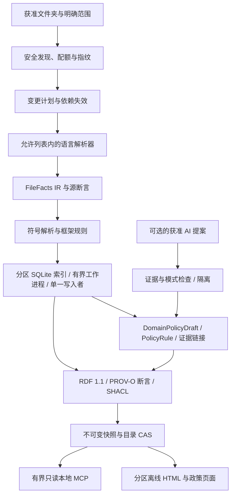
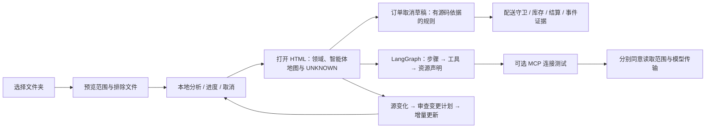

# 下一代架构：计划中的 0.9.0

[English](../NEXT_ARCHITECTURE_0_9_0.md) | [한국어](../ko/NEXT_ARCHITECTURE_0_9_0.md) | [日本語](../ja/NEXT_ARCHITECTURE_0_9_0.md) | [简体中文](NEXT_ARCHITECTURE_0_9_0.md) | [Русский](../ru/NEXT_ARCHITECTURE_0_9_0.md)

**设计状态：DESIGN_ONLY · NOT_IMPLEMENTED_IN_0_8_3 · 2026-10-22。** 当前运行时和软件包版本仍为 **0.8.3**。本文提出同一产品中的未来重大变更，因此依据 A.B.C 产品版本规则，将 B 增加至 **0.9.0**。此前*未发布*的开发标签 0.9.0 已重新归类为 0.8.2；该历史别名不代表本次未来里程碑，也不是已发布的证据。本文描述的新语言、AI 框架、Kafka 和 Redis 适配器均未在 0.8.3 中实现。

## 1. 产品目标与当前边界

**选择文件夹 → 分析 → 打开结果。** 计划提供的结果包括：（1）系统与智能体地图；（2）附有证据的领域政策文档；（3）无需重读代码的政策问答。

个人或团队应能选择文件夹、确认范围、执行分析并打开结果，高级选项保持可选。同一本地引擎应能处理大型代码库，而不要求引入企业平台。它应描述普通应用、AI 智能体自身以及 AI 数据管道，并为商品、订单、商品展示、客诉、结算和配送领域生成 **DomainPolicyDraft** 文档。

当前 0.8.3 提供部分 Java/Spring 和 Python 静态分析；政策提取止于政策键与分支影响，不等于完整的业务规则重建。官方 Skills-only 配置不包含 MCP 服务器；完整本地软件包提供只读服务器。每个模块的安全限制为 25,000 个文件、512 MiB、500,000 个节点和 1,000,000 条边；这些是防护限制，不是实测容量。大型模式最多接受 128 个独立模块，不解析跨模块调用。其 HTML 仍读取完整的内嵌数据并构建层级；聚焦分页仅将显示图限制为 60 个节点/160 条边。这些上限或原生测试配置均不能证明大型代码库性能。Windows 原生验证仍为 **UNKNOWN**；Windows、macOS 和 Linux 均保留为必要目标。

## 2. 本地引擎与持久化存储



- 发现阶段只打开已注册根目录下获准的文件。私有源文件清单记录内容指纹；规划器比较文件、公共签名、导入/导出和配置。删除、重命名和范围变化会使依赖项失效，而不只处理已编辑文件。缺少指纹时结果为 UNKNOWN。
- 解析器输出带版本的 **FileFacts IR**：声明、引用、导入/导出、带类型的字面量、源码位置和解析诊断。确定性合并先于语义与框架规则。未解析的引用保持未解析；语法匹配不等于已解析调用。
- 可移植的不可变包携带源版本/摘要、模式/契约、覆盖率、血缘、完整性和兼容性元数据，用于常规交换。目录标识不可变的分区数据库及其模式/规则版本。建议表包括文件、符号、引用、断言、领域归属、政策规则、依赖和任务，以稳定的不透明 ID 和范围建立索引。参数化查询只读取有限行，不加载完整 JSON 图。全局导出/导入解析连接各分区，同时保留未解析和有歧义的目标。
- 有界工作进程池解析隔离的文件批次；每个分区代由一个写入者提交，目录提升由一个发布者负责。任务具有幂等键、检查点和取消机制。最终哈希、工件清单和持久化回执完成后，才对预期的前一目录执行原子比较交换（CAS）。源漂移或 CAS 失败不能提升过时结果。导出不可变 SQLite 包前，停止其写入者、对 WAL 执行检查点，并将数据库与所需旁文件一致封存；不得导出不匹配的运行中组合。迁移保留原件，并构建经过验证的新一代。读取者固定代；垃圾回收只有在检查读取者/租约后，才能删除未被引用的代。
- 发现、解析、解析引用、索引、导出、查询和渲染各阶段分别设定文件/字节、内存、队列、时间和输出预算。配额耗尽必须明确报告部分覆盖或隔离，不能默默声称完整。SQLite 和分区数量不会消除总磁盘或内存限制。

## 3. 适配器契约与优先级

每个适配器声明支持的版本与层级：**syntax / symbol / resolved / framework**。按语言、层级和原因报告 **detected / analyzed / unsupported / excluded** 数量；仅凭文件数不能证明语义覆盖。

| 优先级 | 计划范围 | 边界 |
| --- | --- | --- |
| 核心 | Java, Python, JavaScript/TypeScript, SQL | 发布前冻结带版本的纵向功能范围；不支持的语法/方言必须可见。 |
| 下一批 | Kotlin, C#, Go, Rust, C/C++, PHP | 各适配器单独通过门槛；不承诺在首个 0.9.0 版本中全部提供。 |
| 后续 | Swift, Dart, Ruby, Scala, Shell/PowerShell | 待办范围，不是当前支持。 |
| 应用 | Spring/Boot, MyBatis, React, Vue, Node ESM/CJS | 保守解析注解、XML 映射、SFC 区块、导入和声明路由。.NET、FastAPI 和 Django 是独立的可选范围。 |
| 数据管道 | SQL 血缘；后续 dbt、Airflow、Dagster、Spark、Flink | 记录声明的转换与依赖，不代表成功执行或实时数据值。 |
| 契约 | OpenAPI, GraphQL, Protobuf, Avro, JSON Schema | 连接声明的模式、操作与序列化器；保留版本不匹配和未解析绑定。 |

Tree-sitter 是语法解析候选，不是全程序语义证明（[项目](https://github.com/tree-sitter/tree-sitter)）。TypeScript 语义适配器需要受允许列表限制的编译器宿主；仅靠 `noResolve` 不能形成文件系统沙箱（[Compiler API](https://github.com/microsoft/TypeScript/wiki/Using-the-Compiler-API)）。Vue 分析分别处理 SFC 区块（[SFC 规范](https://vuejs.org/api/sfc-spec.html)）。MyBatis 在禁用外部实体/DTD 的条件下解析映射语句和动态条件；动态 SQL 保持条件性（[mapper 规范](https://mybatis.org/mybatis-3/sqlmap-xml.html)）。无需构建、安装依赖或导入目标代码。

**Kafka/Redis 优先范围：** 建模 Kafka 生产者/主题/消费者/组/序列化器及偏移声明；建模 Redis 缓存/键结构/TTL/发布订阅/流关系。不能仅凭主题同名合并代理或环境：缺少环境范围时，保留独立的未解析身份。使用本地 HMAC 派生 ID 和安全别名；绝不保留原始键、值或含秘密的连接 URI。动态 SpEL、条件配置和运行时创建的资源保持 UNKNOWN。这些是声明关系，不是投递保证、有效 TTL 或实时偏移。

## 4. 将 AI 智能体本身作为软件分析

计划词汇为 **Agent, WorkflowStep, ModelCall, PromptReference, Tool, Resource, Retriever, EmbeddingIndex, Memory, Checkpoint, Guardrail, Evaluation, Handoff**。优先支持 Python 和 TypeScript 中的 LangChain/LangGraph；然后是 OpenAI Agents SDK 和 LlamaIndex，其他框架进入适配器待办。LangGraph 介绍有状态工作流编排（[概述](https://docs.langchain.com/oss/python/langgraph/overview)）；Agents SDK 介绍智能体、工具、护栏和移交（[SDK](https://openai.github.io/openai-agents-python/)）。这些是建模参考，不是已实现兼容性的声明。

在不执行代码、不导入 SDK、不发送网络请求的前提下，提取构建、图边、条件分支、工具绑定和声明的资源/权限范围。PromptReference 保存不透明引用，不保存提示词正文。默认不收集聊天、提示词、工具载荷和密钥。区分 **declared / effective / runtime** 权限：源码配置不能证明实际授予或行使的权限。未来若另行同意导入选定且已脱敏的运行时轨迹，它们应属于独立证据图；不能据此把静态可达性变成智能体行动或成功的证明。



## 5. 一次编译，从版本化政策知识回答

**编译一次获准代码 → 封存带版本的政策快照 → 通过只读政策 MCP 回答。** 政策问题不应要求重读源文件。只有源代码/规范变化时，增量分析才生成新的政策快照。政策快照有独立的清单、完整性元数据、规则集摘要和原子封存，并绑定对应的代码快照/目录。证据 ID 单独解析已存储的来源元数据；可选的源码打开操作需要独立授权。

领域发现结合包/模块、数据库模式、API、事件、明确的用户映射，以及可选 AI 候选。一个文件可属于多个领域。保存分类证据、未分类项和冲突归属；不能仅凭文件夹名称推断业务权威。

**PolicyRule IR：** `subject / action / guard / condition / exception / stateTransition / formula / authority / sourceAssertionIds / scope / configProfile / status`。受类型与允许列表限制的 **PolicyValue** 可在凭据/PII 检查后，记录必要的数值阈值、枚举和 SQL/配置条件。这只是任意字面量收集限制的狭窄例外，不是保留任意字符串的许可。未经批准的敏感业务字面量应掩码或标为 UNKNOWN；草稿完整性必须反映其缺失。

条件重建需要方法局部 CFG 和有界定义—使用分析：否定、提前返回、短路、重新赋值、别名、异常和调用顺序。过程间预算耗尽时保持未解析；声明范围以外的动态 MyBatis SQL、ORM 行为、数据库过程和配置优先级保持不支持。政策快照必须自包含其支持的常量、配置、表达式、映射和覆盖闭合信息。源 `lastVerifiedAt` 与快照 `createdAt` 分别记录；新生成的工件不能证明源仍是当前版本。

### 带类型的政策知识与求值

| PolicyRule 字段 | 必需语义 |
| --- | --- |
| 身份 / 范围 | 稳定规则 ID、领域归属、源 Assertion ID、目录/政策快照 ID 和规则集摘要；保留跨领域规则、归属歧义和分类冲突。 |
| 资格 / 守卫 | 针对类别与显式提供上下文的类型化谓词；员工资格使用类别，绝不使用真实员工身份。无法解释的谓词是 UNKNOWN，不是 false。 |
| 效果 / 公式 | 仅允许规定运算符与类型的表达式 AST；明确单位、货币、最小货币单位或 Decimal，以及舍入模式。禁止 `eval`、任意代码或 LLM 自行编造的算术。 |
| 条件 / 组合 | 阈值、例外、优先级、可叠加性、排除、上限与顺序。未声明的组合不能隐式视为可叠加。 |
| 有效期 / 配置 | 业务生效起止时间与配置档案，独立于分析/快照事务时间和提取版本。明确报告缺失或过时的日期/配置。 |
| 权威 / 状态 | 提取验证、implemented-rule、AI-proposed、owner-reviewed 和 approved-business-policy 状态保持独立；批准不代表提取正确。 |
| 完整性 / 限制 | 支持/不支持的 IR 节点、必要运行时输入、冲突、覆盖分母和证据支持判定。明确展示部分语义。 |

拟议工具（设计名称，尚未注册）：**list_domain_policies**、**query_policy_rules**、**compare_policy_cases**、**explain_policy_result**。只读取已封存的政策知识，并实施注册工作区访问、隐私拒绝、有界筛选/分页/搜索和稳定游标。后端必须先完成有界政策求值，再对响应文本分页；输出字节限制绝不能截断用于计算的输入规则。响应包含目录/政策快照 ID、规则集摘要、覆盖率、业务 `asOf`、事务时间、假设、缺失输入、冲突和证据 ID。

求值器必须在计算前绑定 **policyView** 和 **rulesetAuthority**。默认 `verified_implemented` 视图只包含提取验证通过的已实现规则；`AI-proposed` 规则不得参与求值或最大值证明。明确选择的 `approved_business` 视图需要固定审批版本并绑定权威来源，且必须独立于实现状态。保留冲突的已实现/提案/已批准记录，在相关位置报告 UNKNOWN，绝不默默混合视图。业务批准不能验证提取准确性。

闭合覆盖仅指明确命名的模块/源版本/配置档案/规则族/查询领域中的封闭世界范围，绝不表示组织内的全部政策。未解析的反射、运行时插件或外部过程要求 complete=false。明确记录未知分母；提取到零条规则不证明规则不存在。

对于“有哪些员工折扣类型？”，返回已分析类型和覆盖率；只有相关范围闭合且完整时才说“全部”。对于“哪种情况最高？”，首先确定目标：最高百分比、最大即时金额、最低最终付款、有效折扣率或未来奖励是不同目标。只枚举闭合且受预算限制的有限集合，包括符合资格的促销、叠加/顺序选择、商品、金额和上下文。类型化的确定性解释器执行计算。实际会员状态、历史使用次数和剩余额度需要提供运行时值；仅凭政策知识不能确认资格，查询也不会读取实时 DB/Kafka/Redis。

`proven_maximum` 要求相关政策范围闭合完整、未解析语义/冲突为零、输入完整，并完成有界穷举或给出合理的最优上界证明。超时返回 `best_found`，绝不是全局最优。否则返回 `optimum=false`、`needs_context`、`unknown_conflict` 或 `incomplete_coverage`，并询问缺失上下文。不能用流畅的政策表述掩盖未知规则。

以下**合成请求/响应形式**不定义任何真实公司的折扣或权益。摘要和 ID 仅为示例，不是已验证工件。

```json
{
  "tool": "compare_policy_cases",
  "arguments": {
    "workspace_id": "synthetic-workspace",
    "policy_snapshot_id": "synthetic-policy-1",
    "domain": "order",
    "policyView": "verified_implemented",
    "rulesetAuthority": "synthetic-extraction-verification-v1",
    "objective": "minimize_immediate_payment",
    "eligibility_categories": ["synthetic_employee"],
    "as_of": "2030-01-01",
    "config_profile": "synthetic",
    "context": {},
    "max_cases": 100
  }
}
```

```json
{
  "status": "needs_context",
  "policyView": "verified_implemented",
  "rulesetAuthority": "synthetic-extraction-verification-v1",
  "catalogSnapshotId": "synthetic-catalog-1",
  "policySnapshotId": "synthetic-policy-1",
  "rulesetDigest": "sha256:0000000000000000000000000000000000000000000000000000000000000000",
  "asOf": "2030-01-01",
  "transactionTime": "2026-10-22T00:00:00Z",
  "analyzedPolicyTypes": ["synthetic-employee-discount"],
  "coverage": {"analyzedRules": 1, "unsupportedRules": 1, "complete": false},
  "missingInputs": ["cart", "membership_state", "usage_count", "remaining_cap"],
  "assumptions": [],
  "conflicts": [],
  "evidenceIds": ["assertion:synthetic-rule"],
  "maximum": null,
  "optimality": {"optimum": false, "scope": "not_evaluated"}
}
```

生成决策表、状态转换图、领域依赖图、规则冲突/未知报告和变更影响视图。每条政策陈述均链接源 Assertion ID 和准确支持它的源码位置。面向人的 HTML 增加政策标签页/页面；计划中的 MCP 政策/证据查询保持有界并固定快照。合成示例为订单取消 → 配送状态守卫 → 库存/结算/事件效果；只有实际选定代码支持时才包含对应边，未观察到的动态效果标为 UNKNOWN。

区分 **implemented-rule / AI-proposed / owner-reviewed / approved-business-policy**。代码可能描述已实现规则，却与组织政策冲突；软件绝不自动批准业务政策。审核者只记录为获准的化名角色/ID。审核批准是明确的外部决定，不是置信度分数或解析器结果。

## 6. 可复现性与 AI 约束

AI 语义提案通过有界提案契约，来自调用者选择的宿主模型或明确获准的本地模型。插件不会默认切换模型、创建云 API 配置或传输源代码；使用脱敏事实包。若宿主无法提供不可变模型指纹，设为 `modelIdentity=unverified` 和 `repeatability=unverified`；相同输出保证及 AI 可重复性门槛保持未验证。模型身份与语义验证彼此独立：规则通过独立的源码、类型化 IR、计算及证据验证后，可以成为 `extraction_verified`，同时保留 AI 派生来源。仅有人类业务批准还不够。`AI-proposed` 记录本身仍被排除在计算之外；只有语义验证通过的规则才能进入选定政策视图。仅确定性处理的配置使用 `modelNotUsed` / `N/A`，不要求模型指纹或模型运行门槛。

确定性基线是提取代码事实的权威来源；AI 提案保存在独立推断记录中，不能覆盖基线。**analysisSpecId** 对源/范围、工具/规则/模式/解析器版本、不可变模型身份及设置、上下文组装、提示词模板和脱敏策略生成指纹。按稳定顺序组装块，并明确 token 和响应预算。同一模型名称不保证相同权重、服务配置或输出；指纹不可获得时为 UNKNOWN。

仅复用与完整规范匹配的已批准缓存项。未经验证的模型身份使用每次运行专属的身份，并禁止自动跨运行复用 AI 提案缓存；绝不把不同模型合并到同一个 unknown 缓存键下。已封存且验证通过的政策快照与确定性解析缓存仍允许复用。验证模式、证据 ID 存在性、准确源码支持、矛盾和覆盖率。最多允许**一次有界重试**，随后隔离；禁止编造后备证据。针对每种不可变模型/配置，通过黄金测试样例和重复运行测量无依据声明数量、证据精确率/召回率和提案差异。保留差异，不假装随机输出逐字节一致。未经单独授权，任何可选推断或设计审查都不得向外部模型发送数据。

## 7. Assertion 血缘与标准

将每条关系实体化为 **Assertion**，保存主语/谓词/宾语及来源，而不是为整张图只附加一个置信值。记录相对源路径位置或不透明源 ID、源指纹、规则版本、分析运行、AI 派生时的模型指纹、依据/时间/验证/限制以及 `supersedes`/墓碑链接。区分 **observed / declared / inferred / validated / approved**。

使用 RDF 1.1 与有文档的 PROV-O 映射：源/快照/断言对应 Entity，分析/转换对应 Activity，软件别名对应 Agent（[PROV-O](https://www.w3.org/TR/prov-o/)）。命名图可选；普通 Turtle 不代表支持数据集/命名图。SHACL 检查必需字段、引用和允许状态，不验证现实世界真相（[SHACL](https://www.w3.org/TR/shacl/)）。逆向血缘查询解释影响、版本差异和部分结果。SHA 哈希证明完整性，不证明真实性。可选签名的私钥留在本地；没有外部锚点的仅追加哈希链并非不可篡改。

## 8. 安全与简便交付

将源码、注释和内嵌指令视为不可信数据。绝不执行源码中的提示注入。限制解析器/宿主读取允许列表；禁止外部 XML 引用、可执行 YAML 构造器、构建、安装、钩子和 eval。针对 TOCTOU 重新检查符号链接、Windows 重解析点和文件身份；限制深度、递归、字节和时间炸弹。在每个支持的操作系统上验证权限，不能把离线运行等同于保密。

使用 SQLite 参数化、HTML 转义、严格 CSP 和导航允许列表。MCP 只接受已注册根目录/ID，保持只读，并执行大小、游标和查询预算。导出默认私有，使用脱敏/拒绝配置和明确的公开检查。公开工件不得包含真实姓名或个人邮箱；发布者身份为 **battle-doll**。私有源清单、缓存键和轨迹不得进入公开包。

UI 必须说明：**宿主可能把本地 MCP 响应发送给远程模型**。读取文件夹与传输选定证据需要分别同意。本地引擎不能证明宿主模型的运行位置。拟议简易设置提供文件夹选择、范围预览、进度/取消、打开结果、明确的 MCP 连接测试和仅变化部分刷新；绝不默默变更宿主权限或安装软件。

大型离线 HTML 是“目录 → 模块 → 有界页面”的自包含静态页面集合，使用相对链接。必要导航必须在 `file://` 下无需 `fetch` 即可工作。可选本地服务器属于独立功能，不是前提。保留 3D 聚焦、减少动态效果、移动端画布最小 240px 和 44px 触控目标。大型项目的全量模式必须使用聚合/分页，不能无限制渲染所有原始符号。每个生成页面都验证转义和链接范围限制。

## 9. 架构决策（ADR）

| 选择 | 拟议决策 | 成本 / 替代方案边界 |
| --- | --- | --- |
| 完整 JSON 与 SQLite | 分区 SQLite 索引；JSON 仅用于有界交换 | 模式迁移和索引占用磁盘；避免每次查询读取全图。 |
| 仅解析器与语义分析 | 语法基线加明确的语义/框架层级 | 需要更多适配器和歧义处理；仅解析不能证明调用目标。 |
| 全 AI 与基线 | 确定性事实加隔离的 AI 提案 | 需要更多契约和审查；避免随机替换事实。 |
| 全局图与联邦 | 分区事实加全局导出/导入目录 | 必须实现跨分区失效；独立模块或单体内存图都不足以满足要求。 |
| 离线 HTML 与服务器 | 优先静态分区页面，后续可选服务器 | 离线模式实时查询较少；基本使用无需配置服务器。 |

## 10. 故障与恢复

| 故障 | 必需行为 |
| --- | --- |
| 运行中源变化 / 公共签名变化 | 使受影响依赖项失效；拒绝提升过时结果；保留前一快照。 |
| 解析器崩溃 / 恶意嵌套 / 配额耗尽 | 终止受预算约束的工作进程，隔离受影响文件，报告部分覆盖；不能静默跳过。 |
| 取消 / 进程退出 / 磁盘已满 | 保留持久化检查点；恢复同一幂等任务或明确放弃。绝不提升不完整工件。取消 ACK 不等于终止：测量工作进程终止、查询停止、排队任务丢弃、停止后续写入/提升及资源关闭，并包含有界清理/回滚。 |
| 两个发布者 / 过时目录 | 单一发布者加 CAS；失败者基于新目录重新规划。 |
| 分区 / 清单 / 回执损坏 | 安全拒绝，保留证据和前一快照；恢复前验证哈希及绑定。 |
| AI 证据无效 / 矛盾 | 一次有界重试，随后隔离；基线保持不变。 |
| 缺少代理范围 / 动态政策条件 | 保留独立未解析 ID 和 UNKNOWN 政策单元格；不猜测合并或编造规则。 |
| 读取者固定旧代 / GC 中断 | 保留被引用的代；可恢复 GC 绝不删除已固定内容。 |

## 11. 验收记分卡与退出门槛

以下所有数值均为**拟议目标，不是实测容量或已完成测试**。比较前冻结硬件、操作系统、样例种子和预算。建议合成规模为 1k/10k/100k 个文件和 50k/500k/5M LOC，包含混合语言、规模不均的模块和生成代码排除。包含无变化、5% 编辑、文件删除/重命名、公共签名/配置变化及跨模块依赖。拟议低端配置为 4-GiB 机器、一个工作进程、总 RSS ≤2 GiB；较大语料可能需要更多分区磁盘和时间。更小的资源预算可以减少并行度、增加时间，绝不能暗中降低语义准确性。不支持的工作保持显式。此配置在实测前未经验证。

分别测量各阶段墙钟时间、查询 p50/p95 延迟、峰值 RSS、磁盘/输出字节数、取消和恢复时间。

| 门槛 | 验收证据 |
| --- | --- |
| 源/图正确性 | 声明的确定性样例中，全量和增量构建得到相同语义断言；过时提升和重复恢复事件均为零。覆盖分母包含被排除/不支持的输入。 |
| 政策纵向功能范围 | 六个合成领域覆盖条件、例外、状态、公式、配置档案冲突、动态边界、缺失证据和 AI 幻觉。政策语句引用存在率为 100%；另行评估黄金声明到源码的精确支持率，无依据声明必须为 0。测试类型化算术、货币/舍入、优先级/叠加/上限、缺少使用次数/会员输入、业务时间与事务时间、部分 IR 和超时 best_found；不得出现虚假的 proven_maximum。冲突的 implemented/AI-proposed/approved 样例必须只按选定 policyView/rulesetAuthority 求值，未经批准规则的混入为 0。未验证模型的提案在通过独立源码/IR/计算/证据验证前保持排除；通过后可纳入其 extraction_verified 规则，同时模型可重复性仍保持 unverified。未知动态部分保持 UNKNOWN。生成后禁止访问全部源路径：相同政策快照/输入仍须产生相同政策答案。翻译必须保留政策 ID、数值条件和语义。 |
| 智能体/事件范围 | 固定版本的 LangChain/LangGraph 加 Kafka/Redis 样例验证声明步骤/资源和环境隔离；不声称运行成功。其他框架可以保持明确不支持。 |
| AI 可重复性 | 仅适用于启用 AI 的配置：每个获准的不可变模型/配置至少运行 5 次；记录差异和证据精确率/召回率。无依据声明为 0；缺少指纹或检查失败不能通过此 AI 门槛。仅确定性处理的配置使用 modelNotUsed/N/A，可以在不使用 AI 的情况下通过。模型身份检查失败会使 repeatability 保持 unverified，但不阻止通过独立语义验证提升为 extraction_verified，同时保留 AI 派生来源；仅有人类批准还不够。 |
| 性能目标 | 拟议的 8 核/16-GiB/SSD 参考机器：总峰值 RSS ≤12 GiB，有界 top-50 查询 p95 ≤1s，有界页面就绪 ≤2s，取消确认 ≤2s 和实际静止状态（quiescence）达成 ≤5s 是独立目标；5% 编辑工作耗时 ≤全量构建时间的 40% 是目标。按配置测量工作进程/查询的实际停止、队列丢弃、停止后续写入/提升及资源关闭，包含有界清理/回滚；仅 ACK 不能通过恢复门槛。按语料/操作系统报告未达标情况，不据此声称已支持。 |
| 隐私与恶意输入 | 默认引擎测试无出站流量；预埋秘密/PII 泄漏为零；恶意 XML/YAML/路径/链接/深度/SQL/HTML 样例被拒绝或安全表示。在原生操作系统检查私有缓存和导出。 |
| UX 与打包 | 由人在 Windows/macOS/Linux 上检查五种语言、文件夹到结果及 MCP 同意流程、键盘/文本替代、减少动态效果和移动布局。未经原生运行的情况保持 UNKNOWN。 |

**G0 — 契约冻结：** 批准 IR、源/权限边界、合成样例计划和精确支持版本矩阵。**G1 — 引擎：** 持久化索引快照、跨模块失效和故障注入通过。**G2 — 纵向价值：** 六领域政策草稿和优先智能体/事件范围通过证据门槛；按层级声明适配器覆盖，不承诺所有框架。**G3 — 规模/安全：** 针对冻结预算公开可复现基准证据和原生操作系统结果。**G4 — 候选版本：** 独立审查、五语言文档、确定性软件包和隐私检查通过。供应商提交、批准和发布仍是分别授权的步骤。其他语言/框架适配器在此里程碑后通过各自门槛。

## 12. 审查问题与待定事项

1. 哪些代表性合成代码库结构和政策示例定义首个六领域范围？哪些语言/框架版本是必需的？
2. 哪些本地硬件预算和 SQL 方言应阻止未达标版本发布？哪些目标可保持实验性？
3. 哪些化名角色可授权敏感 PolicyValue 字段、领域映射和业务政策批准？
4. 可选提案允许使用哪种不可变本地模型配置（如果有）？默认不向外部模型传输。
5. 哪些页面大小、打包格式和原生操作系统权限机制可通过易用性/安全审查？实测前，容量、浏览器易用性和模型改进保持 UNKNOWN。

这是使用标准和公开技术文档的独立设计。打包前需审查适配器许可证和再分发条款；不声称获得法律合规认证。

审查答案用于完善设计，不会启动分析、传输代码库内容、批准业务政策或发布插件。
